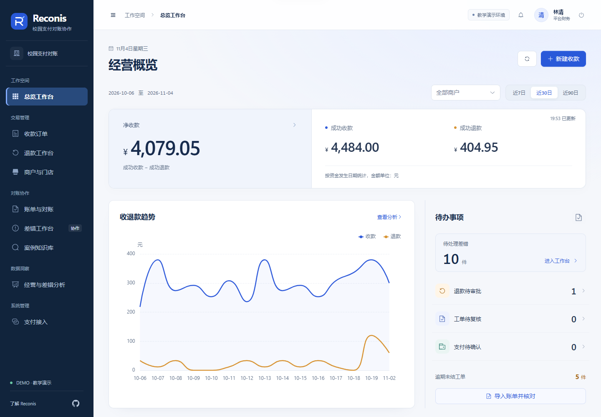

# Reconis

校园多商户支付对账与差错协作系统。处理收款、跨日退款、渠道账单、历史对账和工单复核。



## 功能

| 工作台 | 操作 |
| --- | --- |
| 商户与门店 | 维护门店和成员，审核商户入驻及资料变更，导入导出 Excel / XML |
| 收款与退款 | 开单、扫码、支付确认、退款审批及主动查询恢复 |
| 账单与对账 | 获取或导入账单，核对本地流水，重跑并比较历史批次 |
| 差错工单 | 分派、提交证据、独立复核；全文检索和推荐已结案案例 |
| 经营分析 | 按商户、门店和账期钻取至交易；导出 PDF / Word |
| 审计中心 | 按人员、商户、结果和时间查询，按请求关联号追踪访问与变更 |

SQL Server 管理 15 张关系表。退款额度和对账结果由数据库过程维护，触发器保护资金事实并记录关键变更。业务日采用北京时间，金额以整数分存储。

## 运行

需要 PowerShell 7.4+、Node.js 24、JDK 21 和带全文组件的 SQL Server 2022。

```powershell
.\scripts\bootstrap.ps1
.\scripts\build.ps1
.\scripts\initialize.ps1
.\scripts\start.ps1
```

打开 `http://localhost:8080`。首次初始化生成的教学账号和密码位于 `private/demo-accounts.txt`。本机已完成配置后，可双击 `启动Reconis.cmd`。

| 目录 | 内容 |
| --- | --- |
| `frontend/` | Vue 3 工作台 |
| `backend/` | Spring Boot 和 MyBatis API |
| `database/` | SQL Server 建库、迁移与教学种子 |
| `scripts/` | 安装、构建、运行、备份和验证 |
| `samples/` | 教学账单 |
| `docs/` | [运行说明](docs/runbook.md)、[数据库设计](docs/design.md)、[课程功能对照](docs/requirements-matrix.md) |

两份课程报告单独提交。
