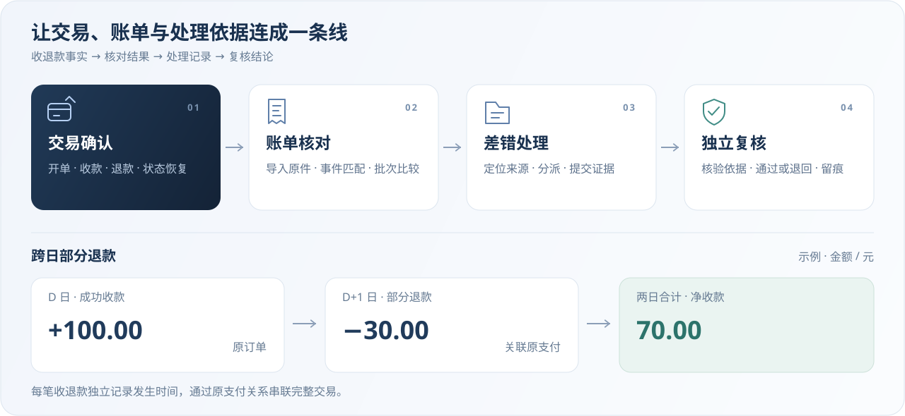
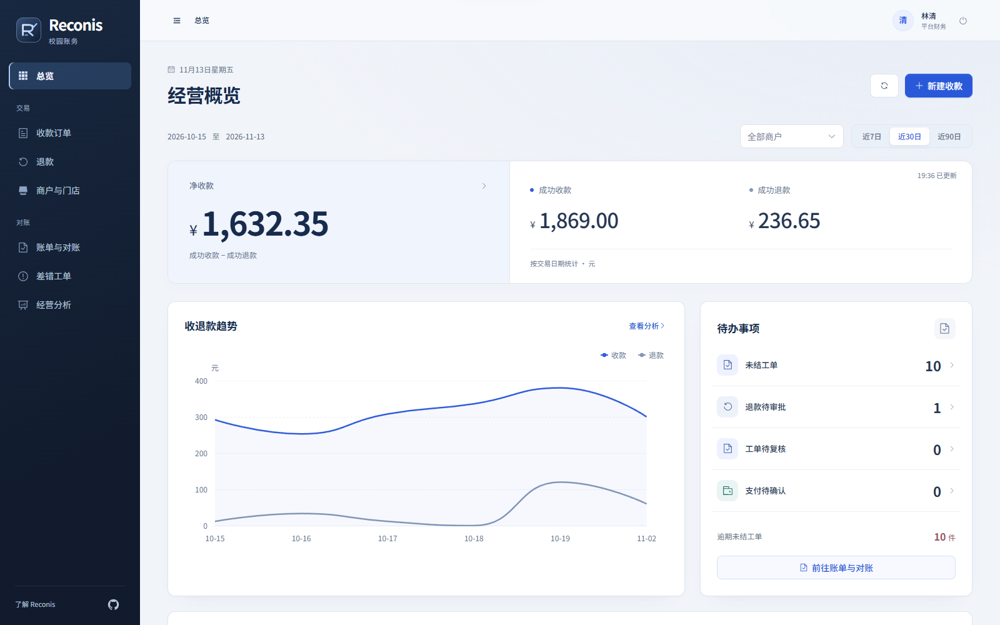
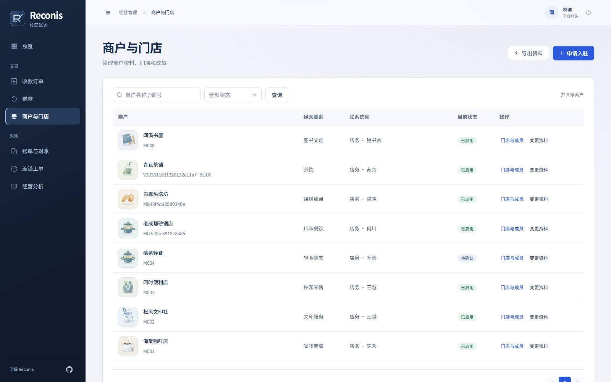
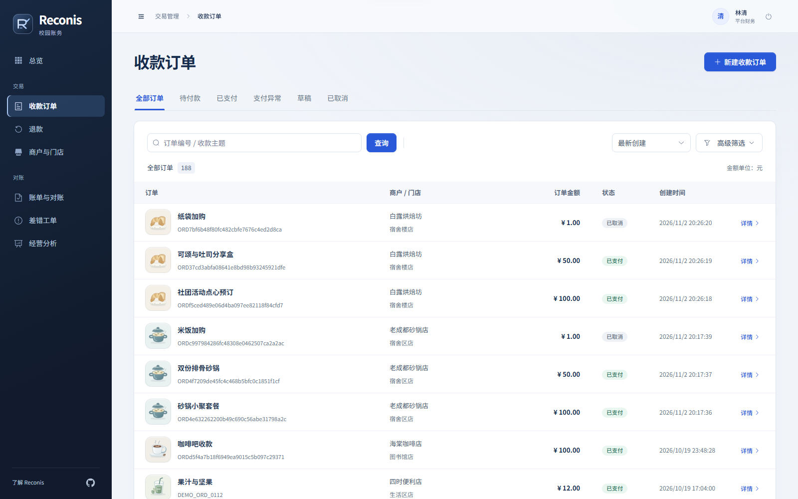
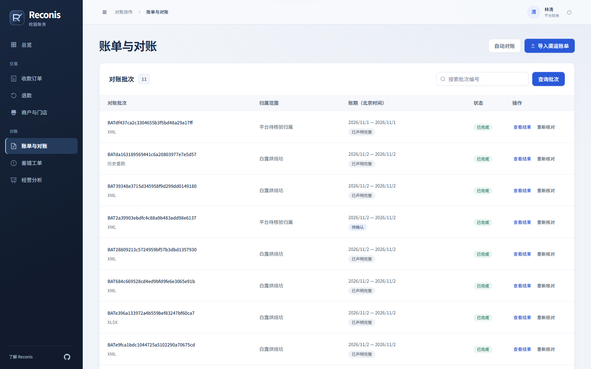
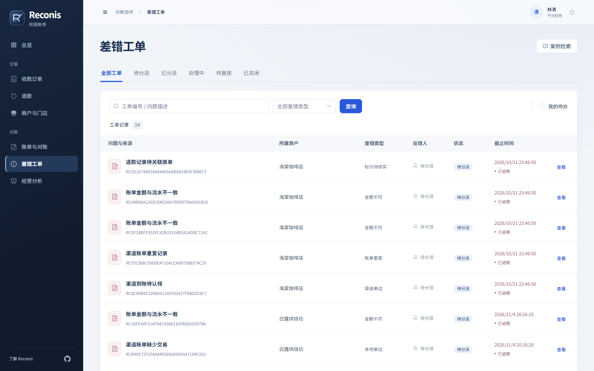
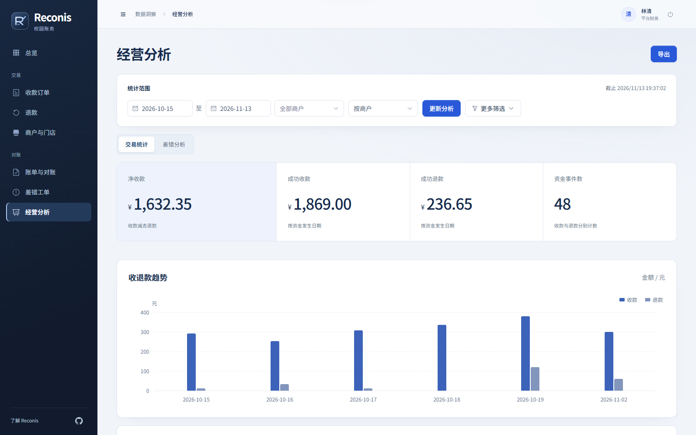
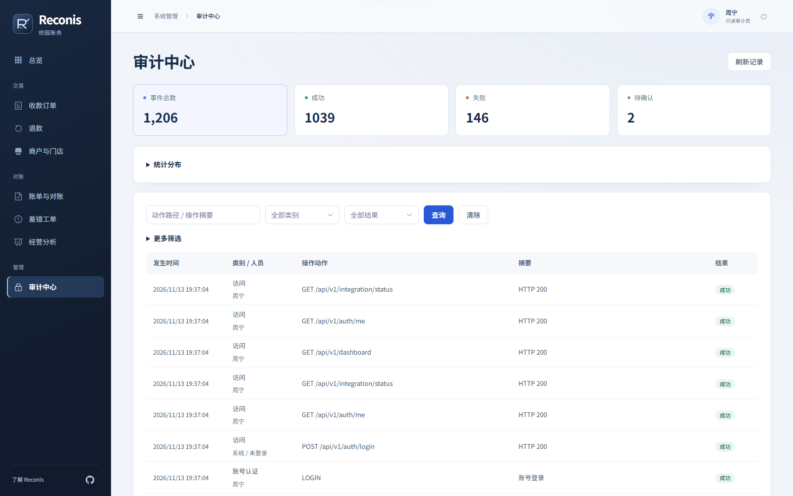
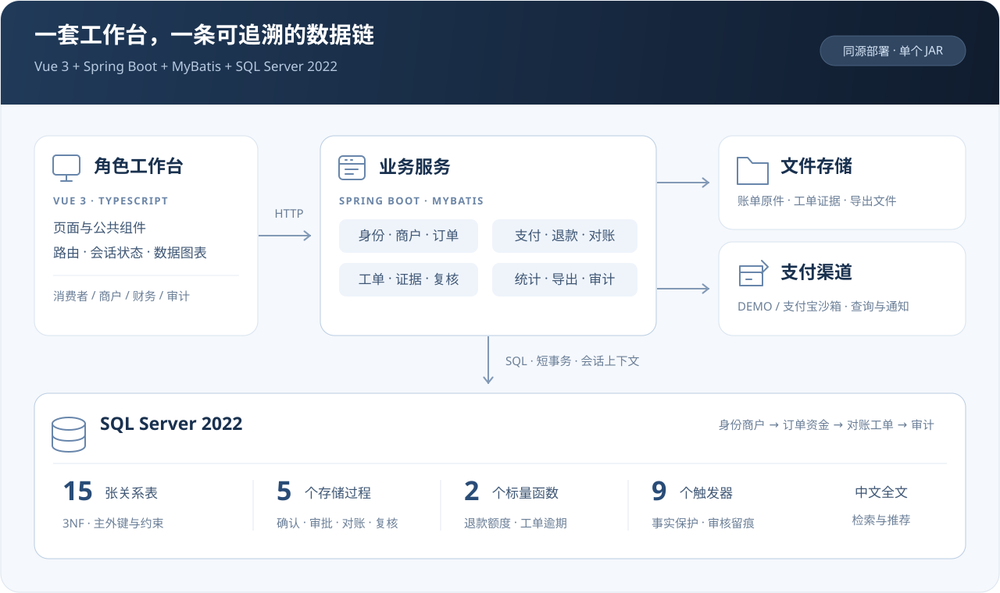

<div align="center">


<h1>Reconis</h1>

<p><strong>校园多商户跨日支付对账与差错协同处理系统</strong></p>

<p>从一笔收款，到一份核对清楚的账单。</p>

<p>


</p>

<p><strong>跨日退款 · 逐笔对账 · 差错复核 · 数据钻取</strong></p>

<p><a href="#features">功能</a> · <a href="#screenshots">界面</a> · <a href="#architecture">数据库设计</a> · <a href="#quick-start">快速开始</a> · <a href="#structure">目录与文档</a></p>

</div>


<a id="features"></a>

## 🧭 业务与功能

Reconis 面向校园餐饮、零售与服务商户，将订单、收退款流水、渠道账单和差错工单连接起来。财务可逐笔核对账目，追溯原始记录，并与经办人、复核人协作处理差异。

| 工作空间 | 主要功能 |
| --- | --- |
| 🏪 商户与门店 | 入驻与资料审核、门店和成员管理、Excel / XML 导入导出 |
| 💳 收款与退款 | 开单收款、支付确认、主动查询恢复、部分退款与独立审批 |
| 🧾 账单与对账 | 账单导入、定时获取、逐笔核对、历史批次比较与重跑 |
| 🔎 差错协作 | 分派、证据提交、独立复核、中文全文检索与相似案例推荐 |
| 📊 经营分析 | 商户 → 门店 → 流水、年 → 月 → 日钻取，差错关联分析，PDF / Word 导出 |
| 🛡️ 权限与审计 | 平台与商户两层角色、数据范围控制、访问及操作日志、请求关联追踪 |



收款与退款按各自发生日期记账。每次对账保存独立结果批次，工单保留分派、证据与复核记录，可从差错追溯至账单、流水、原支付和订单。

<a id="screenshots"></a>

## 🖥️ 软件界面

**经营概览** · 收退款趋势、待办事项与商户范围筛选。

<a href="docs/assets/screenshots/dashboard.png"></a>

| 🏪 商户与门店 | 💳 收款订单 |
|:---:|:---:|
| [](docs/assets/screenshots/merchants.png) | [](docs/assets/screenshots/orders.png) |
| 🧾 账单与对账 | 🔎 差错工单 |
| [](docs/assets/screenshots/reconciliation.png) | [](docs/assets/screenshots/cases.png) |
| 📊 经营分析 | 🛡️ 审计中心 |
| [](docs/assets/screenshots/analytics.png) | [](docs/assets/screenshots/audit.png) |

<sub>以上为本地 DEMO 环境的实际界面，点击图片查看原图。</sub>

<a id="architecture"></a>

## 🗄️ 架构与数据库

Vue 3 构建角色工作台，Spring Boot 与 MyBatis 承载业务接口，SQL Server 处理关系数据、事务和全文检索。前端随后端打包为单个 JAR，通过同源 Session 与 CSRF 机制访问接口。



| 数据库实现 | 源码入口 |
| --- | --- |
| **15 张关系表** · 身份商户、订单资金、对账工单与审计，按 3NF 组织 | [表结构](database/001_schema.sql) · [约束与索引](database/002_constraints_indexes.sql) |
| **5 个存储过程** · 支付确认、退款审批与确认、执行对账、工单复核 | [视图、函数与过程](database/003_views_functions_procedures.sql) |
| **2 个标量函数** · 可退额度、工单逾期天数 | [函数定义](database/003_views_functions_procedures.sql) |
| **9 个触发器** · 交易事实与历史记录保护、审核留痕、订单明细冻结 | [触发器与中文全文索引](database/004_triggers_fulltext.sql) |

金额以整数分存储；数据库时间使用 UTC，业务日按北京时间划分。订单、支付尝试、渠道通知和资金流水分别建模，退款通过原支付关联订单。

<details>
<summary><strong>📚 数据库课程功能对应</strong></summary>

| 课程内容 | 项目实现 |
| --- | --- |
| 数据管理与审核 | 商户、门店、成员和订单维护；账号、资料与退款审核；Excel / XML 数据交换 |
| 数据展示与查询 | 首页、列表、详情、多条件筛选、排序分页；全文检索、历史批次比较、案例推荐 |
| 业务办理与协作 | 收款 → 退款 → 对账 → 派单 → 处理 → 复核；渠道状态定时同步 |
| 统计与分析 | 图表汇总、粒度钻取、跨表关联统计、PDF / Word 报告导出 |
| 安全与数据库设计 | 多角色授权、商户数据范围、审计日志；3NF、视图、过程、函数、触发器与索引 |

</details>

<a id="quick-start"></a>

## 🚀 快速开始

**环境：** Windows 10 / 11、PowerShell 7.4+、Node.js 24、JDK 21、SQL Server 2022（含全文检索组件）。

```powershell
git clone https://github.com/floatingmist828-eng/Reconis.git
cd Reconis

.\scripts\bootstrap.ps1
.\scripts\build.ps1
.\scripts\initialize.ps1
.\scripts\start.ps1
```

访问 [localhost:8080](http://localhost:8080)。初始化生成的账号位于 `private/demo-accounts.txt`，以后可双击 `启动Reconis.cmd` 启动。SQL Server 安装、开发模式与支付宝沙箱配置见[运行说明](docs/runbook.md)。

<a id="structure"></a>

## 📂 目录与文档

```text
Reconis/
├── frontend/                 # Vue 页面、组件与静态资源
├── backend/                  # Spring Boot / MyBatis 业务接口
├── database/
│   ├── 001_…005_*.sql        # 表、约束、过程、触发器与初始账号
│   ├── migrations/           # 增量迁移
│   ├── demo/                 # 校园商户目录与资料刷新
│   └── seed_demo.sql         # 教学交易数据
├── scripts/                  # 环境、构建、运行、备份与验证
├── samples/statements/       # 跨日退款 XML 账单
├── docs/
│   ├── assets/               # 软件截图与 SVG 图示
│   ├── runbook.md            # 安装、开发与部署
│   └── api.md                # 接口、认证与数据约定
└── 启动Reconis.cmd
```

| 文档 | 内容 |
| --- | --- |
| [🛠️ 运行说明](docs/runbook.md) | 环境准备、开发启动、沙箱配置、数据库迁移与备份 |
| [🔌 接口说明](docs/api.md) | Session / CSRF、业务入口、金额与时间约定 |
