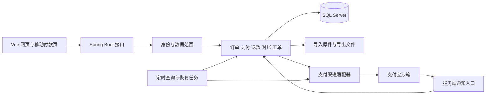
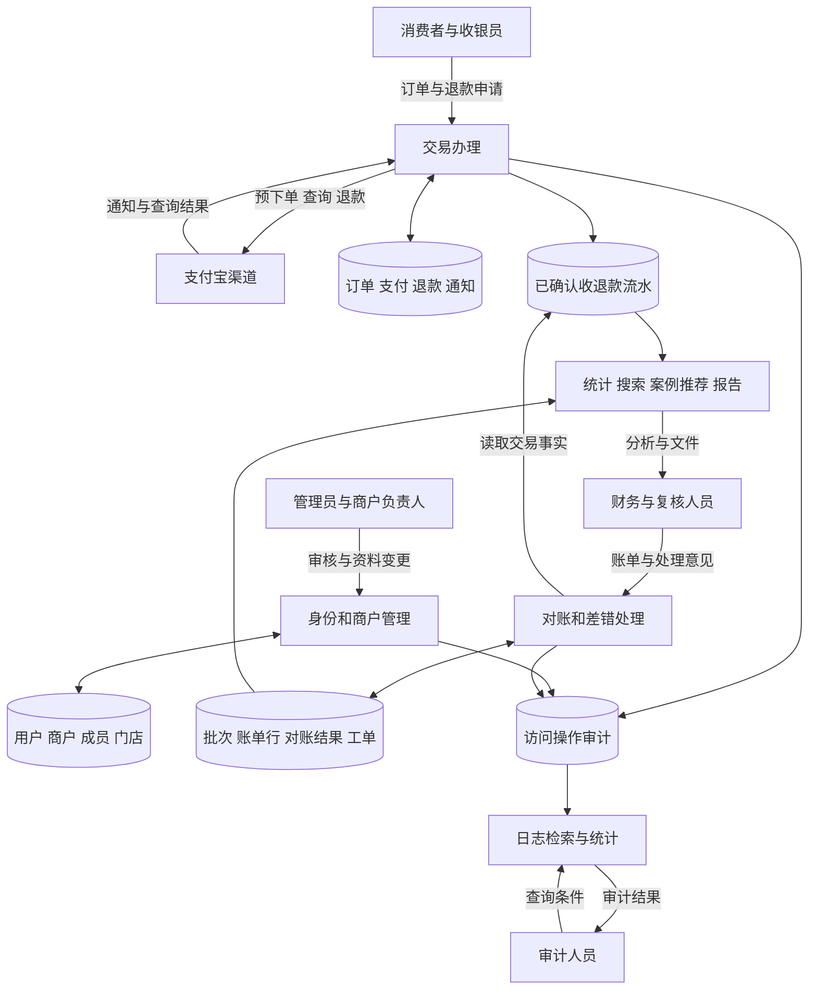
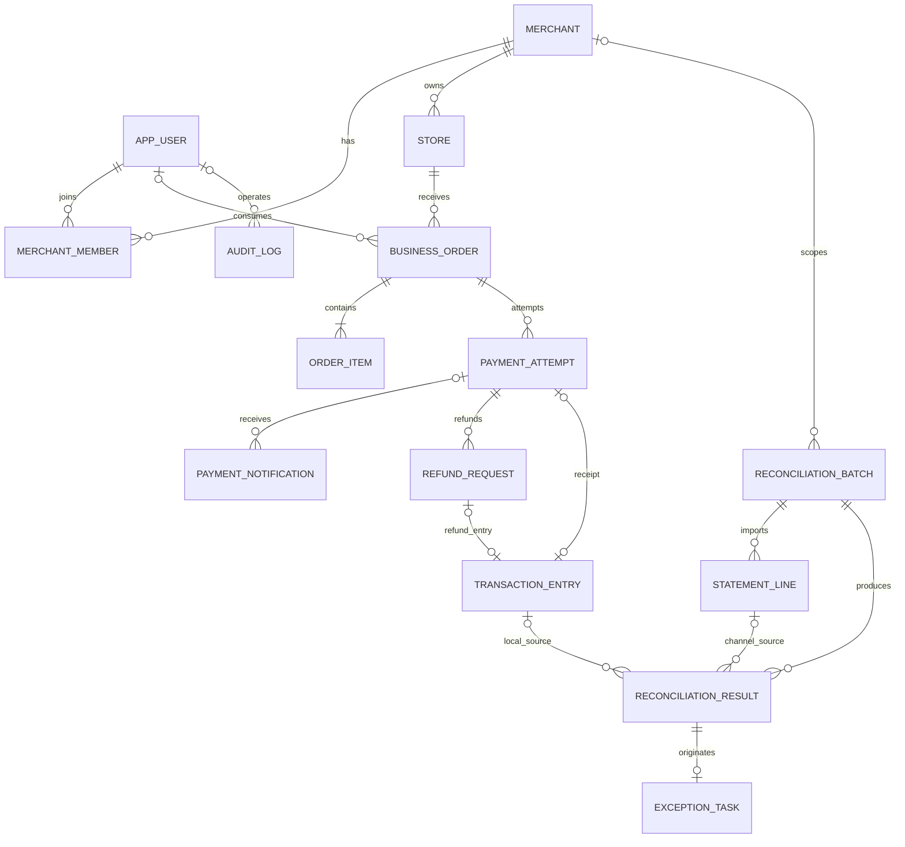

# Reconis 项目整体设计

版本：1.0　日期：2026 年 10 月 19 日

完整题目：**Reconis 校园多商户跨日支付对账与差错协同处理系统的设计与实现**

课程依据：[《数据库系统原理》课程设计指导手册](course-guide.md)

项目仓库：[floatingmist828-eng/Reconis](https://github.com/floatingmist828-eng/Reconis)

当前本地代码目录：`D:/大三/数据库/sjk/re`

本文作为后续项目搭建、数据库实现、接口开发、页面制作和报告编写的共同依据。建设目标是完整覆盖课程基本与高级功能，并通过跨日退款、支付状态恢复、历史对账结果和差错协作形成作品特色。本文描述设计目标，不代表功能已经实现或支付宝已经联调成功。

## 1 项目定位与确定的范围

Reconis 面向校园咖啡店、文印店、便利店等商户，管理收款订单、支付确认、退款、交易流水、渠道账单和差错工单。用户能从一条差错查到渠道记录、原支付、退款、订单、门店和商户，并完成处理、复核及统计。

核心业务为：

**商户资料审核 → 开单收款 → 支付确认与状态恢复 → 退款审批与结果确认 → 账单导入 → 逐笔及跨日对账 → 差错派单 → 处理与复核 → 分析和报告导出。**

### 1.1 本次设计确定的决策

| 决策 | 确定方案 |
| --- | --- |
| 应用形式 | 中文网页应用，电脑端工作台为主，消费者订单和付款页适配手机 |
| 架构 | 按业务模块划分的单体后端、一个主关系数据库、一个前端项目 |
| 支付范围 | 支付宝测试渠道，人民币；完整支持支付查询、全额及部分退款、退款查询 |
| 多商户含义 | 商户、门店、成员及数据范围隔离；不将测试账户下的虚拟商户称为真实进件商户 |
| 资金边界 | 记录收退款业务事实，不建设充值钱包，不进行真实清分、提现或银行结算 |
| 数据库规模 | 15 个主要概念对象及关系表，普通一对多联系用外键表达 |
| 全文、比较、推荐 | 三项全部实现；推荐对象为已经解决的相似差错案例 |
| 文件能力 | Excel/XML 双格式导入导出，PDF/Word 双格式统计报告 |
| 运行方式 | 本地与局域网完整运行；沙箱通知使用可访问的回调地址，主动查询提供状态恢复 |
| 交付方式 | 源代码、数据库脚本与备份、两份报告、运行说明和软件演示 |

整个实现范围一次确定，按依赖顺序建设，不把只接通付款按钮或只完成增删改查作为最终成果。

### 1.2 主要特色

1. **交易状态能够恢复**：重复通知不重复确认，通知丢失后主动查询，退款超时保留待确认状态。
2. **跨日统计保持正确**：昨日支付与今日退款分别归入实际发生日期，退款仍能追溯原交易。
3. **对账有历史**：原始账单、每次对账结果及处理记录可追踪，重跑不覆盖历史结果。
4. **差错有完整处理流程**：定位来源、推荐历史案例、分派、提交证据、复核和重新核对相互衔接。

## 2 与指导书逐项对应

### 2.1 五类基本功能

| 编号 | 指导书要求 | Reconis 对应内容 |
| --- | --- | --- |
| B1 | 关系数据浏览、查看、添加、修改、删除 | 商户、门店、成员、订单草稿维护；未引用草稿可删除，交易事实只读，已有引用的基础资料停用 |
| B2 | 首页、列表、详情、多条件查询、排序、翻页、跳转 | 角色工作台及订单、支付、退款、批次、工单列表；多条件筛选、分页、明细和来源跳转 |
| B3 | 实际业务功能 | 开单、付款、确认、退款、对账和差错处理，有明确状态与数据库更新 |
| B4 | 多角度汇总、报表、统计图，导出 PDF 或 Word | 按商户、门店、时间、金额区间、差错类型分析；图表与表格联动，PDF/DOCX 均导出 |
| B5 | 多类用户，注册、审核、权限分配、登录 | 消费者、商户成员、平台财务、管理员和审计人员；平台权限与商户内权限分别控制 |

### 2.2 全部高级功能

| 编号 | 指导书位置 | 设计与实现目标 | 实际展示方式 |
| --- | --- | --- | --- |
| A1 | 数据管理高级第 1 项 | Excel/XML 导入、导出商户资料和标准账单，导出交易、对账结果 | 使用两种格式实际读写，显示正常、重复和错误行 |
| A2 | 数据管理高级第 2 项 | 高级用户审核商户入驻和资料变更 | 待审数据不直接生效，显示审核人、时间、意见 |
| A3 | 数据管理高级第 3 项 | 定时调用外部交易和退款查询接口，自动同步状态 | 模拟通知缺失后，展示一次真实沙箱查询及状态恢复；人工导入单独保留 |
| A4 | 数据展示高级要求 | 数据库原生全文检索工单描述、原因、处理结论 | 输入自然语言问题，按文本相关度显示命中案例 |
| A5 | 数据展示高级要求 | 本地与渠道逐笔比较；两次对账运行结果比较 | 双栏查看原记录、差异字段、状态变化及来源 |
| A6 | 数据展示高级要求 | 根据差错类型、业务环节与文本相似度推荐已解决案例 | 展示推荐理由，进入原案例，当前工单变化时结果相应变化 |
| A7 | 业务高级要求 | 退款审批；差错工单分派、处理、退回、复核 | 不同角色实际完成一次工作流，历史可查看 |
| A8 | 统计高级第 1 项 | 按商户到门店、年到月到日逐级钻取 | 点击汇总保留筛选条件，最终进入构成数字的明细 |
| A9 | 统计高级第 2 项 | 差错—账单—流水—支付/退款—订单—门店—商户关联分析 | 找出差错集中的商户、门店及环节，统计数量、金额、处理时长 |
| A10 | 安全高级要求 | 访问和操作日志记录、查询、浏览及统计 | 审计人员按人、商户、时间、动作、结果查询并查看统计 |

指导书对 Excel/XML、PDF/Word 使用了“或者”，全文检索与比较、推荐也提供替代选项。Reconis 主动全部覆盖，但不将这些增强目标描述为老师逐字强制要求。PDF/Word 导出属于基本统计要求，钻取和关联分析属于高级统计要求。

### 2.3 数据库与课程材料要求

| 要求 | 本设计安排 |
| --- | --- |
| 12–15 个实体，含联系 | 第 8 节列出 15 个主要对象，明确商户成员、明细等关系；概念对象计数与物理表数分别说明 |
| 数据库服务器端过程、触发器、函数 | 第 10 节规定对象、调用入口和实际职责 |
| 全部关系规范到 3NF | 第 9 节按候选键和函数依赖分析，区分当前资料、交易事实与历史观察 |
| 数据流图、数据元素表、E-R 图、逻辑模式 | 本文提供总体数据流、E-R 关系、表字段与规则；正式报告按同一模型展开 |
| 不同人员的外模式与权限 | 第 14 节规定视图、数据库授权和后端数据范围 |
| 最多 3 人，人人独立设计实现 | 第 17 节按完整模块分工，各自包含 SQL、接口、页面和报告 |
| 两份报告、源程序、数据库、演示 | 第 19 节列明最终交付材料及展示内容 |

评分依据为设计报告 20%、实现及实现报告 50%、演示 30%。申优重在实际功能、技术、界面与工作量表现；指导书没有公布每项高级功能的独立分值。

## 3 用户与权限模型

### 3.1 两层角色

平台角色固定为 `MEMBER`、`PLATFORM_FINANCE`、`ADMIN`、`AUDITOR`。普通用户同时可作为消费者；通过 `merchant_member` 获得指定商户内的 `OWNER`、`CASHIER`、`FINANCE` 或 `REVIEWER` 角色。每条商户成员关系只设一个主角色，一个用户可以加入多个商户。

| 人员 | 可以执行 | 数据范围 |
| --- | --- | --- |
| 消费者 | 查看绑定本人账号的订单、付款结果，提交本人的退款申请 | 本人订单；柜台匿名订单不自动归入某个用户 |
| 商户负责人 OWNER | 门店、成员管理，商户经营数据，退款及工单管理 | 其负责的商户 |
| 收银员 CASHIER | 开单、收款、查看交易，代消费者登记退款申请 | 所属商户的门店与交易 |
| 商户财务 FINANCE | 退款审批、账单导入、对账执行、差错分派和处理 | 所属商户 |
| 商户复核员 REVIEWER | 复核工单、查看对账证据与退款记录 | 所属商户 |
| 平台财务 PLATFORM_FINANCE | 处理账户级原始账单、无法归属的账单行、平台对账分析 | 经授权的平台业务范围 |
| 管理员 ADMIN | 注册审核、商户资料审核、平台角色与配置管理 | 账号与基础管理；不因管理员身份自动获得改账能力 |
| 审计员 AUDITOR | 日志、只读业务追踪、操作统计 | 审计视图，不办理收退款 |

商户负责人可以承担本商户财务、复核操作，但处理人不得复核自己提交的工单，申请人不得审批自己的退款。该要求仅用于实际审批与复核，不给正常支付确认额外增加人工审批。

### 3.2 注册和商户资料审核

账号状态为 `PENDING`、`ACTIVE`、`REJECTED`、`DISABLED`。注册后由管理员审核，只有 ACTIVE 能办理业务。

商户入驻提交后进入待审。已启用商户的资料变更保留现行资料，将待审名称、类别、联系资料存入同一商户记录对应的 `proposed_*` 标量字段；审核通过后原子替换，退回则保留现行值并记录意见。不存在把多个成员或业务关系放进 JSON 的做法。

审核人、审核时间与当前结论保存在主体记录；多次审核的历史从操作审计中追踪。

## 4 总体架构与模块

### 4.1 技术组合

| 层次 | 选择 | 用途 |
| --- | --- | --- |
| 后端 | JDK 21、Spring Boot 4.1.1、Spring Security | 业务服务、身份与会话、任务调度 |
| 数据访问 | MyBatis Starter 4.0 系列、Microsoft JDBC Driver | 显式 SQL、视图查询、存储过程调用 |
| 数据库 | SQL Server 2022 Developer，安装全文检索组件 | 关系模型、事务、约束、服务器端程序、全文索引 |
| 前端 | Vue 3、TypeScript、Vite、Vue Router、Pinia、Element Plus | 页面、类型、路由、状态和基础组件 |
| 图表 | ECharts；服务端报告图使用 JFreeChart | 可交互分析与导出图表 |
| 文件 | Apache POI、JDK XML 组件、Apache PDFBox | XLSX、DOCX、XML、PDF |
| 支付 | 支付宝官方 Java SDK，采用其 v2 接口适配器 | 预下单、查询、退款、退款查询、验签 |
| 构建 | Maven Wrapper、Node.js 24 LTS、pnpm 锁文件 | 三人使用一致依赖 |

初始化时将所有依赖固定为具体版本，提交 Maven 和 pnpm 锁定配置。此处已核对 Spring Boot 与 MyBatis 的版本系列兼容性；其余补丁版本在创建工程时选定并记录，不在实现后期随意升级。SQL Server 2022 是本项目固定设计目标，不混用不同版本的全文检索配置。[Spring Boot](https://spring.io/projects/spring-boot/)、[MyBatis 兼容表](https://mybatis.org/spring-boot-starter/mybatis-spring-boot-autoconfigure/)

### 4.2 架构图



后端按 `identity`、`merchant`、`order`、`payment`、`refund`、`reconciliation`、`casework`、`analytics`、`audit` 分包。包内采用 Controller、Service、Mapper 和 DTO 等常规结构，不拆微服务，不引入消息队列、Redis 或独立搜索服务。

### 4.3 总体数据流

下图按“外部参与者—处理—数据存储”组织，供正式报告继续细化为分层数据流图。



## 5 核心状态与业务规则

### 5.1 订单和支付状态

业务订单：`DRAFT → WAITING_PAYMENT → PAID`，草稿或未付款订单可进入 `CANCELED`；可信支付结果与当前业务矛盾时进入 `PAYMENT_EXCEPTION`。已收款订单不能直接取消，退款使用独立流程。

支付尝试：`CREATED → PENDING → SUCCEEDED / CLOSED / FAILED`；网络不确定进入 `UNKNOWN`，后续查询确认。超时本身不是已失败或已关闭的证据。

一张订单可以有多次支付尝试，但新的尝试应在原尝试确认关闭或失败后创建；结果待确认时先查询原尝试。每次尝试使用新的商户请求号，同一次重试沿用原号。

用 `payment_attempt.is_primary` 表示正常履约采用的支付记录，同一订单最多一条主支付。实际出现第二笔成功交易时，仍保存成功事实和流水，只是不再次成为主支付，并生成额外成功交易差错。取消后收到成功结果也保留事实，进入异常处理，不自动发货或重新开单。

退款进度由成功退款事实派生为未退款、部分退款、全部退款，不为了展示退款进度反复改写原支付成功事实。

### 5.2 退款状态

`PENDING_REVIEW → APPROVED → PROCESSING → SUCCEEDED`。审批可进入 `REJECTED`，明确的渠道失败进入 `FAILED`，调用超时或结果不明确进入 `UNKNOWN`。

其中 APPROVED、PROCESSING、UNKNOWN 占用退款额度；SUCCEEDED 计入已退款；PENDING_REVIEW 尚未预留额度，审批时再进行竞争检查。拒绝或明确失败释放对应额度。

`可申请额度 = 该支付已确认收款金额 − 已成功退款金额 − 已批准但未最终完成的退款金额`。

退款针对具体支付尝试，不只针对订单总额，以便处理同一订单的多笔真实支付。页面可以显示余额，最终是否可批由数据库事务判断。

### 5.3 对账批次与工单状态

| 对象 | 状态或分类 | 含义 |
| --- | --- | --- |
| 对账批次 | IMPORTING、READY、RUNNING、COMPLETED、FAILED | 导入、准备、运行和完成状态；重复执行产生新的运行批次 |
| 账单完整性 | UNKNOWN、DECLARED_COMPLETE、PROVIDER_COMPLETE | 未知、操作人声明完整、渠道确认完整；不把手动勾选等同于渠道证据 |
| 对账结果分类 | MATCHED、CHANNEL_ONLY、LOCAL_ONLY、AMOUNT_MISMATCH、BILL_DUPLICATE、KEY_UNRESOLVED、PENDING_CONFIRMATION、EXTRA_SUCCESS | 分类事实，产生后不由工单按钮改写 |
| 工单 | OPEN、ASSIGNED、PROCESSING、PENDING_REVIEW、CLOSED | 发现、分派、处理、待复核、关闭；退回转 PROCESSING，重新出现转 OPEN 并留痕 |

处理人提交分析、处理动作和证据，复核人决定通过或退回。复核结论可为已通过重新对账确认、输入账单无效、误报或保留说明的已知例外；关闭工单不等于宣称历史账单已经匹配，更不能修改原金额消除差错。

## 6 支付接入与故障恢复

### 6.1 支付确认过程

1. 后端根据订单创建或取得已有支付尝试，订单明细和应付金额在首次发起支付后冻结。
2. 默认采用官方预下单生成收款二维码，界面展示金额、商户和测试环境标识；产品能力按当前沙箱业务用例接入。
3. 收到通知先保存必要接收记录，使用官方 SDK 验签，再核对应用、收款方、请求号、交易号和金额。
4. 验证通过后调用支付确认过程，在一个本地事务内更新尝试、确定主支付、登记唯一收款流水。
5. 事务提交后才确认该通知已处理。响应丢失造成再次通知时，确认过程返回已处理结果，不再记一笔流水。
6. 页面轮询本系统支付状态；页面跳转参数不能直接令订单成功。

验签失败或金额、身份不一致的通知只作为接收与安全事件记录，不能直接确认交易。必要时主动查询渠道；如果查询证实存在真实但与订单矛盾的收款，保留渠道事实并生成差错，不据此正常履约。

### 6.2 退款调用过程

1. 审批过程锁定原支付，检查可退额度，登记批准状态并提交事务。
2. 调用服务将 APPROVED 原子转为 PROCESSING，携带既定退款请求号调用渠道。网络调用期间不持有金额事务锁。
3. 可信成功结果由退款确认过程更新状态并登记唯一退款流水；明确失败释放预留。
4. 超时转 UNKNOWN，保留预留并定时查询同一退款请求，不换号重新退款。
5. 进程在调用前后退出时，通过数据库中未完成请求恢复。PROCESSING 超过处理期限后先查询结果，不能直接再发起一笔新请求。

退款请求记录本身就是需要继续处理的持久业务任务，不另建消息队列表。SDK 的响应验签、退款结果查询与本地状态判断相互配合。

### 6.3 自动获取任务

单实例定时任务扫描支付、退款中的 PENDING/UNKNOWN 以及异常滞留状态，依据 `next_query_at` 调用外部接口。建议首次间隔 15 秒，随后 1 分钟、5 分钟；持续不明时保留待确认并支持财务手动发起查询。

记录请求对象、渠道返回码、取得时间与结果摘要，既用于页面追踪，也用于证明 A3 自动获取功能。未完成外部调用时不能将本地演示状态变化描述为已从支付宝获取。

### 6.4 两种运行环境

- **DEMO**：完整功能与可重复异常演示，所有模拟交易、账单和报告明确标注；支付适配器提供可控的重复通知、超时、跨日记录等情形。
- **ALIPAY_SANDBOX**：使用官方测试应用和 SDK，保存真实联调产生的查询、支付及退款证据；用于展示真实外部数据获取。

两种环境使用独立数据库及文件目录，页面始终显示环境标签。DEMO 是异常演示环境，不能替代沙箱接入成果；后续完整交付包含两种环境。沙箱账单下载能力未核实前，账单文件导入是确定实现项，自动交易与退款查询仍须完成。

## 7 金额 时间与业务标识

| 数据 | 统一约定 |
| --- | --- |
| 金额 | 数据库 BIGINT，单位为分；收退款金额为正数，由事件类型决定方向；不使用 FLOAT/DOUBLE |
| 数量 | 收款项目数量为正整数，单价为分；订单金额由后端计算明细合计 |
| API 金额与 ID | 以十进制字符串传输，如 `"10000"`、`"12345"`；前端用整数方式格式化，不用浮点元值累计 |
| 渠道金额 | Java BigDecimal 精确转换元和分，拒绝不能精确表示到分的输入 |
| 时间 | 数据库 DATETIME2(3) 存 UTC，接口返回带 Z 的 ISO 8601；页面与业务日使用 Asia/Shanghai |
| 渠道发生时间 | 表示实际收款或退款发生时间，用于现金流日期归属 |
| 本地记录时间 | 表示系统获知并写入该事实的时间，用于迟到记录和来源追踪 |
| 业务号 | 订单、支付请求、退款请求、批次和工单采用各自独立业务号，不能仅用毫秒时间戳保证唯一 |
| 请求重试 | 创建订单、支付、退款分别保存客户端请求 UUID；同号同参数返回原结果，同号不同参数拒绝 |

支付事件标识以渠道环境、应用/收款方身份和渠道交易号确定；退款事件还需退款请求号。不能仅按订单号匹配多次部分退款，也不能用金额相同认定同一交易。

跨日例子：D 日收款 100 元，D+1 日退款 30 元，D 日净收款为 100 元，D+1 日为 −30 元，两日合计 70 元。退款关联原支付查询可跨日期，不把原支付不存在于当天数据集当作错误。

按日筛选先将北京时间日界转换为 UTC 起止，使用半开区间查询；不在索引时间列上逐行转换日期。报告注明时间范围、环境、数据截止时间和对账批次。

## 8 概念模型与关系结构

### 8.1 建模范围

主要对象固定为下列 15 项，其中商户成员是独立联系，订单明细和账单明细属于依赖主对象的明细。实体数与联系数在正式 E-R 图中分别标注，不能仅以“有 15 张表”替代对手册规模的说明。迁移脚本、视图、索引和临时查询表不是额外业务实体。

相比选题阶段，正式设计将 `reconciliation_difference` 明确为 **`reconciliation_result` 对账结果**：匹配与不匹配都保存，不匹配结果供差错工作台使用。这样两次对账可以比较全部结果，而不只比较差错数量。

### 8.2 E-R 关系图



图中省略审核人、处理人等重复人员外键及批次自关联。`exception_task` 同时保留起因结果与最新复核结果，后者可指向新批次；同一差错不会因重跑机械创建新工单。

### 8.3 公共字段与类型

主键采用 BIGINT IDENTITY。普通文本用 NVARCHAR，状态与固定类型用受 CHECK 限制的 VARCHAR；金额 BIGINT；布尔值 BIT；时间 DATETIME2(3)。可编辑主体具有 `created_at`、`updated_at` 和 ROWVERSION，用于避免表单覆盖别人刚提交的修改。

交易流水、原始账单行和已完成对账结果属于只增不改的事实。只有工作流主体更新状态，变更由审计记录；不对所有表机械添加软删除字段。

### 8.4 15 个关系及关键数据元素

下表列出实现必须明确的字段。创建/更新时间等公共字段不逐行重复；`*_id` 默认指相应表的外键。

| 表 | 主要字段 | 候选键 约束及说明 |
| --- | --- | --- |
| `app_user` | id、username、password_hash、display_name、platform_role、status、reviewed_by、reviewed_at、review_reason | username 唯一；密码只存散列；审核人与操作者为用户外键 |
| `merchant` | id、merchant_code、name、category_code、contact、status、proposed_name、proposed_category、proposed_contact、reviewed_by、reviewed_at、review_reason | merchant_code 唯一；待审值与现行值区分；联系方式按权限展示 |
| `merchant_member` | id、merchant_id、user_id、role_code、status | merchant_id+user_id 唯一；本题权限限定到商户，不再额外建立成员与门店授权关系 |
| `store` | id、merchant_id、store_code、name、location_text、status | merchant_id+store_code 唯一；已有交易后不允许把门店改挂到另一商户 |
| `business_order` | id、order_no、store_id、consumer_id 可空、created_by、client_request_id、subject、remark、status | order_no、client_request_id 各唯一；金额由明细汇总取得；进入支付阶段后明细冻结 |
| `order_item` | id、order_id、line_no、item_name、category_code、quantity、unit_price_cent | order_id+line_no 唯一；quantity>0、unit_price_cent≥0；名称和价格是当次交易事实 |
| `payment_attempt` | id、order_id、client_request_id、out_trade_no、channel_code、channel_env、app_id、seller_id、channel_trade_no 可空、status、is_primary、next_query_at、query_count、confirmed_at | out_trade_no 与请求 UUID 唯一；非空渠道交易号按环境和应用唯一；主支付采用过滤唯一索引限定每订单一条 |
| `payment_notification` | id、payment_id 可空、notify_id 可空、payload_file_uri、payload_hash、signature_valid、handling_result、received_at、request_id | 记录每次接收，通知 ID 不用来限制接收日志条数；无法匹配通知仍可保留，不能据此新建支付 |
| `refund_request` | id、payment_id、client_request_id、out_request_no、amount_cent、reason、status、applicant_id、reviewed_by、reviewed_at、query_count、next_query_at、succeeded_at | out_request_no 与请求 UUID 各唯一；amount_cent>0；申请、审批、调用、确认分别留状态 |
| `transaction_entry` | id、entry_no、event_key、entry_type、payment_id 可空、refund_id 可空、amount_cent、channel_occurred_at、recorded_at、evidence_file_uri | event_key 唯一；收款只关联 payment，退款只关联 refund；对应源业务各最多一条已确认流水；金额>0 |
| `reconciliation_batch` | id、batch_no、scope_type、merchant_id 可空、period_start、period_end、source_type、statement_source_batch_id 可空、baseline_batch_id 可空、source_file_uri、file_sha256、completeness、status、observed_at、started_at、finished_at、created_by | batch_no 唯一；MERCHANT 范围必须有商户，PLATFORM_UNASSIGNED 无商户；自关联来源和基线须保持同一对账范围 |
| `statement_line` | id、import_batch_id、line_no、event_type、out_trade_no、channel_trade_no、out_request_no、amount_cent、channel_occurred_at、raw_line_file_uri | import_batch_id+line_no 唯一；标准事件键由规范化视图生成；允许原账单重复业务键，交由质量检测暴露，不能静默去重 |
| `reconciliation_result` | id、batch_id、result_key、source_event_key、entry_id 可空、statement_line_id 可空、classification、reason_code、detected_at | batch_id+result_key 唯一；引用不可变源记录；重复键等分组异常可通过 source_event_key 定位整组原始行 |
| `exception_task` | id、case_no、case_key、origin_result_id、latest_result_id、assignee_id、status、title、description、analysis_text、resolution_text、resolution_code、evidence_file_uri、submitted_by、reviewed_by、due_at、closed_at | case_no、case_key、origin_result_id 各唯一；同一事件同类差错复用工单；起因结果不改，最新结果随重新核对关联 |
| `audit_log` | id、event_category、actor_user_id 可空、scope_merchant_id 可空、object_type、object_id、action、result、summary、before_json、after_json、occurred_at、request_id | 访问、业务和数据库变更分事件类型；对象标识与 JSON 是审计快照，不代替业务外键或主体数据 |

通知和证据原件保存到专用目录，数据库保留路径与必要摘要；不保存应用私钥、完整令牌。工单证据为受控文件路径，工单历史操作通过审计查看，不把原始回调直接展示给普通用户。

`business_order` 不重复保存明细合计；查询视图聚合金额，支付创建与确认过程在锁定订单后取得相同合计。这样既保持关系模型简洁，也防止明细合计和订单总额漂移。

`transaction_entry` 的支付/退款两个源外键采用“恰好一个非空”的 CHECK；收款源和退款源分别建过滤唯一索引。若无法确认渠道发生时间，不写成已确认交易事实，先保留为待确认状态。

### 8.5 批次与输入复用

首次账单导入建立批次并保存原始行。重新核对建立新批次，`statement_source_batch_id` 指向最初拥有账单行的批次，不复制或覆盖原始行；`baseline_batch_id` 指向需比较的旧运行。原批次及新批次各保存自己的结果。

原始支付宝账单可能覆盖整个测试收款账户。只有平台财务能导入这种账户级文件；按系统已生成的商户订单号和本地订单映射拆成商户批次。无法归属的行保留在平台待认领范围，不能按文件上传人猜测其商户。普通商户财务只能导入明确属于本商户的标准账单。

## 9 关系规范化 约束与索引

### 9.1 3NF 分析依据

每个关系都列出主键、自然候选键和主要函数依赖。枚举类型使用固定代码，不另建只有少量固定值的配置平台。正式设计报告按下面的依赖继续展开，而不是只写“全部达到 3NF”。

| 关系 | 主要函数依赖与规范化处理 |
| --- | --- |
| 用户 | id 或 username → 用户当前属性；不在用户行保存商户编号列表 |
| 商户 | id 或 merchant_code → 当前资料与待审提案；名称不复制到门店、支付和流水作当前资料 |
| 商户成员 | merchant_id+user_id → 商户内角色、范围、状态；复合候选键无部分依赖 |
| 门店 | merchant_id+store_code → 门店资料；通过 merchant_id 关联商户名称 |
| 订单 | order_no → 门店、消费者、状态和说明；金额由明细取得，商户通过门店取得 |
| 订单明细 | order_id+line_no → 项目、数量、成交单价；不同时保存可推导的行小计 |
| 支付尝试 | out_trade_no → 订单、渠道身份、状态；应付金额取冻结的订单，不重复保存请求金额 |
| 通知接收 | id → 本次接收事实；一次支付多次通知单独成关系，不成为订单的重复列 |
| 退款 | out_request_no → 原支付、退款金额、申请与审批状态；不重复保存原订单及商户属性 |
| 交易流水 | event_key → 唯一已确认收退款事实；源业务与流水为条件一对一，发生和获知时间分别表达 |
| 对账批次 | batch_no → 本次运行范围、来源、时点与状态；统计数字查询取得，不存多套可手改汇总 |
| 账单行 | import_batch_id+line_no → 该原始行事实；重复业务键是输入质量，不强行当候选键 |
| 对账结果 | batch_id+result_key → 本次观察分类与源记录关系；不复制源金额、商户名等可关联字段 |
| 差错工单 | case_no 或 case_key → 本事件的处理主体；批次重跑通过起因与最新结果联系，不复制旧账单 |
| 审计日志 | id → 一次历史事件快照；允许记录当时值，不作为可编辑主业务数据 |

订单明细的成交名称和价格、审计中的当时值属于历史事实，不等于当前商品资料的冗余。对账结果引用的流水、原账单行均不可变，因此旧结果不会因再次查询而变成新金额；迟到流水由新批次关联体现。

### 9.2 约束与索引

- 所有主体建立主键、真实外键和必要 NOT NULL，交易事实禁止级联删除。
- 正数金额、数量、状态集合、时间先后、流水源互斥等用 CHECK 表达。
- 支付、退款和流水的业务键唯一；第二笔真实成功支付允许入库，但不会再次成为同一订单主支付。
- 跨行退款额度、订单门店与当前商户归属、批次来源范围等由过程或服务事务检查，不以无法跨表的 CHECK 冒充已经约束。
- 订单按 `store_id, created_at`、支付与退款按 `status, next_query_at`、流水按 `channel_occurred_at`、结果按 `batch_id, classification`、工单按 `assignee_id, status, due_at` 建面向查询的索引。
- 原始账单按 `import_batch_id, channel_trade_no, out_request_no`，审计按 `scope_merchant_id, occurred_at` 及 `actor_user_id, occurred_at` 建索引。
- 工单全文索引覆盖 title、description、analysis_text、resolution_text，使用唯一非空主键作为全文键。

不为每个字段建索引，不按 15 张表再机械生成 15 组无业务用途的页面。

## 10 数据库服务器端程序与事务

### 10.1 明确实现的对象

| 对象 | 调用入口与职责 |
| --- | --- |
| `usp_confirm_payment` | 可信通知或查询结果；锁定订单和尝试，确认事实、确定主支付、写唯一收款流水，返回本次确认或重复确认结果 |
| `usp_approve_refund` | 财务审批；锁原支付，计算已退和预留，审核并占用额度，拒绝超额或不合法状态 |
| `usp_confirm_refund` | 渠道确认；锁退款和原支付，幂等确认退款并写唯一退款流水 |
| `usp_run_reconciliation` | 运行新批次；在一致读快照中比较源记录，保存 MATCHED 与差错结果，不覆盖旧结果 |
| `usp_review_exception` | 复核工单；检查处理人与复核人、所引用证据和最新结果，完成关闭或退回 |
| `trg_refund_audit` | 退款申请审核和状态变更后，按 inserted/deleted 集合写审计 |
| `trg_case_audit` | 工单指派、提交、退回与关闭变更后写审计，处理一次 SQL 多行更新 |
| `fn_refundable_amount` | 返回指定支付的剩余可申请退款额度，供详情和审批过程使用 |
| `fn_case_overdue_days` | 按 due_at 与显式统计时点计算超期天数；已关闭案例使用实际关闭时间 |

### 10.2 事务归属

关键存储过程自己管理短事务，使用 TRY/CATCH、XACT_ABORT 和错误传播；Java 对这些过程的单次调用不再包一层外部事务。普通资料 CRUD 由 Spring 事务管理，二者职责分别固定。

关键状态竞争默认在 READ COMMITTED 下，按一致顺序锁定原支付、退款或订单记录，必要时使用 UPDLOCK/HOLDLOCK。额度查询函数只返回数值，不能独自保证并发安全；调用它时仍需锁定原支付。

对账读事务单独采用 SQL Server SNAPSHOT，初始化数据库启用该能力，确保一次运行看到一致的已提交交易集合。批次记录观察时点并保存结果；记录时间不是数据库提交序列，不能仅凭一个时间条件声称获得了完全一致的快照。

触发器审计与业务事务一起提交或回滚；失败请求、登录失败和无效通知由应用审计补充。数据库会话上下文传递已认证操作者，使用结束清理，避免连接池复用时串用身份。

## 11 对账算法与历史结果

### 11.1 输入与处理顺序

每次运行明确商户范围、渠道环境、北京时间起止、账单来源、账单完整性和观察时点。批次的比较对象是已确认收退款事实，不是所有待支付订单，也不是接收通知的条数。

处理顺序固定为：

1. 校验文件结构与字段，保留原始文件及文件 SHA-256；形成只读账单行。
2. 规范渠道时间、金额、收款/退款方向和业务标识，生成 `v_statement_normalized` 查询投影。投影中的标准事件键不是重复存储的基础事实。
3. 先检测重复业务键、缺关键标识、无法归属等输入质量问题。存在歧义的记录进入相应分类，不通过先求和或取第一条消除问题。
4. 在一致读快照中取得本地交易事实，按事件发生时间限定期间；查找原支付关系时不限定其必须发生在当天。
5. 对清洁的两侧集合按标准事件键 FULL OUTER JOIN，分别判断匹配、单侧存在和金额不一致。
6. 写入包括 MATCHED 在内的全部结果，保存批次；对差错创建或关联既有工单。
7. 页面从已完成批次查询，不边计算边展示一个可能改变的历史结果。

### 11.2 判定规则

| 情形 | 分类与处理 |
| --- | --- |
| 事件标识一致、方向与金额一致 | MATCHED |
| 渠道记录存在，本地已确认流水不存在 | CHANNEL_ONLY；建议主动查询并核实是否漏记，不凭文件直接确认支付 |
| 本地存在，完整渠道账单无对应项 | LOCAL_ONLY；核查期间、渠道身份、账单范围与交易状态 |
| 本地存在，但账单未确认完整 | PENDING_CONFIRMATION，不能直接称为已证实漏单 |
| 同一事件两侧金额不同 | AMOUNT_MISMATCH，保留两侧原值，核查格式、单位和来源 |
| 原账单同一业务键出现多行 | BILL_DUPLICATE，展示整组原行，避免重复计入渠道合计 |
| 退款缺少可区分的请求号或来源字段 | KEY_UNRESOLVED，不能仅靠相同金额猜测是同一退款 |
| 同一订单对应额外成功支付 | EXTRA_SUCCESS，每笔真实收款仍进入流水，单独处理重复收款问题 |

渠道返回字段以实际接口和账单格式为准。若某格式缺少单次退款标识，应通过退款查询补充证据或维持待核实，不把一个累计退款字段拆成虚构的单次退款。

自动查询产生的异常也可以生成 `source_type=TRADE_QUERY` 的核查批次，并将可信返回规范成输入证据，沿用结果与工单结构。其页面必须标明查询来源，不能伪装成已经下载到渠道日账单。

### 11.3 重新核对与历史比较

旧批次的结果不更新。补记可信流水或取得新账单后创建新批次，重新使用原输入或新的修订输入，并关联 baseline 批次。

比较页按稳定业务事件显示“原分类 → 新分类”：仍存在、已匹配、新出现、原因变化。显示两次运行的时点和来源；不能只比较两个差错总数。

`reconciliation_result` 不保存可手改的金额副本，而是引用不可变流水及账单行。原来缺失的一侧在旧结果仍为空，新结果才关联后来取得的事实。因此，迟到数据不会改写旧运行所看到的关系。

同一事件、同种差错生成稳定 case_key。重跑发现同一问题时更新工单的 latest_result_id，不重复派单；已关闭问题再次出现时重新打开并记录原因。若复核使用新批次证据，关闭动作必须说明使用的批次和结论。

### 11.4 可以执行的修复动作

- 主动查询渠道，确认成功后补入此前缺失的本地交易事实。
- 更正解析配置或取得修订账单，保留原件，新建输入批次重新比较。
- 核实为重复支付后，按独立退款流程处理对应支付，不删除第二笔收款。
- 对来源不完整、尚不能核实的情况保留待确认；结案为已知例外时明确说明，不把分类改成 MATCHED。

系统不提供直接编辑已确认流水金额、删除成功支付或在差错页强制设置支付成功的通道。

## 12 全文检索 案例推荐与文件处理

### 12.1 全文检索

主要文本位于工单的标题、描述、分析与处理结论。SQL Server 建立原生全文目录和索引，中文字段使用相应语言配置；业务号、状态、渠道和金额用普通索引筛选。

搜索入口提供自由文本、差错类型、结案状态、时间范围。使用参数化 `FREETEXTTABLE` 等查询取得相关度，避免把用户输入直接拼成 SQL。显示命中字段、摘要、原工单链接和权限允许的来源。

新增记录的全文索引可能异步更新，界面区分“尚未完成索引”和“无匹配”。初始化演示数据后完成索引填充；不能以 LIKE 查询结果冒充全文索引成果。[SQL Server 全文检索说明](https://learn.microsoft.com/en-us/sql/relational-databases/search/full-text-search?view=sql-server-ver16)

### 12.2 案例推荐

候选仅为当前用户可见、已结案且有有效处理结论的历史工单，排除本工单与已经重新打开的工单。至少满足同类差错或文本相关，才进入候选。

`Score = 0.50 × 差错类型匹配 + 0.20 × 业务环节匹配 + 0.30 × 文本相关度`

前两项为 0 或 1，业务环节由原因代码映射为支付确认、退款同步、账单解析或重复事件处理；文本相关度用本次候选的全文分数归一到 0–1。分数相同按最近结案时间、工单编号稳定排序，返回前 5 条。本题只有一个支付渠道，不把恒定的渠道匹配项包装成有效排序特征。

页面显示“同类漏单、同属支付确认、描述涉及通知未达”等实际命中理由，以及处理摘要。内容为空不凑推荐；只有类型匹配时标为“同类案例参考”。权重是项目业务规则，不声称训练模型或证明推荐效果优于其他方法。

商户默认只推荐本商户可见案例；平台财务可访问授权范围内案例。跨商户共享如需展示，只能使用独立演示库内明确可公开的教学案例，不能把真实交易信息借推荐接口泄漏。

### 12.3 Excel/XML 导入导出

两种格式共用同一字段模型和校验逻辑，提供模板下载、预览、提交、结果文件和批次入口。商户资料先作为候选变更审核，账单作为不可变原始输入；不允许通过导入覆盖已确认交易流水。

标准账单字段：`schema_version`、`merchant_code`、`channel_env`、`event_type`、`out_trade_no`、`channel_trade_no`、`out_request_no`、`amount_cent`、`occurred_at`。退款使用独立事件行；时间必须带时区；金额是分的整数字符串。Excel 使用 snake_case 表头，XML 使用下面固定的 camelCase 节点映射，不在导入时猜字段。

```xml
<statement schemaVersion="1" channelEnv="DEMO">
  <event merchantCode="M001" type="RECEIPT">
    <outTradeNo>PAY_EXAMPLE_001</outTradeNo>
    <channelTradeNo>CHANNEL_EXAMPLE_001</channelTradeNo>
    <amountCent>10000</amountCent>
    <occurredAt>2026-10-18T15:00:00+08:00</occurredAt>
  </event>
</statement>
```

示例标识是教学格式，不是实际支付宝交易号。Excel 使用相同语义的列；模板与导出注明环境、单位、版本、筛选范围。

字段格式错误的行不进入匹配集，结果文件给出行号、字段和原因；业务键重复的有效原始行保留并标记，供差错分析。对账完整性同时显示导入错误数，存在遗漏或解析错误时不自动认定账单完整。

XML 禁用 DTD 和外部实体；Excel 标识和备注按文本输出，避免用户内容被当公式执行。源文件与错误清单保存在本次环境目录，下载入口进行相同权限检查。

## 13 统计口径 钻取与报告

### 13.1 核心指标

| 指标 | 明确口径 |
| --- | --- |
| 订单数 | 按订单创建时间去重统计，不等于支付尝试次数 |
| 成功收款笔数与金额 | 已确认 RECEIPT 流水，按渠道发生时间统计；额外真实成功支付同样计入资金事实 |
| 成功退款笔数与金额 | 已确认 REFUND 流水，按退款实际发生时间统计 |
| 净收款 | 成功收款金额减成功退款金额；不是扣手续费后的实际到账或利润 |
| 支付成功率 | 指定创建期间支付尝试的成功数/该期间已取得明确终态的尝试数，待确认数另外显示；不能拿当日成功流水除当日订单混算 |
| 差错数 | 指定已完成批次中非 MATCHED 的结果数；待确认与已证实差错分别显示 |
| 差错率 | 该批次已证实差错事件数/该批次可判定事件数；分母为 0 显示暂无，不显示 0% |
| 工单完成率与时长 | 明确工单创建期间与统计时点；完结时长用 closed_at-created_at，未关闭不混入已完成平均值 |

收退款先在流水事实层聚合，再关联门店和商户，不能先连接多条通知或工单后 SUM 金额。多批次对账默认选每个范围最近一次成功运行；用户明确做批次比较时才并列历史，不跨批次累加同一事件。

### 13.2 钻取与关联分析

提供两条明确的钻取路径：

- 商户汇总 → 门店汇总 → 该门店选定期间交易 → 订单及支付/退款明细。
- 年 → 月 → 日 → 当日收退款事实；返回时保留上级条件和指标口径。

关联分析提供差错来源图与统计：差错 → 本地/渠道记录 → 原支付及退款 → 订单 → 门店 → 商户；同时按差错类型、门店、处理环节显示金额、数量、完成时长。后端通过多表查询产生结果，不能只用几个互相跳转的详情页替代关联分析。

### 13.3 PDF/Word 报告

两种格式共用一份服务端 ReportData：标题、环境、商户范围、期间、数据截止时间、批次、指标、图表数据与明细摘要。页面、表格导出和报告调用相同统计查询，不各算一遍不同口径。

Apache POI 生成 XLSX 和 DOCX，PDFBox 生成 PDF；服务端 JFreeChart 由同一数据生成图表图片。报告使用可嵌入的中文字体，包含页码、表头、图例和筛选说明，避免依赖前端截图或把客户端上传图片当可信统计图。[Apache POI](https://poi.apache.org/components/)、[Apache PDFBox](https://pdfbox.apache.org/)

报告生成不新增业务表：结果为文件，生成动作与筛选条件摘要写审计；创建人、商户范围、格式及文件校验值等技术元数据写入同名侧车文件。生成完成后下载，按当前用户和最新权限校验，审计日志不承担文件授权关系。

## 14 安全 外模式与审计

### 14.1 应用安全

采用同源 Session 登录与成熟密码散列机制；启用常规 CSRF 保护。支付宝通知端点单独排除浏览器 CSRF，改为官方验签、参数与来源业务校验，不因“是回调接口”就跳过身份和金额检查。

每次请求从当前账号、平台角色和有效商户成员关系取得数据范围，不相信前端传入 merchant_id 就代表有权访问。停用成员或修改角色后，后续请求使用最新权限。

页面隐藏按钮只控制交互，读详情、导出、文件下载、推荐、统计、写操作都在后端校验。审计员和管理员不默认拥有改账权。

### 14.2 外模式与数据库账号

| 视图或账号 | 用途 |
| --- | --- |
| `v_public_merchant` | 可公开的已审核商户与门店资料，不含联系方式和内部字段 |
| `v_consumer_order` | 以会话上下文中的 user_id 限制本人订单及必要支付信息 |
| `v_merchant_transaction` | 以已验证 merchant_id 限制本商户收退款事实 |
| `v_reconciliation_summary` | 指定范围和已完成批次的结果汇总 |
| `v_case_search` | 授权可见的工单及案例，不带敏感原始报文 |
| `v_audit_summary` | 安全人员需要的日志和统计字段 |
| 数据库部署账号 | 建表、迁移、创建过程/函数/触发器，交付恢复使用 |
| 应用运行账号 | 必要视图、查询和存储过程权限，不授予 db_owner，不允许直接修改流水和原始账单 |
| 审计只读账号 | 为报告演示只读外模式与授权，不执行业务写过程 |

视图以受信后端设置的会话上下文进行相应过滤。由 MyBatis 执行拦截器在当前 Executor 实际使用的同一连接上设置 user_id、merchant_id 和角色，执行后 finally 清理；不能另借一个连接设置上下文后，假定查询会取得该连接。查询参数仍显式包含授权范围，避免缓存忽略范围。后台任务和回调单独设置系统身份，不沿用网页用户的线程上下文。

上下文不使用无法在池内清理的固定 read_only 值。SQL Server 支持通过设置 NULL 清除上下文值；本项目查询采用即时加载，不在清理后继续消费延迟游标。[会话上下文说明](https://learn.microsoft.com/en-us/sql/relational-databases/system-stored-procedures/sp-set-session-context-transact-sql?view=sql-server-ver16)

所有网页用户仍由后端认证，不能把共用的应用数据库账号说成每位网页用户拥有独立 SQL Server 登录。视图和过程支持数据库权限，后端也负责业务行范围，两者共同说明安全设计。

### 14.3 日志分类

`audit_log.event_category` 区分 ACCESS、AUTH、BUSINESS、DB_CHANGE、CHANNEL_QUERY、IMPORT_EXPORT。访问记录包含路径、响应结果和时间；业务事件包含对象及动作；数据库变更由触发器记录关键前后值。

同一退款可能对应访问、审批和数据库变更多条事件，统计时按事件类别分别计数，不能当作多笔退款。request_id 将一次请求的相关事件联系起来。

私钥、密码、Cookie、令牌不进入日志。原始报文受限归档，普通日志只展示脱敏摘要；未登录失败事件允许 actor_user_id 为空。

## 15 页面与接口契约

### 15.1 页面清单

| 页面 | 主要内容与操作 |
| --- | --- |
| 登录 注册与审核 | 登录、注册状态；管理员待审账号队列 |
| 角色工作台 | 当日收退款、待处理任务、待确认交易、最近批次，点击数字进入明细 |
| 商户与门店 | 入驻、待审变更、门店维护、停用、商户成员和角色 |
| 收款订单 | 草稿、明细编辑、计算金额、提交、付款二维码；列表与详情 |
| 订单来源追踪 | 支付尝试、通知/查询摘要、收款流水、退款、对账结果的时间线 |
| 退款工作台 | 本人申请、审批队列、额度说明、查询结果、重复请求提示 |
| 账单与批次 | 模板、上传预览、错误行、完整性、来源、执行与重新核对 |
| 对账结果比较 | 本地和渠道双栏；分类筛选、原行查看、历史批次对比 |
| 差错工作台 | 待分派、我的待办、处理编辑、证据、提交与复核、来源链 |
| 案例检索与推荐 | 全文检索、已解决案例、相关度、推荐理由 |
| 经营与差错分析 | 筛选、图表、钻取、关联分布、Excel/XML/PDF/Word 导出 |
| 审计中心 | 访问和操作查询、失败事件、人员商户分布与统计 |
| 接入状态 | 当前环境、是否配置、最近查询结果；不显示私钥，不提供浏览器直接调用支付宝接口 |

视觉采用浅色背景、深蓝文字与青绿色强调，金额列右对齐。支付成功、待确认、差错分别用稳定的文字和颜色，不只靠颜色识别。列表、详情、时间线和状态按钮保持一致；不堆无意义大屏图表。

订单与付款页在手机上可完成必要操作；财务双栏比较以电脑为主，小屏可切换两侧。桌面至少检查常见 1366/1440 宽度，手机检查约 390 宽度。

### 15.2 API 约定

统一前缀 `/api/v1`，JSON 请求；文件上传用 multipart。时间为 ISO 8601，ID 和金额使用字符串。分页从 1 开始，响应包含 items、total、page、pageSize；排序字段按接口支持集合处理。

| 方法与路径 | 用途 |
| --- | --- |
| `POST /auth/register`、`POST /auth/login`、`POST /auth/logout`、`GET /auth/me` | 身份和当前权限 |
| `GET /admin/users`、`POST /admin/users/{id}/review` | 用户审核与管理 |
| `GET/POST /merchants`、`POST /merchants/{id}/submit`、`POST /merchants/{id}/review` | 入驻和资料审核 |
| `GET/POST /merchants/{id}/stores`、`GET/POST /merchants/{id}/members` | 门店与成员；修改/停用使用对应资源路径 |
| `GET/POST /orders`、`GET/PATCH/DELETE /orders/{id}` | 订单列表、详情与草稿维护 |
| `POST /orders/{id}/submit`、`POST /orders/{id}/cancel` | 提交或取消，按状态限制 |
| `POST /orders/{id}/payments`、`POST /payments/{id}/sync` | 发起或复用付款、主动查询 |
| `POST /callbacks/alipay` | 渠道通知，独立认证与验签策略 |
| `POST /payments/{id}/refunds`、`GET /refunds` | 发起退款、退款列表 |
| `POST /refunds/{id}/review`、`POST /refunds/{id}/sync` | 退款审批和查询 |
| `POST /reconciliation/imports`、`GET /reconciliation/batches` | 账单上传与批次查询 |
| `POST /reconciliation/batches/{id}/run`、`POST /reconciliation/batches/{id}/rerun` | 初次运行或创建新的重跑批次 |
| `GET /reconciliation/batches/{id}/results`、`GET /reconciliation/compare` | 查询固定结果、比较两个批次 |
| `GET /cases`、`GET /cases/{id}`、`GET /cases/search`、`GET /cases/{id}/recommendations` | 工单、全文检索和案例推荐 |
| `POST /cases/{id}/assign`、`PATCH /cases/{id}`、`POST /cases/{id}/submit`、`POST /cases/{id}/review` | 分派、处理、提交和复核 |
| `GET /analytics/transactions`、`GET /analytics/reconciliation`、`GET /analytics/cases` | 同一筛选模型下的统计与钻取 |
| `POST /exports`、`GET /files/{fileId}` | 生成并下载清单或报告，下载继续校验范围 |
| `GET /audit/events`、`GET /audit/statistics` | 审计检索与统计 |

创建订单、支付、退款提交 `clientRequestId`，对应 UUID 重复时返回原业务对象。提交金额或订单内容不同却复用同号，返回业务冲突；正常重复确认返回幂等成功，不作为系统异常。

以创建退款为例：

```json
{
  "clientRequestId": "由客户端为本次操作生成的UUID",
  "amountCent": "3000",
  "reason": "部分项目取消"
}
```

成功响应统一为 `data` 和 `requestId`，集合额外带分页；错误返回 `code`、`message`、必要字段错误和 requestId。未登录 401、无权限 403、状态或并发冲突 409、输入语义不合法 422；不将所有错误都包装成 HTTP 200。

接口只返回当前角色所需字段，付款详情不返回签名私钥和原始完整报文。页面路由与资源 ID 不是权限凭据。

## 16 工程目录 运行与配置

### 16.1 后续搭建目录

```text
Reconis/
  backend/                 Maven Wrapper 与 Spring Boot
    src/main/java/.../     按业务模块组织
    src/main/resources/    Mapper XML 与环境配置模板
  frontend/                Vue TypeScript 工程与 pnpm 锁文件
  database/
    001_schema.sql
    002_constraints_indexes.sql
    003_views_functions_procedures.sql
    004_triggers_fulltext.sql
    seed_demo.sql
  docs/
    design.md              本文的仓库内版本
    runbook.md              安装 初始化 启动 沙箱配置
    requirements-matrix.md  课程功能对照
  samples/
    imports/               Excel XML 模板
    statements/            明确标注的教学账单
  scripts/                 Windows 启动 建库 导出备份脚本
  .env.example             配置项名称，不含秘密
  README.md
```

源码位于 `re`，课程报告单独提交。

### 16.2 配置项

配置包含数据库连接、环境、服务端口、文件根目录、支付宝 app_id、收款方身份、私钥文件位置、公钥/证书位置、通知地址和查询间隔。秘密来自本地私有配置或环境变量，不提交 Git，不把沙箱和正式网关混用。

完整开发先以独立 DEMO 数据库运行，沙箱环境使用另一数据库。数据库首次初始化配置全文检索与 SNAPSHOT 能力，依次执行版本化 SQL，再导入明确标注的演示数据。应用运行使用受限账号，迁移使用部署账号。

网页通过同源反向代理访问 API；本地开发使用 Vite 代理。支付沙箱通知需要当前测试环境可访问的服务端地址，仅本机 localhost 无法假定能收到外部通知。服务器部署和通知地址在实施时按实际可用环境配置。

如果沙箱凭据尚未提供，接入页明确显示“未配置”，不能将模拟付款标成真实沙箱成功；这不阻断其他模块搭建。沙箱完整联调仍是最终交付工作的一部分。

### 16.3 文件与恢复

文件按 `data/{demo|sandbox}/{imports|evidence|exports}/` 存放，数据库保存相对文件标识，下载经后端解析和授权。保存原始账单、查询证据与报告，不对外暴露本机绝对路径。

提交包包括建库脚本、演示种子、备份及文件目录说明，给出从空库重建步骤。数据库备份和业务证据分别备份；仅有源码或仅有一个数据库文件都不足以复现系统。

## 17 三人分工与实现顺序

### 17.1 完整模块分工

| 成员 | 主责模块 | 独立数据库与实现内容 | 公共职责 |
| --- | --- | --- | --- |
| A | 身份 商户 门店 成员 订单和付款页 | 用户商户关系、订单明细、约束、权限范围、接口和页面 | 前端结构与组件规范、登录和基础视图 |
| B | 支付通知 主动查询 退款与交易流水 | 渠道适配、状态恢复、幂等、额度事务、支付退款过程、接口和页面 | 配置与数据库脚本组织、沙箱联调证据 |
| C | 账单 对账结果 差错工单及分析 | 对账算法、批次比较、工单流程、关联统计、接口和页面 | 全文检索、推荐、报告、审计能力的组织 |

导入导出由 A 承担商户部分、C 承担账单和报告部分；B 为交易导出提供事实查询。日志接入由各模块自己完成，C 负责审计查询页。过程由 B、C 分别实现，函数和触发器在相关模块分担，避免把所有高级项集中给一个人。

每人都提供需求、表与键、SQL、服务接口、页面、运行实例和报告段落。共同审核总模型、统一术语与状态，三人都能解释整个核心流程。

### 17.2 建设顺序与阶段产物

| 阶段 | 实际完成内容 | 可直接接续的产物 |
| --- | --- | --- |
| 1 工程与数据库 | 前后端、15 表、约束、账号、环境分离、基本脚本 | 可启动工程和可重建数据库，不作为最终版本 |
| 2 资料与订单 | 注册/商户审核、成员权限、门店、开单和列表详情 | 第一条从登录到订单提交的完整路径 |
| 3 交易处理 | DEMO 与沙箱适配、通知、查询、全额/部分退款、服务器端过程 | 已确认事实与幂等/恢复路径 |
| 4 对账协作 | 双格式导入导出、不可变输入、完整结果、重跑比较、派单复核 | 跨日退款与差错处理的完整故事 |
| 5 全部高级功能 | 全文、案例推荐、钻取、关联、PDF/Word、日志统计 | 每个 A1–A10 都有实际入口和数据 |
| 6 交付打磨 | 界面一致性、报告、脚本备份和演示 | 课程完整交付包 |

这些阶段按依赖推进，最终范围不删减。指导书给出的第 6–17 周安排用于课程排期，具体截止日期以本学期通知为准。

## 18 演示数据与必要验证

### 18.1 数据准备

建议 DEMO 库准备 3–5 家虚拟商户、每家 1–3 个门店、覆盖各角色的账号，以及跨多个日期的订单、部分退款、重复通知、延迟确认、不同类型差错和约 15–30 个有完整结论的历史案例。交易规模可从数百至数千笔起，数量是展示建议，不是手册硬性要求。

演示数据必须遵循与程序相同的金额与关系规则，构造差错只作用于标注的教学输入。不要用随机金额和无关联的订单凑数据量。沙箱库另保存实际产生的少量完整交易，明确区分真实联调与构造场景。

### 18.2 仅保留必要的业务核对

| 场景 | 应成立的结果 |
| --- | --- |
| 同一成功通知重复、并发到达 | 接收记录可多条，一笔源业务只确认一条收款流水 |
| 两个审批同时竞争有限退款额度 | 成功与预留金额合计不超过原支付，失败的一方得到明确额度结果 |
| 外部退款超时或进程退出 | 请求号不变，额度不提前释放，通过查询恢复，不重复退款 |
| D 日收 100，D+1 日退 30 | 日净额分别为 100 和 −30，两日合计 70，退款可追溯原支付 |
| 重导账单、重跑对账 | 不重复输入事实，不覆盖旧结果，同一差错不重复派单 |
| 其他商户换 ID 访问详情 推荐 导出 | 后端拒绝，不依赖页面隐藏 |
| 页面统计、钻取与文件报告 | 相同条件下数字和明细一致，文件能打开、中文和图表正常 |

验证围绕这些关键规则实施，不建设大规模测试平台，不为简单可逆页面操作机械补测试。程序构建、类型检查和以上必要业务核对完成后，将时间投入功能与报告。

### 18.3 申优演示主线

1. 两个商户账号展示数据隔离，完成入驻审核和一笔收款。
2. 展示真实沙箱查询证据；在 DEMO 库演示重复通知与通知丢失恢复，两种环境标识明确。
3. 演示部分退款和退款额度竞争，解释本地事务与外部调用边界。
4. 展示跨日账单、差异双栏、一次迟到事实补记及新旧批次变化。
5. 财务派单，处理人检索和查看推荐案例，提交证据后由另一人员复核。
6. 从商户或月份钻取到交易，关联回原订单，导出报告并查看审计记录。

讲解重点放在“发生了什么、数据库怎样表达、规则怎样保持一致”，不逐页展示无业务关系的表单。

## 19 课程报告与后续搭建交接

### 19.1 两份报告的内容

**系统设计报告**包含需求及角色、总体和分层数据流图、数据元素表、E-R 图、15 个对象的关系模式、候选键与函数依赖、3NF 分析、业务规则与分工。

**系统实现总结报告**包含环境、功能结构图、建表及约束索引、安全与外模式授权、过程/触发器/函数代码说明、支付与对账等主要模块、实际运行实例、源程序结构和收获体会。

运行实例按 B1–B5 和 A1–A10 建立对应关系。每张重要截图说明操作、输入、数据变化与结果，不能用界面截图替代 SQL 和设计解释。申优 PPT 提炼选题价值、关键关系、事务、跨日对账、任务协作、界面和个人贡献。

### 19.2 后续搭建应直接沿用的约定

- 代码根目录使用现有 `re` 仓库，项目英文名 Reconis，中文业务定位保持本文定义。
- 采用本文技术组合、模块边界、15 表与状态枚举；正式表名为 reconciliation_result，不再使用仅保存差错的旧设计。
- 金额统一为分、UTC 存储与北京时间业务日、业务标识唯一、事实不可变、批次重跑留历史。
- 订单明细冻结、正常主支付与额外真实收款分开、退款按具体支付处理，外部调用不包在数据库长事务中。
- DEMO 与沙箱隔离；自动获取、全文、比较、推荐、双格式文件、钻取、关联和日志全部纳入最终范围。
- 实施中确有必要调整模型时，同步更新本文、数据库脚本和项目 `.codex/CODEX.md`，不让报告与代码长期分叉。

## 20 参考资料与当前证据边界

课程约束以用户提供的 Markdown 指导手册为准。技术事实参考官方来源：

- [Spring Boot 项目页](https://spring.io/projects/spring-boot/)：本次查阅显示 4.1.1。
- [MyBatis Starter 兼容表](https://mybatis.org/spring-boot-starter/mybatis-spring-boot-autoconfigure/)：4.0 系列对应 Spring Boot 4.0+。
- [SQL Server 全文检索](https://learn.microsoft.com/en-us/sql/relational-databases/search/full-text-search?view=sql-server-ver16)：全文检索为可选安装组件。
- [支付宝官方 Java SDK](https://github.com/alipay/alipay-sdk-java-all)：官方请求、签名与验签实现。
- [预下单接口请求源码](https://github.com/alipay/alipay-sdk-java-all/blob/master/v2/src/main/java/com/alipay/api/request/AlipayTradePrecreateRequest.java)、[退款查询请求源码](https://github.com/alipay/alipay-sdk-java-all/blob/master/v2/src/main/java/com/alipay/api/request/AlipayTradeFastpayRefundQueryRequest.java)：确认接口用途，具体账户支持范围仍需实施联调。
- [支付宝账单获取和生成时间](https://help.alipay.com/enterprise/knowledgeDetail.htm?knowledgeId=201603401890)：渠道账单存在生成时间，不能把即时查询与已生成日账单混为一谈。
- [Apache POI](https://poi.apache.org/components/)、[Apache PDFBox](https://pdfbox.apache.org/)：文件实现所用组件。
- [JFreeChart 官方仓库](https://github.com/jfree/jfreechart)：服务端图表，选发布版，不使用未发布主分支版本。
- [Node.js 发布说明](https://nodejs.org/en/about/previous-releases)：初始化前端时固定支持期内的 LTS 环境。

实际启动方式见 [运行说明](runbook.md)，业务入口见 [课程功能对照](requirements-matrix.md)。
