# 摘要

校园中的餐饮、零售和服务商户每天产生多笔收款与退款。订单状态、渠道交易结果和账单到达时间并不总是一致，跨日退款、通知丢失、重复账单与未知归属记录又使人工核对更加困难。Reconis 将这些问题组织为“交易确认—账单核对—差错处理—独立复核”的连续业务过程，保存资金事实、原始账单和处理依据，使统计结果能够追溯到具体交易。

系统采用 Vue 与 Spring Boot 构建浏览器应用，以 SQL Server 2022 存储关系数据。最终数据库包含15张业务表、207个字段、32个外键、27个检查约束，以及5个存储过程、2个标量函数和9个触发器。收款与退款采用独立资金事实，金额以整数分保存；本地事务、业务唯一键、行版本和持久租约共同处理重复请求与并发状态变化。对账保留原始输入和历史批次，通过标准事件键比较两侧记录；差错处理与客观核对结果分开保存，经办人与复核人相互独立。系统还实现中文全文检索、历史批次比较、案例推荐、逐级钻取、关联统计及多格式数据交换。

系统在教学环境中完成收退款、对账、差错复核和统计钻取的完整业务测试，并在独立数据库中完成1万和10万条流水的规模实验。支付宝沙箱收退款已有历史联调记录，公网通知和真实业务日账单自动核对尚待验证。明确业务标识、统计时间口径和异常状态，使资金变化与处理结论具有可追溯的记录。

关键词：校园支付；SQL Server；对账；事务一致性；差错协作；数据钻取

# 目录

# 1 项目背景与最终范围

## 1.1 业务问题与建设目标

校园咖啡店、文印店和便利店具有交易频繁、单笔金额较小、门店分散的特点。商户需要知道今天实际收到了多少款、哪些退款已经退回、渠道账单与本地记录是否一致。平台财务需要跨商户识别未归属交易和差错，处理人员则需要知道差错由谁负责、依据是什么、何时可以结案。只维护一张“订单是否支付”的表，无法同时回答这些问题。

典型困难包含三类。第一类是结果到达不同步：用户已在渠道付款，通知却尚未到达，此时本地仍需查询确认支付结果。第二类是业务日期不同步：前一天的收款可能在次日退款，把退款倒扣回原订单日期会扭曲每日净收款。第三类是证据不同步：后续取得的修订账单可能证明差异已经消除，但早先对账结果和人员处理记录仍需保留。系统的目标是建立可确认、可核对、可追溯的资金记录。

最终选题为“校园多商户跨日支付对账与差错协同处理系统的设计与实现”。主要目标包括：按角色管理商户、门店与订单；确认收退款并避免重复记账；导入和核对渠道记录；将差错分派给人员并独立复核；在统一统计口径下提供图表、钻取、关联查询及导出。公开产品首页用于介绍已有能力，实际业务在登录后的工作空间完成。

## 1.2 参与主体与业务边界

系统中的商户是业务数据隔离主体，门店属于商户，用户通过商户成员关系获得工作权限。消费者查看本人订单并提出退款申请；收银人员办理订单；商户财务处理账单和退款；复核人员检查工单结论；平台财务处理跨商户及未知归属事项；管理员维护账号与资料审核；审计员查看记录。平台角色与商户内角色共同决定权限，第8章给出操作边界。

本系统是可在本地浏览器使用的校园支付业务管理应用。发布包同时提供网页与接口，数据库和文件目录构成持久化部分。本机运行不需要公网服务器；支付宝异步通知需要另行配置公网 HTTPS 入口。

系统不包含储值钱包、充值、提现、银行清算、真实商户进件或资金托管。DEMO 环境模拟渠道结果，ALIPAY_SANDBOX 环境调用支付宝测试接口[5]，两者使用不同数据库及文件根目录。测试交易分别来自这两个环境。

## 1.3 成果及验证范围

最终成果包括前后端源程序、数据库建表与升级脚本、可执行发布包、测试脚本及本报告。最终运行版本为 category-artwork-20261106-r2，界面截图于2026年11月6日从该版本采集。各阶段测试的环境、版本和结果见第9章，源码与运行包标识见附录C。

图1-1展示公开首页的产品入口和功能示例。第6、7章采用11月4日验证商户保存的教学交易记录；图2-3采用另一组校园演示订单，展示条目的图文组织。

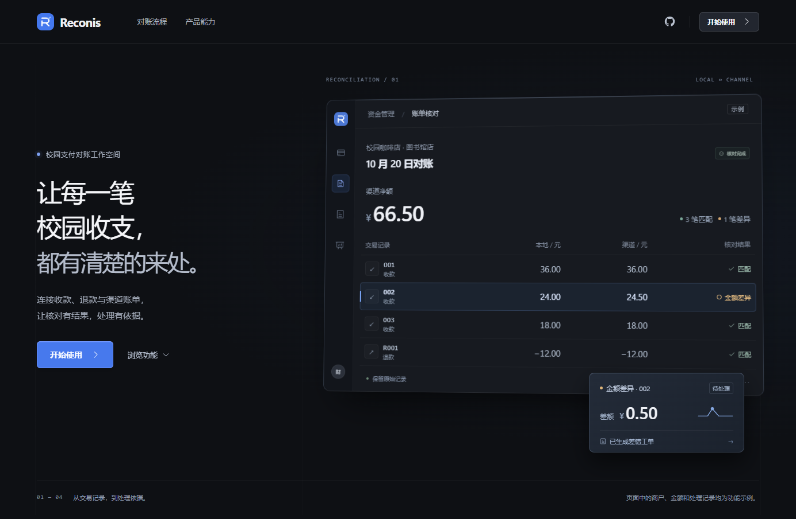

# 2 需求落实与功能结构

## 2.1 功能组织

功能按身份与基础资料、收退款、账单核对、差错协作、经营分析、知识与审计六组组织。图2-1展示系统的主要业务功能。基础资料支撑交易发生，资金事实成为对账输入，非匹配结果形成工单，处理结论与客观结果共同进入分析和审计。业务主线既可以从一笔订单进入，也可以从一条账单差异反向追溯。

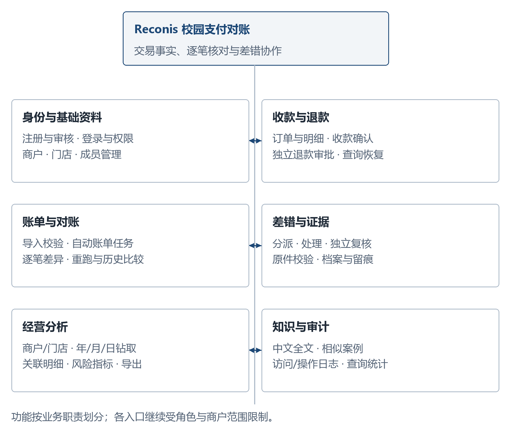

数据管理保留必要的新增、修改和删除能力，同时服从资金记录的业务约束。例如草稿订单可以修改和删除，普通业务操作不得删除已发生的收退款事实。商户和门店通过状态控制后续可用性，停用后仍保留历史交易供查询。

## 2.2 基本功能与操作结果

表2-1列出基础功能及操作结果。列表支持条件筛选和分页，关键记录可进入详情；业务状态由服务端校验并写入数据库，界面显示服务端返回的结果。

表2-1 基本功能及完成结果

| 功能类别 | 实际操作 | 结果与约束 |
| --- | --- | --- |
| 基础资料 | 浏览商户、门店和成员，申请与审核商户，维护有效状态 | 商户、门店及成员关系可查询；有效关系决定业务范围 |
| 订单管理 | 新建草稿、编辑明细、提交待付、查询详情、取消或删除允许状态的订单 | 头与明细同时保存；发起支付后明细冻结；仅草稿可删除 |
| 支付退款 | 生成付款入口、查询结果、申请退款、独立审批、查询退款 | 每笔成功收退款有独立资金事实；未知结果保留原请求号 |
| 账单核对 | 上传预览、校验、导入、执行核对、查看两侧明细 | 保留原件、范围与分类；不同批次不覆盖历史 |
| 差错处理 | 分派、保存分析、上传证据、提交、退回或复核结案 | 状态和人员共同约束操作；版本冲突返回明确错误 |
| 展示与统计 | 工作台、列表、详情、过滤、排序、分页、图表及报表导出 | 汇总可追溯到流水；报告保留期间、范围和截止时间 |
| 账号安全 | 注册、管理员审核、登录、退出、角色与状态维护 | 待审核账号不能登录；接口执行当前有效权限校验 |

图2-2为平台财务工作台。选定测试商户后，摘要显示150元收款、30元退款与120元净收款，角色入口与当前业务范围同时可见。

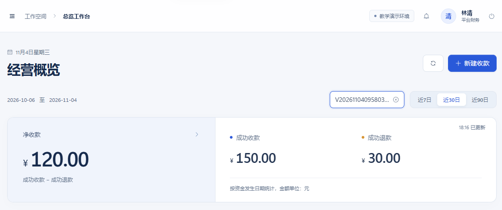

订单、退款和商户等条目采用统一的图文结构，金额、状态和主要操作保持清晰的视觉层级。图2-3使用校园演示订单展示分类插画：系统优先依据收款主题，在缺少明确主题时参考类别和商户信息选择咖啡、餐食、文印等图像；无法识别时使用中性票据图像。该映射只辅助浏览，不修改数据库中的业务分类、状态或金额。手机端重新排列条目，保留详情与业务操作；悬停反馈遵从系统的减少动态效果偏好。

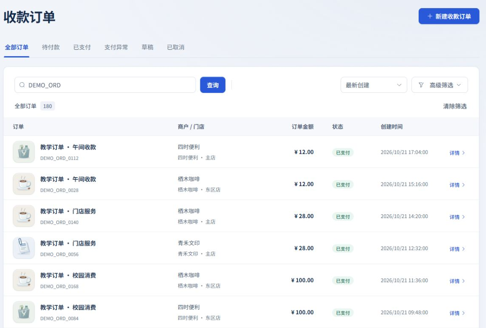

## 2.3 高级能力的落点

高级能力围绕同一业务数据链组织。表2-2给出能力、入口与验证位置；详细机制见第6—9章[1][2]。

表2-2 高级能力与验证方式

| 能力 | 实际实现 | 操作与证据 |
| --- | --- | --- |
| 数据交换 | 商户、账单支持 XLSX/XML 导入；交易、对账等支持相应导出 | 导入预览呈现有效、错误、重复与归属；回导测试验证记录一致 |
| 资料和业务审核 | 用户/商户审核、退款独立审批、工单独立复核 | 审核人、状态、时间及结论持久保存，非法自审被拒绝 |
| 自动获取 | 支付退款主动查询，持久化自动账单任务 | 教学流程完整；沙箱模板识别后不生成虚假业务差错 |
| 全文检索 | SQL Server 中文 FREETEXTTABLE | 工单正文分词检索，结果服从数据范围；检索命中新写入工单 |
| 记录比较与推荐 | 历史批次比较；按分类、原因和全文相关度推荐案例 | 两个金额差异在修订批次中 RESOLVED；推荐显示相关结案依据 |
| 流程管理 | 差错分派、处理提交、退回复查、独立复核 | 工单115由不同人员提交和复核，保留原始差异与新匹配证据 |
| 多粒度钻取 | 商户→门店→流水，年→月→日→流水 | 子查询继承父范围和 asOf；同一商户净收款保持120元 |
| 数据关联统计 | 资金、订单、门店、商户及差错记录联接 | 统计能够定位到实体与原始事件，避免一对多连接放大金额 |
| 日志查询统计 | ACCESS、AUTH及业务审计 | 按人员、动作、商户、结果与时间查询，requestId串联请求及变更 |

全文检索、比较和推荐三项均有实现。商户与账单提供Excel/XML数据交换，交易统计提供PDF/Word报告导出；各入口支持的格式见第7.6节。自动账单获取的渠道测试结果见第9.4节。

# 3 实现环境与系统架构

## 3.1 实际环境

系统在 Windows 本机运行，SQL Server Developer实例与Java服务通过本地TCP连接。表3-1列出构建目标、实际运行时和依赖版本。

表3-1 实现与验证环境

| 项目 | 实际配置 | 用途 |
| --- | --- | --- |
| Java | 编译目标21；本机运行时24.0.2 | 后端编译兼容与当前服务运行 |
| Spring Boot / MyBatis Starter | 4.1.1 / 4.0.0 | Web服务、会话安全、事务及SQL映射 |
| SQL Server | 2022 Developer，16.0.4305.5 | 关系存储、过程、触发器、视图、全文检索 |
| 数据库配置 | Chinese_PRC_CI_AS；兼容级别160 | 中文排序与SQL功能兼容 |
| JDBC | 12.10.2.jre11 | Java访问SQL Server |
| 前端 | Vue3.5.22、Router4.6.3、Pinia3.0.3 | 路由、组件和状态管理 |
| UI与图表 | Element Plus2.11.5、ECharts6.0.0 | 交互组件与统计图形 |
| 构建 | Node24.11.0、pnpm11.25.0、Vite7.1.12、TypeScript5.9.3 | 前端依赖、类型检查与打包 |
| 文件处理 | POI5.4.1、PDFBox3.0.5、JFreeChart1.5.6 | Excel/Word、PDF及报告图表 |
| 支付适配 | Alipay SDK4.40.272.ALL | 支付宝沙箱预下单、查询、退款和账单下载 |

## 3.2 模块化单体与数据流

图3-1展示最终技术结构。浏览器以同源 /api/v1 请求后端；Spring Boot内部按身份、交易、支付、对账、工单和分析划分模块，MyBatis执行参数化SQL和数据库程序。各模块在同一应用进程中运行。

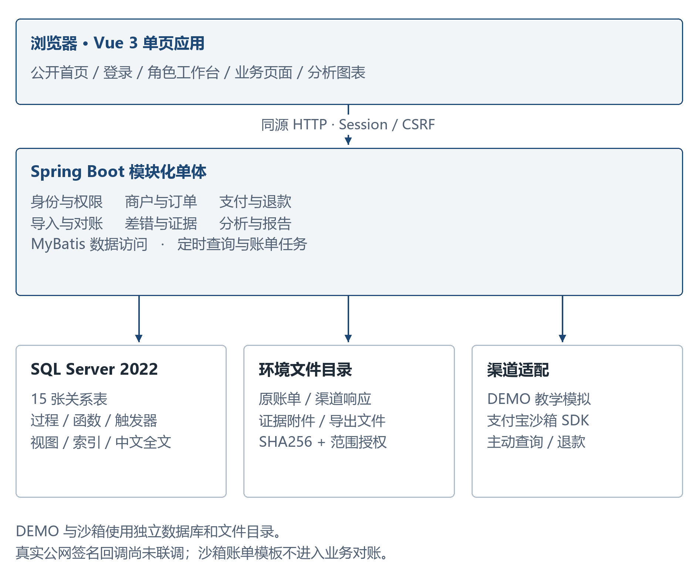

支付适配层选择DEMO或支付宝沙箱。可信渠道结果进入确认过程后才形成资金事实；账单下载与人工上传都经过解析校验再成为对账输入。文件保存原件和证据，数据库保存文件标识、散列与业务关联。统计从事实与结果中读取，生成图表与报表，不反向修改交易。

定时恢复任务与Web服务在同一进程运行，任务状态和租约保存在数据库。服务短暂中断后，可以依据已保存状态查询渠道和继续处理。数据库事务保证本地写入的一致性；支付宝网络调用在事务外执行，渠道结果通过主动查询和状态恢复与本地记录衔接。

## 3.3 本地部署与环境隔离

开发时Vite可代理后端接口，发布时前端静态产物进入后端可执行包，因此浏览器只需访问 http://localhost:8080。公开页为 /welcome，登录页为 /login，认证后 / 为工作台。已登录用户可以直接进入业务路由，无需重复经过展示页。

DEMO使用ReconisDemo及demo文件目录；ALIPAY_SANDBOX使用ReconisSandbox及sandbox目录。启动检查要求环境、数据库和文件目录组合一致，避免把测试渠道请求写入另一环境。本地配置中，数据库连接池最大5、最小空闲1，单文件上传上限20MB，会话空闲超时60分钟。

本机使用HTTP，数据库连接加密并信任本地证书。正式公网部署需要配置HTTPS、可信证书、密钥管理、备份恢复及运维监控。连接参数和密钥由本机私有配置读取。

## 3.4 源程序组织与运行版本

表3-2从维护者视角说明源码位置。接口、服务和SQL分层，使页面只提交业务意图，权限判断和状态变化留在服务端，涉及多表资金写入的约束进一步进入数据库。

表3-2 主要源程序与职责

| 位置 | 职责 |
| --- | --- |
| frontend/src/pages | 首页、登录、工作台、订单、退款、对账、工单、分析等页面 |
| frontend/src/router.ts | 公开入口、认证路由与业务页面导航 |
| frontend/src/analyticsFilters.ts | 钻取时继承筛选条件及日期范围求交 |
| backend/src/main/java/cn/reconis/identity | 注册审核、会话认证、角色与数据范围 |
| 同级 order、payment | 订单、渠道适配、收退款状态恢复与通知 |
| 同级 reconciliation、casework | 导入校验、自动任务、核对、工单与证据 |
| 同级 analytics、common | 聚合导出、文件存储、异常响应、审计上下文 |
| database | 表、索引、视图、数据库程序、升级及权限脚本 |
| scripts | 构建、启动、数据库测试、完整业务及浏览器验收 |

发布采用独立目录保存JAR和构建快照，源码与运行包的SHA256见附录C。测试记录同时保存源码快照及文件散列，用于对应构建内容、运行版本和测试结果。


# 4 最终数据库设计

## 4.1 数据组织原则与总体结构

校园支付对账涉及订单、支付渠道、账单和人员处理四类信息。订单说明应收内容，支付结果说明渠道确认结果，资金流水记录已经发生的收付，渠道账单提供另一侧核对依据。差错工单保存的是对这些证据的处理过程。我们将这些对象分别建模，使支付状态变化、重新导入和复核结案不会覆盖原始资金事实。

最终数据库运行于 SQL Server 2022 Developer Edition，版本为 16.0.4305.5，兼容级别为 160，排序规则为 Chinese_PRC_CI_AS。教学模拟与支付宝沙箱分别使用 ReconisDemo、ReconisSandbox，避免两种环境的资金记录混入同一核对范围。两库采用相同结构，每库包含 15 张业务表、207 个字段、32 个外键和 27 个 CHECK 约束。图4-1展示最终实体关系的总体划分。

表4-1按数据职责列出基础关系。身份与商户部分确定业务归属；资金部分保留请求与确认事实；对账部分保留输入、观察结果和处理记录；审计日志贯穿各模块。

表4-1 最终数据库关系及职责

| 数据范围 | 关系 | 主要职责 |
|---|---|---|
| 身份与商户 | app_user | 账号、平台角色、注册审核与启停 |
| 身份与商户 | merchant | 商户正式资料和待审资料修订 |
| 身份与商户 | merchant_member | 用户在指定商户中的成员身份 |
| 身份与商户 | store | 商户下的门店及启停状态 |
| 订单与资金 | business_order | 收款订单、消费者和创建人 |
| 订单与资金 | order_item | 订单项目、数量和单价 |
| 订单与资金 | payment_attempt | 每次支付尝试、渠道结果及补查状态 |
| 订单与资金 | payment_notification | 通知原件摘要、验签和处理结果 |
| 订单与资金 | refund_request | 退款申请、审批、发送和确认 |
| 订单与资金 | transaction_entry | 已确认的收款或退款事实 |
| 对账与处理 | reconciliation_batch | 导入来源、对账观察和自动获取任务 |
| 对账与处理 | statement_line | 原始账单的逐行记录 |
| 对账与处理 | reconciliation_result | 一次观察中的分类和两侧证据 |
| 对账与处理 | exception_task | 分派、分析、证据、复核与结案 |
| 审计 | audit_log | 操作主体、业务范围和变更前后快照 |

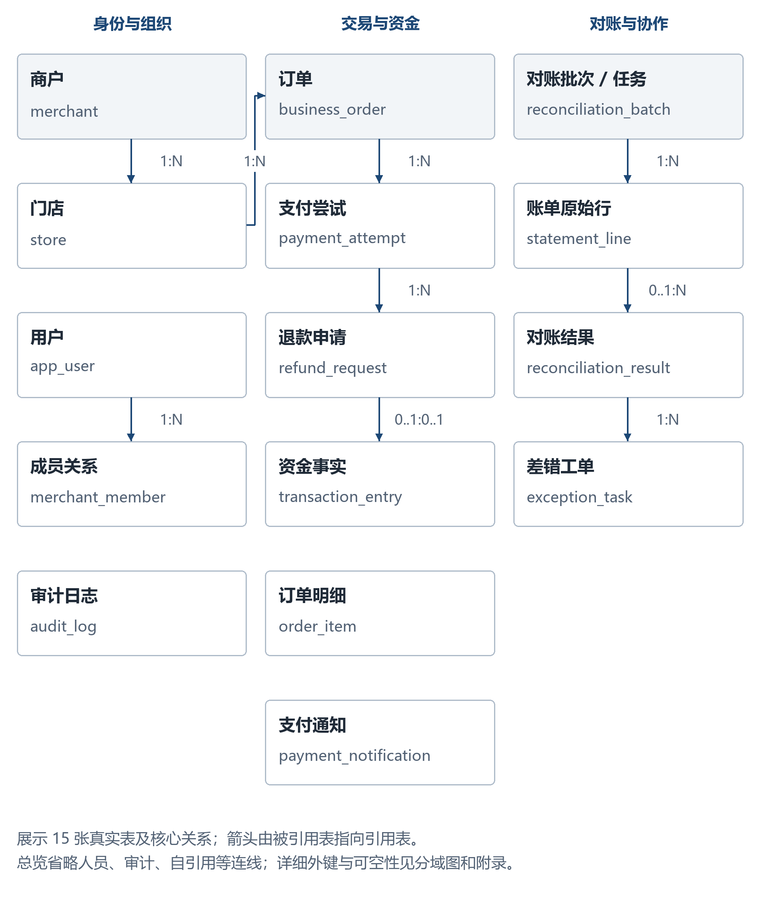

## 4.2 主要关系模式与实体联系

以下列出各关系的主要业务属性及实体之间的联系。所有关系均以 id 为 BIGINT IDENTITY 主键，完整的207个字段、类型、空值性及键约束见附录A，默认表达式见数据库元数据附件。

1. 用户 app_user（id，username，password_hash，display_name，platform_role，status，reviewed_by，version）。username 唯一；reviewed_by 自引用审核账号。平台角色与账号状态分别保存，待审核账号不会因为已选择身份而直接取得操作资格。
2. 商户 merchant（id，merchant_code，name，category_code，contact，status，proposed_name，proposed_category，proposed_contact，reviewed_by，version）。merchant_code 唯一；正式资料与待审修订值分开，审核前仍可识别原有业务归属。
3. 成员 merchant_member（id，merchant_id，user_id，role_code，status，created_at）。merchant_id、user_id 分别引用商户与用户，组合唯一；一名用户在不同商户中可以承担不同工作。
4. 门店 store（id，merchant_id，store_code，name，location_text，status，version）。门店编号在所属商户内唯一，不要求不同商户使用不同的门店简称。
5. 订单 business_order（id，order_no，store_id，consumer_id，created_by，client_request_id，subject，remark，status，version）。order_no 和 client_request_id 各自唯一；消费者可空，创建人不可空，商户归属通过门店确定。
6. 明细 order_item（id，order_id，line_no，item_name，category_code，quantity，unit_price_cent）。order_id 引用订单，订单内行号唯一。项目名称和单价表示成交内容，数据库没有额外的商品主数据表。
7. 支付 payment_attempt（id，order_id，client_request_id，out_trade_no，channel_env，app_id，seller_id，channel_trade_no，status，is_primary，next_query_at，dispatch_token，dispatch_lease_until）。客户端请求号与商户交易号分别唯一，一笔订单可以有多次支付尝试。
8. 通知 payment_notification（id，payment_id，notify_id，payload_file_uri，payload_hash，signature_valid，handling_result，received_at，request_id）。payment_id 可空，使无法归属或验签失败的通知仍可保留处理证据。payload_hash 不设唯一约束，重复到达的通知也能分别留痕。
9. 退款 refund_request（id，payment_id，client_request_id，out_request_no，amount_cent，reason，status，applicant_id，reviewed_by，dispatch_token，dispatch_lease_until，version）。每笔退款关联一笔原支付，请求号唯一；多次部分退款分别记录金额和状态。
10. 资金事实 transaction_entry（id，entry_no，event_key，entry_type，payment_id，refund_id，amount_cent，channel_occurred_at，recorded_at，evidence_file_uri）。entry_no、event_key 各自唯一，payment_id 与 refund_id 按流水类型互斥使用。
11. 批次 reconciliation_batch（id，batch_no，scope_type，merchant_id，period_start，period_end，source_type，statement_source_batch_id，baseline_batch_id，file_sha256，ingest_options_sha256，completeness，status，observed_at，acquisition_key，acquisition_state）。该关系还保存任务租约、重试与获取结果等属性，字段全集见附录。
12. 账单行 statement_line（id，import_batch_id，line_no，event_type，out_trade_no，channel_trade_no，out_request_no，amount_cent，channel_occurred_at，raw_line_file_uri）。原始批次与行号组合唯一，交易标识允许缺失，使有问题的原始行也能完整保留。
13. 对账结果 reconciliation_result（id，batch_id，result_key，source_event_key，entry_id，statement_line_id，classification，reason_code，detected_at）。batch_id 与 result_key 组合唯一；本地流水和渠道行均为可空引用，以表示仅存在一侧的情况。
14. 差错工单 exception_task（id，case_no，case_key，origin_result_id，latest_result_id，assignee_id，status，analysis_text，resolution_text，resolution_code，evidence_file_uri，submitted_by，reviewed_by，version）。case_no、case_key、origin_result_id 分别唯一；最新证据引用不设全局唯一。
15. 审计 audit_log（id，event_category，actor_user_id，scope_merchant_id，object_type，object_id，action，result，summary，before_json，after_json，occurred_at，request_id）。操作人和商户具有外键，object_type 与 object_id 表示多态业务对象，没有跨所有业务表的统一外键。

图4-2中的 merchant_member 将用户与商户的多对多联系转换为独立关系，防止把商户角色错误地直接放进用户表。消费者身份也不要求先成为商户成员，订单的 consumer_id 独立表达消费者与订单的联系。

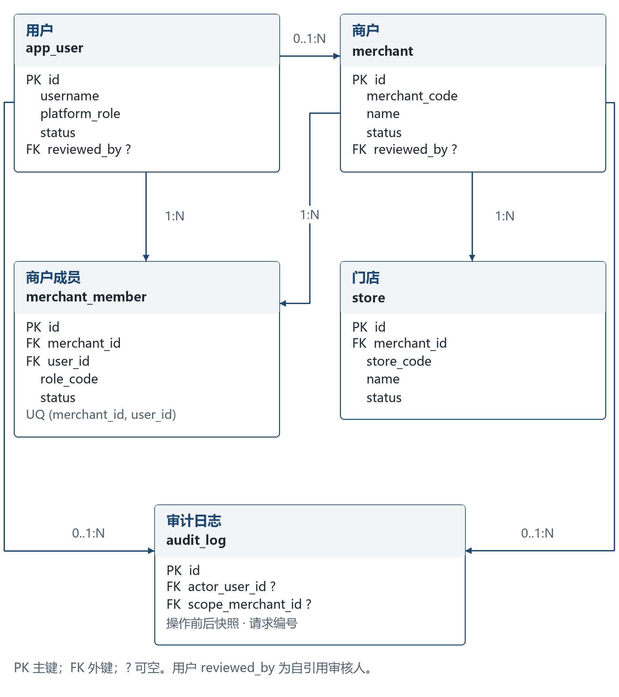

资金关系见图4-3。一笔订单有多条明细和多次支付尝试；一笔支付可对应多次部分退款。成功支付最多产生一条收款流水，成功退款最多产生一条退款流水。支付请求表承担状态恢复，资金事实表承担记账依据，两者保持联系但各有职责。

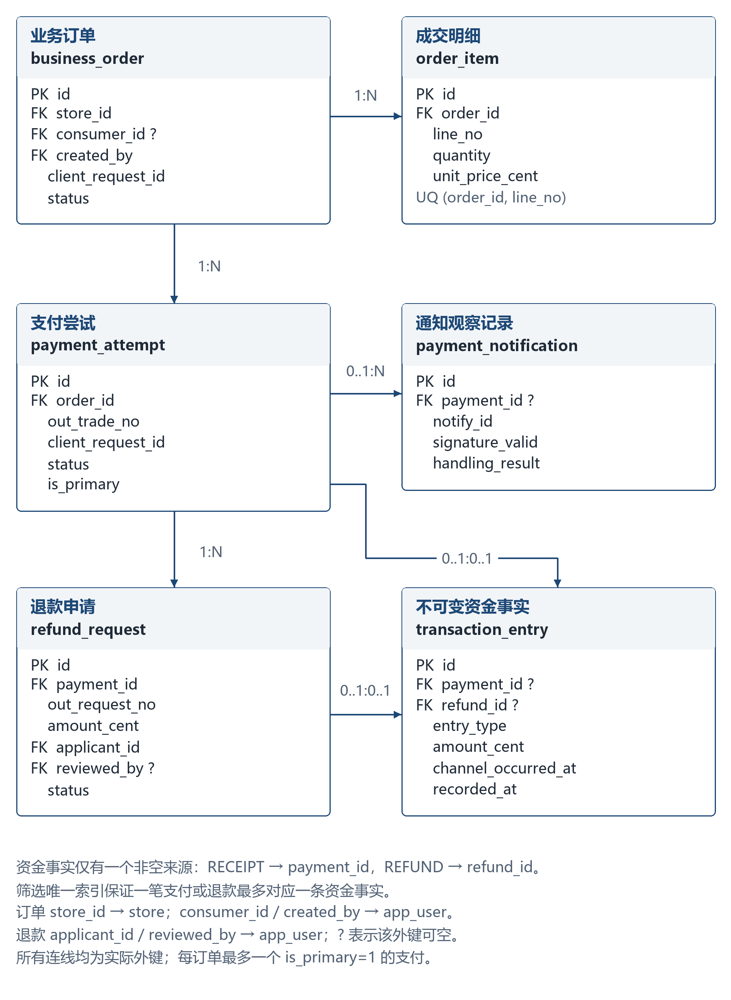

对账关系见图4-4。原始导入批次保存 statement_line，对账观察批次保存 reconciliation_result。重跑批次通过 statement_source_batch_id 复用原始账单，通过 baseline_batch_id 指向比较基线。工单保留最初异常和最新证据两个引用，既能沿当前处理状态继续工作，也能回答异常最初如何产生。

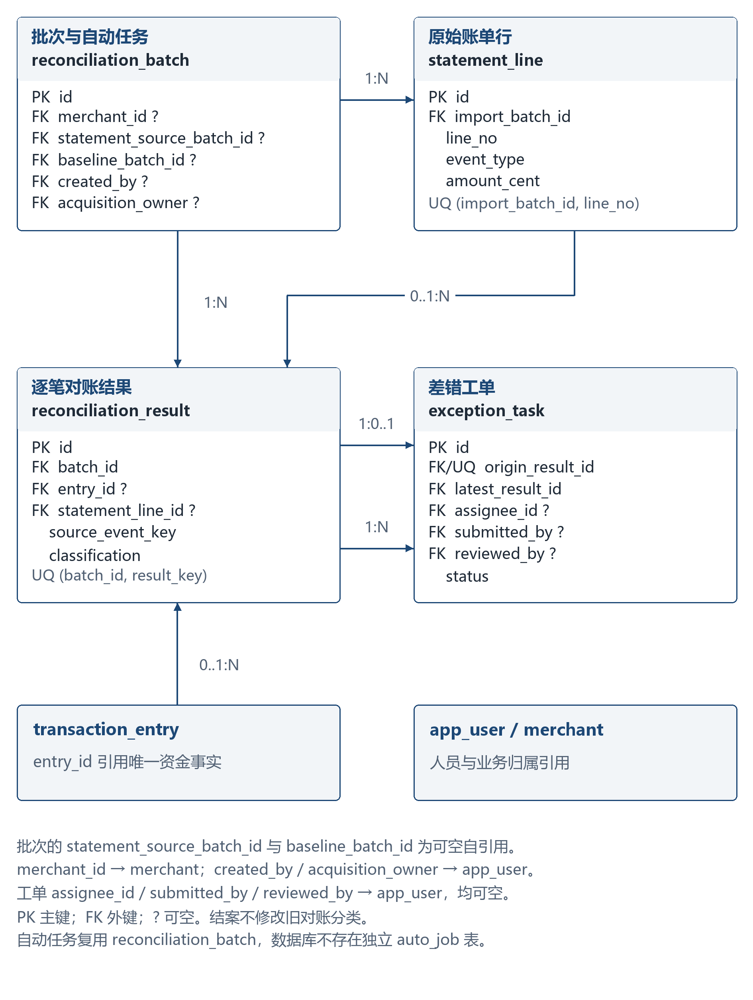

## 4.3 数据类型与完整性约束

金额采用 BIGINT 分值存储。订单单价、退款金额、资金事实金额和账单金额都使用同一单位，比较时不依赖浮点舍入。数量为 INT，SQL 汇总先将数量转换为 BIGINT；应用创建明细时使用精确乘加，并限制订单合计大于零且不超过100万元。数据库允许明细单价为零，但要求退款、资金事实和账单金额为正；这些行内约束与应用层总额范围校验分别承担不同层次的合法性检查。

订单总金额由 v_order 汇总明细得到，business_order 不另存总额。草稿编辑因此只维护一份明细事实。发起支付后，数据库触发器冻结订单明细，避免支付请求与后台价格修改产生金额不一致。收款和退款流水的 amount_cent 均为正值，由 entry_type 指明方向；净收款计算时再将退款作负向合计。

数据库共有15个主键、19个唯一约束。业务编号便于跨系统追踪，技术主键用于关联，两者并存。client_request_id 标识同一次客户端操作，网络重试据此返回原业务记录。支付环境、应用和非空渠道交易号组成筛选唯一索引，区分不同渠道环境中的同名交易编号。

32个外键均采用 NO_ACTION，不进行级联删除。删除上层对象时，存在资金或证据引用会阻止直接删除，避免商户、订单与历史流水同时消失。27个 CHECK 约束覆盖状态枚举、正金额、正数量、账期先后和范围归属等规则。批次要求结束时间大于开始时间；MERCHANT 范围必须指定商户，PLATFORM_UNASSIGNED 范围必须不指定商户。

资金事实的来源采用互斥约束：

```sql
CHECK (
  (entry_type='RECEIPT' AND payment_id IS NOT NULL AND refund_id IS NULL)
  OR
  (entry_type='REFUND' AND payment_id IS NULL AND refund_id IS NOT NULL)
);
```

该约束使每行资金事实只具有一种收付来源。配合两个非空来源字段的筛选唯一索引，同一支付或退款不能重复形成资金事实。空值行不参与对应筛选索引，因此不会错误地限制其他类型的流水数量。

业务时间和操作时间采用 DATETIME2(3)，统一约定保存 UTC，缺省值为 SYSUTCDATETIME()。channel_occurred_at 表示渠道实际发生时间，recorded_at 表示系统入账时间，两者分离使晚到通知仍能归入正确业务日期。v_transaction_fact 将发生时间转换为中国标准时间的业务日期，供日、月、年统计使用。

用户、商户、门店、订单、退款和工单采用 ROWVERSION。该字段是数据库自动维护的8字节版本标记[3]。工单复核使用请求携带的预期版本与当前版本比较，防止两名操作人员从旧页面提交相互覆盖的决定。

## 4.4 函数依赖与规范化分析

规范化分析以关系中的真实依赖为基础。表4-2列出代表性函数依赖及其对结构拆分的影响。每个关系除列出的业务候选键外，还具有 id 主键。

表4-2 主要函数依赖及结构依据

| 关系 | 函数依赖 | 结构作用 |
|---|---|---|
| merchant | merchant_code → name, category_code, contact, status | 商户资料只维护于商户实体 |
| store | (merchant_id, store_code) → name, location_text, status | 门店编号在商户范围内决定门店资料 |
| merchant_member | (merchant_id, user_id) → role_code, status | 角色由用户与商户共同决定，不由用户单独决定 |
| business_order | order_no → store_id, consumer_id, created_by, subject, status | 订单归属与订单级属性集中保存 |
| order_item | (order_id, line_no) → item_name, category_code, quantity, unit_price_cent | 行项目依赖完整复合键，不重复订单级资料 |
| payment_attempt | out_trade_no → order_id, channel_env, status 等尝试属性 | 独立表达一次支付尝试 |
| refund_request | out_request_no → payment_id, amount_cent, applicant_id, status | 每笔退款具有独立请求身份 |
| statement_line | (import_batch_id, line_no) → 类型、标识、金额、发生时间 | 原件中的行由原始批次与行号共同确定 |
| reconciliation_result | (batch_id, result_key) → 两侧引用、分类、原因、检测时间 | 分类属于某次观察，而非永久属于某笔交易 |

例如，若在订单中同时保存 store_id、merchant_id 和 merchant_name，则 store_id 决定 merchant_id，merchant_id 又决定 merchant_name，会引入非键属性之间的传递依赖。最终订单只引用 store，商户信息通过视图连接，避免商户改名时逐单更新。同样，明细表没有重复保存消费者、创建人等订单级属性，不会因一笔订单包含多行而产生多份相同资料。

支付与退款单独建表解决一对多事实的重复组问题。若把第二次支付或第二次退款继续放入订单的“支付号2”“退款金额2”等列，既限制次数，又使空值和状态组合迅速增多。独立关系允许任意合法次数的请求，同时分别建立唯一标识和关联约束。order_item 的项目名称表示当时的成交内容。系统未定义“项目名称决定单价或类别”的函数依赖，这些属性按成交明细保存。

在这些已识别的函数依赖下，核心实体表的非键属性依赖于候选键，复合键关系不存在已定义的部分依赖，实体之间的属性通过外键连接，能够按关系说明第三范式设计。历史与工作流中的半结构化字段和快照保留了受控冗余，其用途和维护约束如下。

transaction_entry 保存确认时的金额和来源，是已发生事实的独立记录；exception_task 保存 case_key、最初结果、最新结果和处理状态，便于差错去重与历史追溯；audit_log 的 before_json、after_json 保存变更时的内容，当前表的外键查询则返回现时数据。上述数据由事务、唯一索引和触发器共同维护。

自动获取任务目前复用 reconciliation_batch，增加14个 acquisition_* 字段，普通导入批次的大部分任务字段为空。该取舍减少了批次与任务间的协调代码，但使一张表承担输入来源与获取任务两种职责。系统通过 CK_batch_acquisition 区分合法组合，后续仍可拆分任务实体，改善职责划分和稀疏字段问题。

## 4.5 索引与查询组织

实际数据库共有53个B树索引，其中34个由主键和唯一约束产生，另外19个为显式业务索引。索引设计分别服务于唯一性、工作队列、统计取数和证据追溯。

表4-3 代表性业务索引及使用目的

| 索引 | 主要键或筛选条件 | 目的 |
|---|---|---|
| UX_payment_primary | order_id；is_primary=1 | 每单最多一个主支付 |
| UX_entry_payment、UX_entry_refund | 非空来源支付或退款ID | 确认重试不重复记账 |
| UX_import_file | 范围、商户、文件摘要、选项摘要 | 同一导入含义下去重 |
| IX_payment_pending、IX_refund_pending | status, next_query_at | 扫描到期补查记录 |
| IX_entry_time | channel_occurred_at，包含金额与来源列 | 账期取数与资金汇总 |
| IX_result_event_observation | source_event_key, detected_at | 查找同事件后续观察 |
| IX_case_assignee | assignee_id, status, due_at | 经办人待办与逾期查询 |
| IX_audit_case_snapshot | object_id, occurred_at DESC, id DESC；工单变更 | 重建截止时间的工单状态 |
| IX_payment_order | order_id，包含状态与主支付标记 | 检查订单是否存在任意支付尝试 |

明细冻结要求检查所有支付尝试，IX_payment_order 为这些记录提供按订单查找的索引；UX_payment_primary 只覆盖 is_primary=1 的主支付。导入唯一性也不只依赖文件摘要；同一原件在不同账期、归属或解析选项下可以构成不同导入，故需要同时保存 ingest_options_sha256。

在当前数据库的估计执行计划中，按订单查支付使用 IX_payment_order 的 Index Seek，按退款状态与下次查询时间筛选使用 IX_refund_pending 的 Index Seek。这两项估计计划反映了相应谓词的索引选择；实测耗时和实验条件见第9.3节。新增索引会增加写入维护和存储成本，后续扩展应继续结合实际查询频率、执行计划与数据规模调整。

# 5 数据库程序与一致性控制

## 5.1 视图形成统一查询口径

系统部署12个视图。实际业务的主要查询由 v_order、v_transaction_fact、v_case 及两个结案证据视图承担，v_statement_normalized 被对账存储过程使用，其余视图提供已部署的受限查询或摘要入口。表5-1列出各视图的职责及实际调用情况。

表5-1 最终视图及调用情况

| 视图 | 数据组织 | 实际调用 |
|---|---|---|
| v_order | 明细总额、门店、商户与订单 | 订单、支付、权限和证据查询 |
| v_transaction_fact | 收退款统一事实及业务日期 | 分析、对账、订单详情 |
| v_statement_normalized | 生成规范事件键 | 对账存储过程 |
| v_case | 最初分类、最新结果、人员与商户 | 工单、权限和风险分析 |
| v_case_matched_evidence | 有效的新匹配结果 | 工单详情、复核过程 |
| v_case_attribution_evidence | 原件同一行的新归属证据 | 工单详情、复核过程 |
| v_public_merchant | 有效商户的公开字段 | 已部署，Java接口未直接引用 |
| v_consumer_order | 会话用户的订单 | 已部署，主要接口使用权限谓词 |
| v_merchant_transaction | 会话商户的资金事实 | 已部署，主要接口使用权限谓词 |
| v_reconciliation_summary | 批次分类计数 | 已部署并授权数据库审计角色 |
| v_case_search | 会话限定的工单范围 | 已部署，全文接口直接连接v_case并限定范围 |
| v_audit_summary | 审计摘要字段 | 已部署并授权数据库审计角色 |

v_transaction_fact 通过退款找到原支付，再连接订单、门店和商户，使收款与退款具有同一归属路径。经营分析由此统一计算收款、退款和净收款，退款按实际退款日期计入，不会因为原订单在另一天创建而漏入当前账期。

## 5.2 存储过程划定业务原子操作

五个存储过程分别承担支付确认、退款审核、退款确认、执行对账和工单复核。我们把必须同时成功或失败的数据库变化放在同一事务内，使用 SET XACT_ABORT ON，并在 TRY/CATCH 中提交或回滚。外部支付请求在数据库事务之外执行，超时与结果未知通过状态恢复处理。

usp_confirm_payment 接收支付ID、渠道交易号、金额、发生时间与证据。过程锁定订单，重新汇总明细校验金额，再同时更新支付状态、插入收款事实和更新订单。已经成功且渠道号相同的重复确认返回 ALREADY_CONFIRMED；相同支付记录出现冲突渠道号则报错。若订单已存在主支付而另一尝试确实成功，过程保留额外资金事实，并标记 PAYMENT_EXCEPTION，避免把异常收款误当无效请求丢弃。

退款流程的事务边界见图6-4。usp_approve_refund 先锁定原支付，再锁定申请，要求申请仍处于待审核状态、审核人与申请人不同，并在锁内重新检查可退额度。通过审核后写入 APPROVED，使额度立即进入预留范围；拒绝则写入 REJECTED。

```sql
SELECT @dummy=id
FROM dbo.payment_attempt WITH(UPDLOCK,HOLDLOCK)
WHERE id=@payment;

IF @applicant=@reviewer
  THROW 51011,N'申请人不能审批自己的退款',1;
IF @approve=1 AND @amount>dbo.fn_refundable_amount(@payment)
  THROW 51012,N'可退额度不足，已有成功或预留退款',1;
```

同一支付上的两个审批事务争用同一行锁，后获得锁的事务重新看到扣除前一申请预留后的余额。两个申请即使各自未超过收款额，其合计也受到同一支付可退额度的限制。

usp_confirm_refund 只接受 APPROVED、PROCESSING、UNKNOWN 等可确认状态，并核对金额和发生时间。退款终态与退款流水在一个事务中写入；已成功退款按相同金额再次确认，不再插入新流水。UNKNOWN 不能简单判为失败，否则原退款可能已经在渠道成功，又被错误释放额度。

usp_run_reconciliation 在 SNAPSHOT 事务中读取本地事实与渠道记录，保存分类结果并生成或更新工单。已有历史结果的批次不可覆盖，重新核对另建观察批次。两库已开启 SNAPSHOT 支持，但默认 READ_COMMITTED_SNAPSHOT 未开启；对账过程显式切换隔离级别，正常或异常结束后恢复 READ COMMITTED[4]。

usp_review_exception 接收复核决定、结案类型、意见、预期版本及可选的新证据。过程要求工单处于 PENDING_REVIEW，复核人与 submitted_by 不同，复核人当前账号有效且仍有相应商户或平台复核权限。版本不符、权限变化或证据不满足条件时均不执行结案。

## 5.3 标量函数与幂等控制

fn_refundable_amount 返回已确认收款减去 APPROVED、PROCESSING、UNKNOWN、SUCCEEDED 退款之和。待审核申请不提前占用额度，额度竞争在审批事务中解决；未知结果继续占用额度，直到查明成功或失败。该函数同时供详情展示与审批决策使用，统一两处的额度计算口径。

函数的核心计算如下。两处 COALESCE 将无收款或无退款记录的空聚合结果转为零；成功退款仍保留在扣减集合中，因此状态从预留转为成功不会重新释放额度。

```sql
RETURN (
  SELECT COALESCE((SELECT amount_cent
    FROM dbo.transaction_entry WHERE payment_id=@payment_id),0)
  -COALESCE((SELECT SUM(amount_cent)
    FROM dbo.refund_request WHERE payment_id=@payment_id
      AND status IN ('APPROVED','PROCESSING','UNKNOWN','SUCCEEDED')),0)
);
```

fn_case_overdue_days 以 due_at 与 closed_at 或给定 as_of 计算超期天数，负值截为零。其实现使用 DATEDIFF(DAY)，按跨日边界计数，不按满24小时折算。历史风险分析传入指定截止时点，避免把当前日期直接代入过去的状态。

幂等在不同层次使用不同标识。订单、支付、退款以 client_request_id 识别同一次操作；资金流水以 event_key 和非空来源唯一索引防止重复记账；导入以文件摘要、解析选项摘要和业务范围识别同一输入；自动任务以 acquisition_key 复用任务。

导入还使用事务级 sp_getapplock，对文件与选项组合加互斥锁，使两个并发导入不会同时完成查重后各自插入。唯一索引保留为最后一道约束。原件相同但账期、范围或完整性声明不同的输入，按新的导入含义处理。

## 5.4 对账分类与可追溯结案

对账先把收款键规范化为 P:加商户交易号，把退款键规范化为 R:加退款请求号。缺少事件键或同键重复的渠道行先形成 KEY_UNRESOLVED 或 BILL_DUPLICATE，剩余唯一有效键再与本地事实进行 FULL OUTER JOIN，使本地单边和渠道单边记录都被保留。

最终分类共8种：MATCHED、CHANNEL_ONLY、LOCAL_ONLY、AMOUNT_MISMATCH、BILL_DUPLICATE、KEY_UNRESOLVED、PENDING_CONFIRMATION、EXTRA_SUCCESS。分类同时考察是否存在两侧记录、金额、退款关联、渠道交易号和支付是否为额外成功。若账单完整性为 UNKNOWN，本地存在而渠道缺失只能判为 PENDING_CONFIRMATION；已确认完整性后，才可判为 LOCAL_ONLY。

差错工单的 case_key 结合归属、事件键和分类生成，相同范围内同类异常的后续观察复用工单。原始异常保存在 origin_result_id，最新证据保存在 latest_result_id。后续又出现异常时，已结案工单可以重新打开，待复核工单回到处理中，防止人员继续批准已经过时的分析。

结案支持 RECONCILED、INVALID_INPUT、FALSE_POSITIVE、KNOWN_EXCEPTION、OWNERSHIP_CONFIRMED。RECONCILED 必须引用同范围同事件的新匹配结果，并且没有更新异常推翻该证据；OWNERSHIP_CONFIRMED 需要相同原件、相同行号及一致的业务内容，并通过原支付关联证明新的商户归属。其他结案类型用于记录无效输入、误报或已知异常，均不直接修改原资金流水。

2026年11月4日的流程验证中，工单115结案后，origin_result_id仍指向金额差异结果371，latest_result_id则指向匹配结果381。工单状态为 CLOSED，结案类型为 RECONCILED，经办提交人与复核人分别为286、287。原始差异与结案依据同时保留。

## 5.5 触发器维护历史边界

九个触发器承担两类职责：记录变更，以及阻止破坏性改写。表5-2给出其作用范围。

表5-2 触发器及一致性职责

| 触发器 | 作用 |
|---|---|
| trg_refund_audit | 冻结退款关键请求属性，状态变化时保存前后快照 |
| trg_case_audit | 固定起因与case_key，校验证据范围，限制提交后替换分析与证据，保存工作流快照 |
| trg_audit_immutable | 禁止更新、删除审计日志 |
| trg_entry_immutable | 禁止更新、删除资金事实 |
| trg_statement_immutable | 禁止更新、删除原始账单行 |
| trg_result_immutable | 禁止更新、删除历史对账结果 |
| trg_merchant_review_audit | 保存商户资料与审核变化 |
| trg_user_review_audit | 保存账号状态和平台身份变化 |
| trg_order_item_freeze | 存在支付尝试后禁止订单明细变更 |

触发器使用 inserted、deleted 集合处理受影响行，审计记录包括变更前后内容及 request_id。工单触发器还要求最初结果和最新结果属于同一事件与业务范围，防止把其他商户的匹配记录作为本工单的处理证据。审计表本身只能追加，使业务改动与相应记录形成连续历史。

资金事实的保护由一个短触发器实现。它截获整个 UPDATE 或 DELETE 语句，使直接SQL修改与接口中的误操作都不能绕过“只追加”的业务边界。需要补充新证据时创建新记录，不更改已经确认的资金事实。

```sql
CREATE OR ALTER TRIGGER dbo.trg_entry_immutable
ON dbo.transaction_entry INSTEAD OF UPDATE, DELETE
AS
BEGIN
  THROW 51040,N'交易事实不可修改或删除',1;
END;
```

这些触发器约束正常数据库写操作。管理员仍可能停用触发器或改变数据库结构，因此运行账号权限、备份和操作管理仍是数据保护的一部分。

## 5.6 全文查询、权限范围与结果边界

全文目录 ReconisCases 对工单的 title、description、analysis_text、resolution_text 四列建立中文全文索引，语言编号为2052，使用自动变更跟踪。知识检索通过 FREETEXTTABLE 返回匹配键和相关性排名，再连接 v_case 加入可见范围条件。搜索结果既能定位历史处理文本，也能回到具体工单和证据链。

数据库定义了 reconis_runtime 和 reconis_auditor 两个角色。消费者、收银、经办和复核属于应用层身份，没有分别建立 SQL 登录。实际应用权限由认证结果、Access 的动作检查及查询范围谓词落实。SessionContextPlugin 在SQL调用前设置 user_id、role、merchant_id、request_id，并在 finally 中清空，供会话限定视图和审计触发器使用，防止连接池复用时残留上一请求上下文。外模式与行范围的实现见第8.2节。

2026年11月4日对两库进行的只读一致性查询中，成功支付缺流水、成功退款缺流水、退款事实金额冲突、收款与订单金额冲突、可退额度为负、工单证据范围冲突六类记录数均为零；外键、CHECK和触发器均有效。

文件本体与关系数据分属文件系统和 SQL Server，本地事务不能天然保证跨介质原子性。后续仍需完善孤立文件清理、附件与数据库一致备份及恢复演练。审计JSON快照和自动任务复用批次表也有演进成本，进一步优化需保留现有证据链语义和历史记录。


# 6 核心业务流程与运行实例

## 6.1 实例范围与订单建立

本章采用 2026 年 11 月 4 日在 DEMO 环境完成的一组业务记录说明系统运行过程。验证商户编号为 54，下设“验证一店更新”。订单 266 的应付金额为 100.00 元，订单 267 为 50.00 元；订单 266 完成 30.00 元部分退款。账单输入、核对结果、差错工单和分析明细均围绕这组记录展开。DEMO 的渠道结果由教学适配器产生。

创建订单时输入门店、主题、消费者和成交明细。后端确认门店及商户处于可用状态，并检查创建者为该商户 OWNER、CASHIER 或平台财务。每行保存当次成交名称、数量和单价；后端使用整数分值计算总额，并检查乘加溢出和金额范围。订单头与明细置于同一事务中，任一明细不合法时整单回滚，不留下无明细的半成品。

草稿可以修改或删除，提交后进入 WAITING_PAYMENT。编辑请求携带 ROWVERSION，只有数据库当前版本相符才能更新。已发起支付的订单明细受到冻结保护，不能在渠道已经获取应付金额后调整商品价格。取消也受状态约束：存在尚未关闭的支付尝试时不能简单将订单置为取消，必须先明确渠道状态。

图6-1为订单列表按2026年11月4日测试前缀筛选的结果，包含两笔已支付订单和一笔已取消订单。图6-2展开订单266：应收100元，已支付且部分退款，时间线分别保存100元收款与30元退款，剩余可退70元。

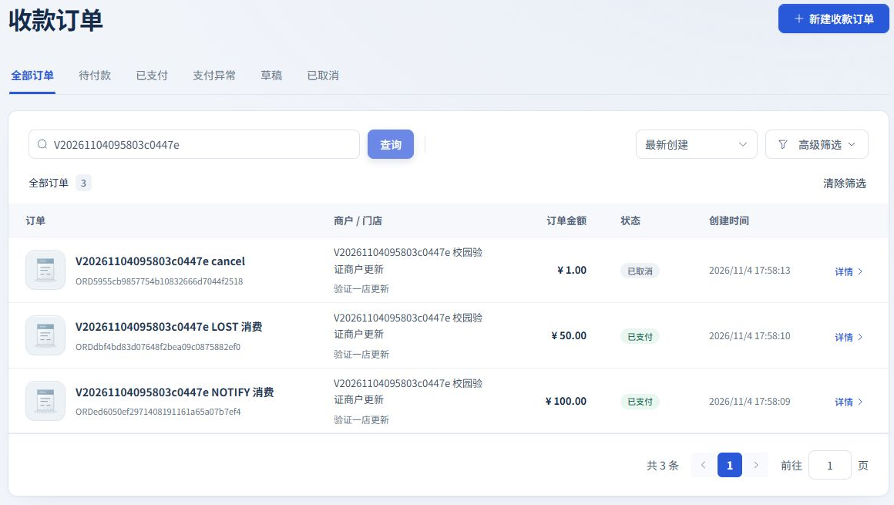

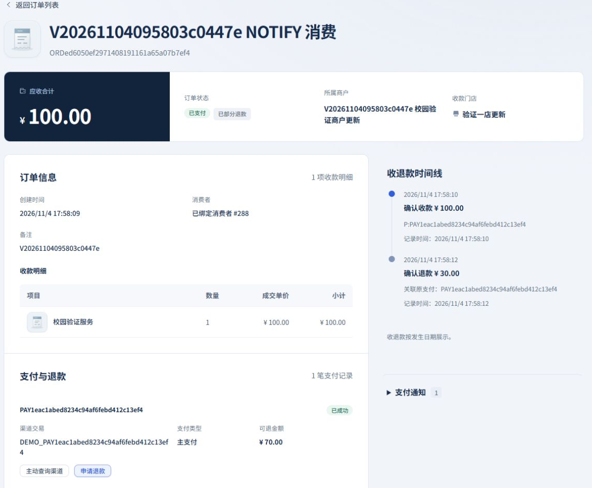

## 6.2 收款确认与异常恢复

收款流程如图6-3 所示。用户发起付款后，PaymentService 在短事务内锁定订单，检查客户端请求标识和已有支付尝试。相同请求重复到达时复用原结果；同一订单已有进行中的支付尝试时沿用原支付号。业务标识 out_trade_no 在网络调用前保存，因此浏览器刷新或请求超时不会使系统失去查询原交易的依据。

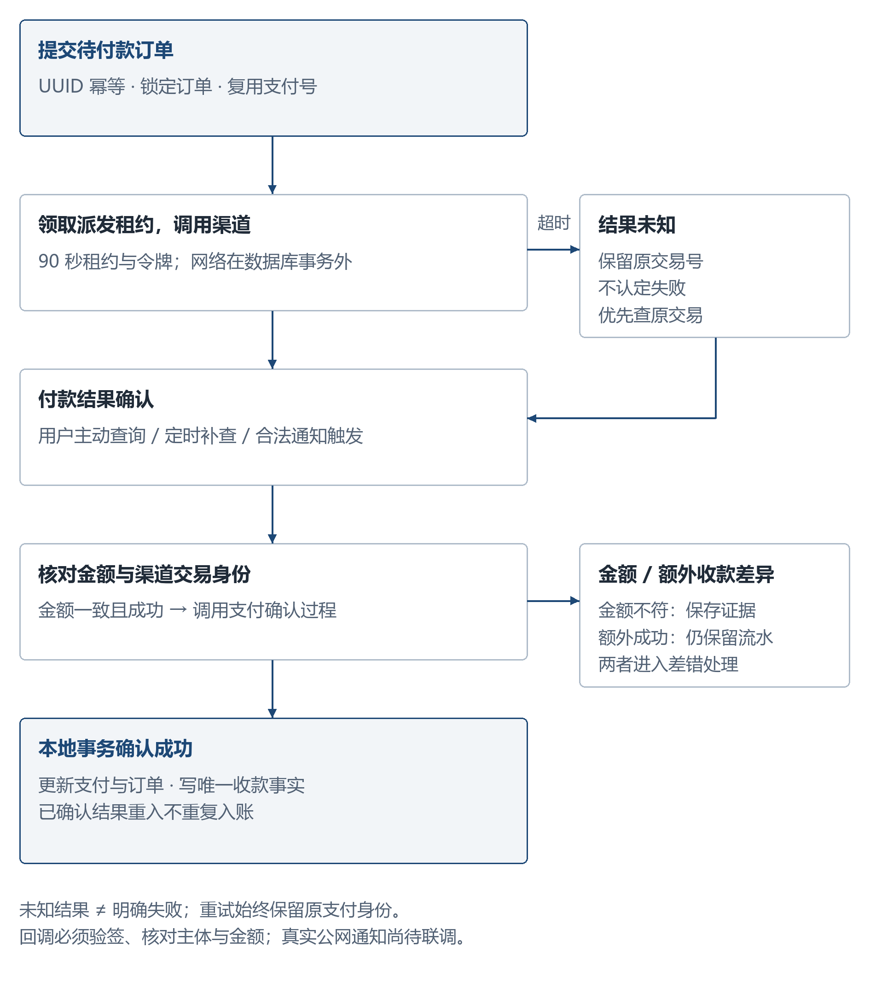

对支付宝的预下单、查询均在数据库事务之外执行。等待网络期间如果一直占有订单锁，会阻塞其他查询和恢复任务；如果完全不约束并发，又可能同时发送多个请求。系统采用 90 秒派发租约、随机令牌和持久发送计数：只有领取成功的执行者可以派发；返回结果时必须匹配该令牌及允许状态。假如查询已先确认支付成功，较晚返回的预下单结果不能再把成功状态改回待支付。

渠道返回成功后，系统继续核对金额、环境和交易身份，再调用 usp_confirm_payment。该过程在一个事务中更新支付状态、订单状态并追加唯一收款事实。支付尝试记录请求与处理进度，transaction_entry 单独保存已确认发生的资金事件。重复通知、重复查询可以形成多次观察，但同一来源只产生一条收款流水。

订单 266 使用教学通知路径确认 100.00 元收款；订单 267 刻意模拟渠道已收款但通知丢失，随后通过查询恢复确认 50.00 元。最终两张订单均为 PAID。通知丢失时，系统通过查询补全本地订单状态；请求超时后，UNKNOWN 保留原业务号，由用户主动查询或每 15 秒运行的恢复任务继续确认，查询间隔根据次数逐步延长，避免持续高频访问渠道。

金额不符时，系统保存渠道查询证据并建立 TRADE_QUERY 来源的差异结果，不将错误金额记成正常收款。若同一订单确实发生第二笔成功收款，则保留额外资金事实并产生 EXTRA_SUCCESS 差错。

## 6.3 部分退款、独立审批与额度

退款以一笔已成功支付为来源，申请保存单次 amount_cent、原因、申请人及稳定 out_request_no。重复提交相同 client_request_id 和相同业务参数返回原申请；相同标识却改变金额或来源时拒绝请求。申请首先进入 PENDING_REVIEW，尚未对外执行退款。

图6-4 中，审批是额度实际竞争的位置。usp_approve_refund 先锁定原支付，再锁定退款申请，重新计算已成功和已预留金额；只有“已占用额度 + 本次金额不超过原支付金额”时才允许批准。APPROVED、PROCESSING、UNKNOWN、SUCCEEDED 均计入额度占用，PENDING_REVIEW 不预留。并发审批不能仅使用页面打开时显示的余额，否则两个申请可能分别通过同一笔剩余额度。

退款 67 对订单 266 申请 30.00 元。申请人编号 288、审批人编号 285，批准后状态为 SUCCEEDED，原支付剩余可退额为 70.00 元。重复提交和两次同步仍只有一条 30.00 元退款事实。随后申请 70.01 元并尝试批准，接口返回 409；申请人直接调用审批接口被拒绝，具有审批权限的人员审批本人申请也被数据库拒绝。超额审批、自审和权限不足的请求分别验证额度完整性、职责分离与操作权限。

批准后执行渠道调用仍采用短事务加租约的方式。结果未知时保留额度，恢复任务先查询原退款号，只有渠道明确未执行才按同一请求号重发。成功结果通过 usp_confirm_refund 追加 REFUND 事实。退款不会删除原收款，也不会将收款金额改小，因此可以保留订单原支付、每次部分退款及其发生日期。

本组实例最终有两笔收款 150.00 元、一笔退款 30.00 元，净收款为 120.00 元。对账和工单操作完成后再次查询该统计，净额仍为 120.00 元，说明差错处理没有改写已有资金事实。

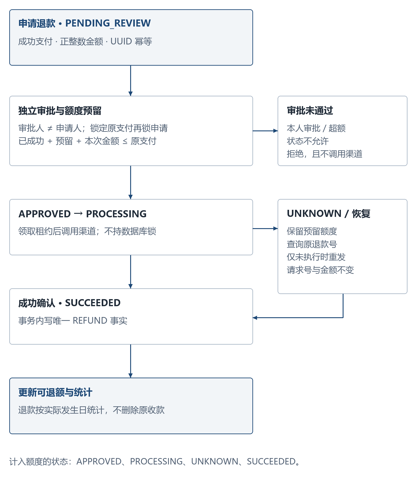

图6-5显示退款申请的最终状态。30元申请成功；70.01元超额申请和1元自审验证申请在测试后的清理流程中退回。接口拒绝申请时的HTTP响应见表9-3。

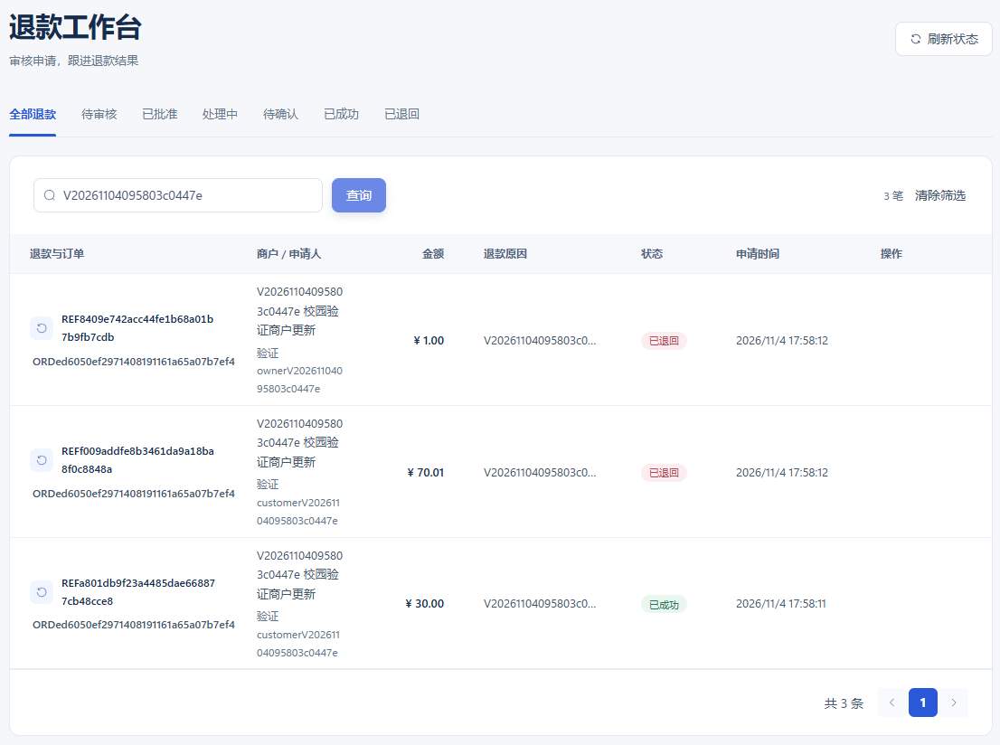

## 6.4 账单导入与逐笔核对

账单处理分为预览、导入和执行核对三个阶段，流程见图6-6。用户选择文件、期间、商户范围及完整性声明后，系统先解析并输出有效行、错误行、重复键和未识别归属。XLSX 要求模板表头一致并拒绝公式单元格；XML 检查根节点、版本、环境和行结构，同时关闭 DTD、外部实体及 XInclude。金额采用整数分，时间要求包含时区。未知 XML 元素不能被当成没有数据的空账单。

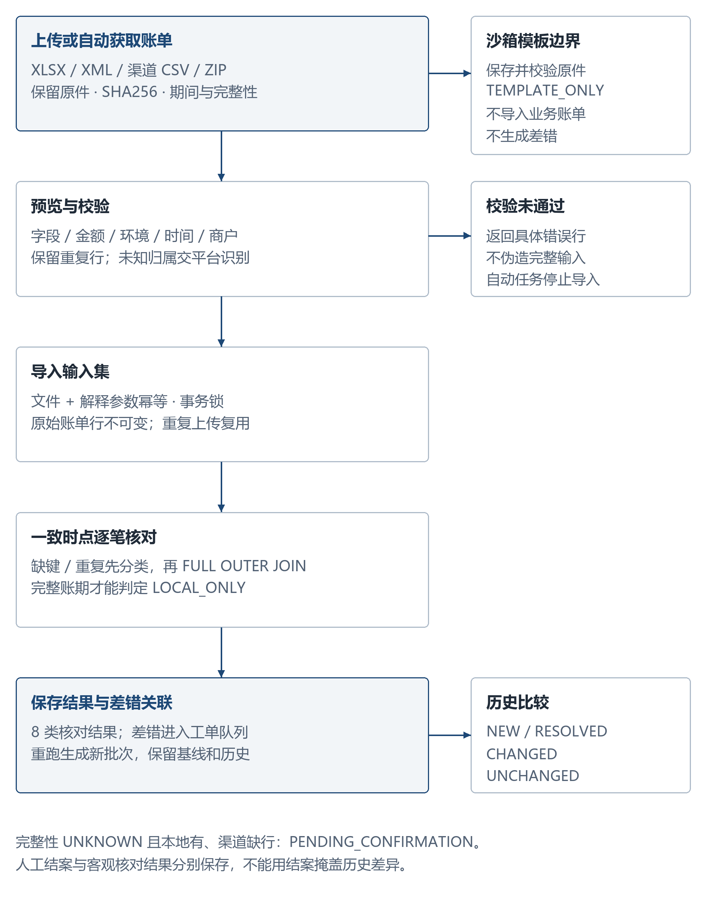

导入时保存文件原件、SHA256、解释参数散列和逐行内容。同一字节文件在不同账期或完整性声明下含义可能不同，因此幂等标识同时包含文件和解释参数；事务型应用锁与唯一约束共同防止重复入库。原文件中的重复业务键被保留，因为重复本身就是需要识别的差错，不能在导入时静默去重。

测试先将三条已确认资金事实导出为 XML，再作为完整账期输入预览，得到 3 条有效记录、0 条错误；批次 125 核对结果为 3 条 MATCHED。以相同参数重复导入返回原批次。随后把两条收款的渠道输入金额各增加 1.00 元，构造教学错误账单：批次 127 得到 2 条 AMOUNT_MISMATCH 和 1 条 MATCHED，并建立两张对应差错工单。原始资金流水仍保持 100.00、50.00 和 30.00 元。

usp_run_reconciliation 先识别缺失业务键和重复输入，再对可比较集合进行 FULL OUTER JOIN，保留单边事件，并在一致观察时点保存结果。分类及判断边界见表6-1。

表6-1 对账分类与判断边界

| 分类 | 含义及判断边界 |
|---|---|
| MATCHED | 业务键、方向和金额等校验一致 |
| CHANNEL_ONLY | 渠道存在而本地缺少可对应事实 |
| LOCAL_ONLY | 本地存在、完整渠道账期不存在对应事件 |
| AMOUNT_MISMATCH | 双方对应事件的金额不同 |
| BILL_DUPLICATE | 输入中同一业务事件重复出现 |
| KEY_UNRESOLVED | 缺少可靠键或归属，暂不能正常比较 |
| PENDING_CONFIRMATION | 证据完整性不足，仍需补充确认 |
| EXTRA_SUCCESS | 同一订单出现额外成功收款 |

渠道记录缺失的判断依赖输入完整性。输入声明并通过相应完整性校验后，系统才能判断渠道账期内是否缺少对应事件；UNKNOWN 完整性下保留待确认结论。测试还使用明确声明完整的空账单，得到三条 LOCAL_ONLY；未知商户的输入进入平台隔离批次，普通商户不能访问。两项反例分别验证完整性和归属边界。

图6-7使用这组交易导出的XML进行预览，3行全部有效，无重复键与错误行。预览选择“未知/不完整”账单，完成了记录格式与归属校验，未再次执行导入。图6-8为已声明完整的差异批次127：100/101元和50/51元各形成金额差异，30元退款匹配。图6-9以127为基线比较修订输入批次130，两笔收款显示RESOLVED，退款显示UNCHANGED。修订输入形成独立批次，原批次保留初次核对结果。

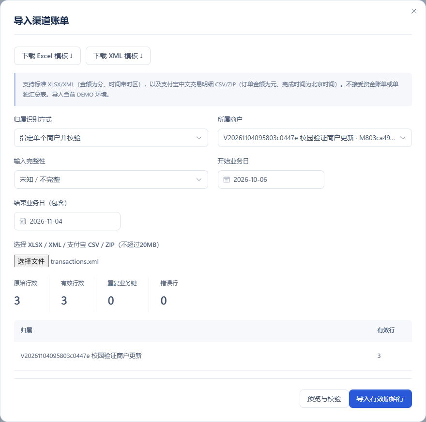

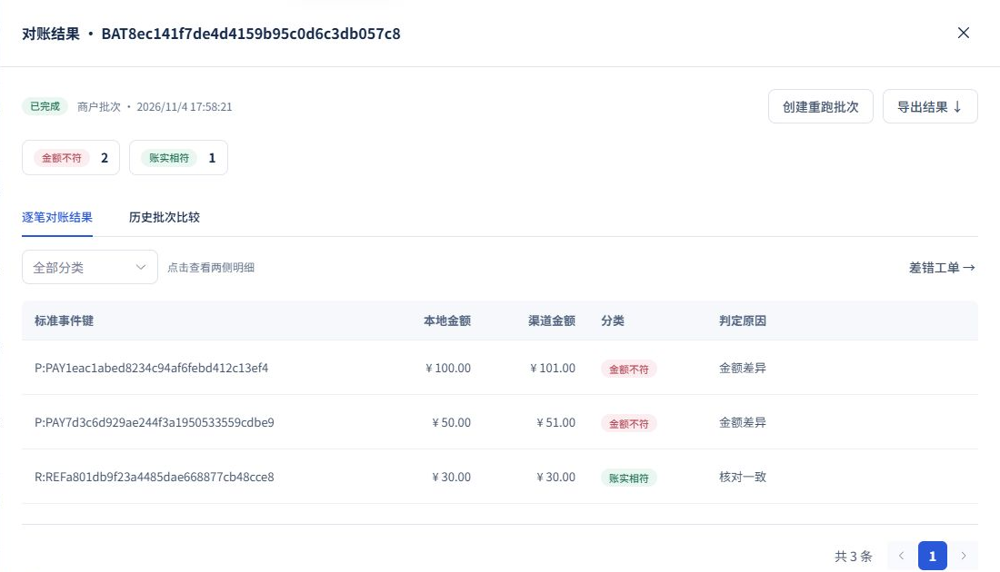

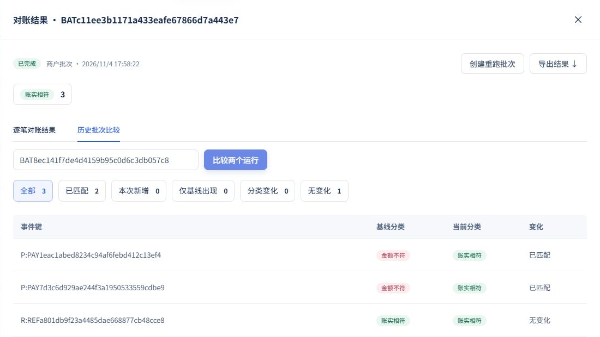

## 6.5 修订账单、工单处理与独立复核

差异发现后，导入一份新的正确账单，批次 130 得到三条 MATCHED。与批次 127 比较，两条金额差异被识别为 RESOLVED。RESOLVED 表示同一事件在新输入下已经匹配，旧批次及其结果保持不变。系统另支持对指定输入重新核对，创建引用原输入和基线的新批次，原有结果保持不变。

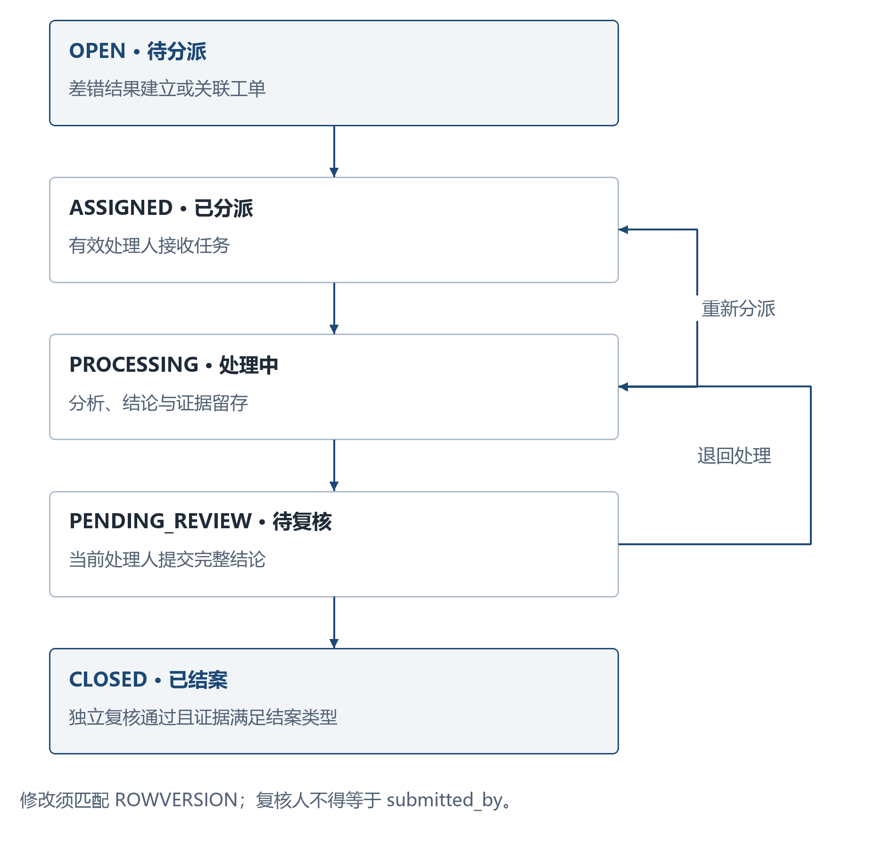

工单状态及退回分支如图6-10 所示。分派人从有效人员中选择处理人；处理人保存原因分析和处理结论，上传附件后提交复核。分派、编辑、上传、提交均将当前状态、受派人及 ROWVERSION 一并放入更新条件。使用旧版本再次分派返回 409；待复核阶段直接修改处理文本也被拒绝，从而保证复核针对的确实是已提交内容。

工单 115 的初始结果为 371，分类 AMOUNT_MISMATCH；最新结果为 381，分类 MATCHED。处理人及提交人均为用户 286，复核人为用户 287。第一次复核退回补充核实，工单回到 PROCESSING；重新提交后，复核人引用同事件的新匹配结果，以 RECONCILED 结案，最终状态为 CLOSED。数据库禁止 reviewer 与 submitted_by 相同，并核验引用证据的事件、范围与新旧关系，不能随意引用另一商户的匹配记录。

结案后，工单起因分类仍为 AMOUNT_MISMATCH，最新观察为 MATCHED，结案结果为 RECONCILED。这三个维度分别记录工单起因、最新核对结果和人员处理结论。其他结案类型包括无效输入、误报、已知例外及归属确认，但均须符合相应状态、说明或证据要求。

## 6.6 证据链与档案

工单详情从对账结果关联原批次、账单行与资金事实，再联接原订单、支付、退款、门店和商户；审计记录给出每次操作的人员、时间及前后内容。处理附件保存随机文件标识、原文件名和 SHA256，上传后的关联更新失败时清理本次文件，避免形成与工单无关的孤立附件。

档案导出将当前工单、历史操作、引用结果、关联业务记录和可授权原件打包，并在清单中标明缺失或无法验证的资料。SHA256 用于检查原件保存后是否被改变。共享账单可能包含其他商户，因此商户用户不能因自己有一行记录就下载整份跨商户原件。查询、归档和最终下载均重新校验权限。跨商户访问工单档案和下载归档的测试均被拒绝，授权复核人能取得本工单证据。

图6-11显示工单115的结案状态、最新核对与复核人员。原批次记录50/51元的金额差异，修订账单核对后两侧均为50元，详情显示这一最新匹配结果。图6-12记录复核退回、再次提交和独立结案的状态变化。图6-13沿同一工单追溯至订单267、成功支付和50元资金事实。

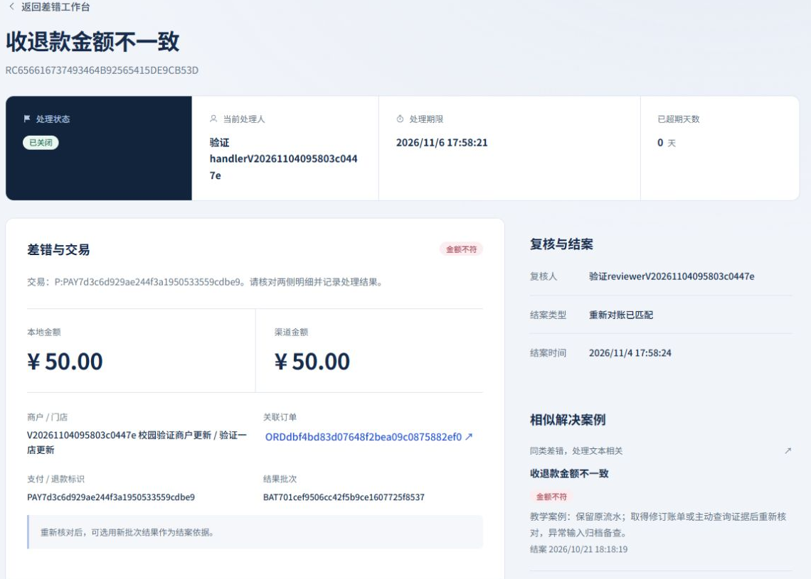

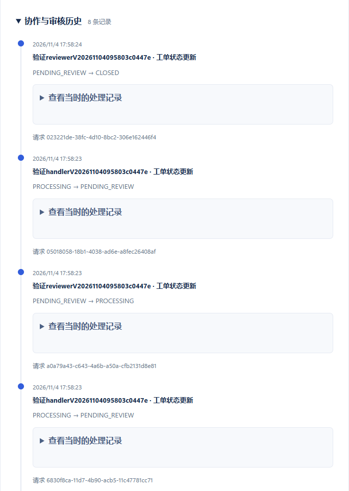

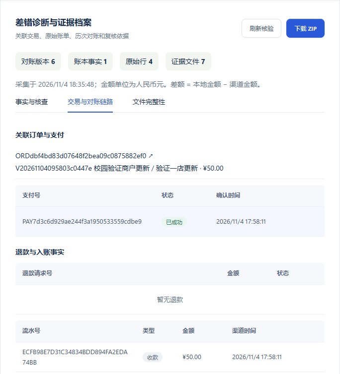

# 7 高级查询、统计分析与数据交换

## 7.1 中文全文检索与相似案例

用户从“差错工单”的“案例检索”入口进入知识检索。检索直接使用 SQL Server 的 FREETEXTTABLE，索引字段为工单标题、描述、分析和结论，语言参数为 2052。它按中文分词及相关排名检索长文本，查询结果仍受当前商户范围约束。全文组件不可用时不使用 LIKE 回退。

应用启动后单独预热中文全文组件，状态分为 WARMING、READY、UNAVAILABLE，并记录最近检查时间和耗时。未就绪时接口给出明确提示并异步重试，避免用户查询一直等待初始化；资源不足或组件异常仍可能使检索失败。查询“金额”的测试返回引擎标识 SQL_SERVER_FREETEXTTABLE，并检索到测试中新建的差错。

案例推荐只选择用户有权访问、已结案且具有处理结论的案例，排除当前工单。排序分数由同类差错 0.50、同原因 0.20、归一化全文相关度 0.30 相加，返回前五项并说明推荐原因。工单 115 结案后，能作为另一同类工单的正分推荐项。该方法采用固定权重评分，适合小规模案例库，规则可解释。

图7-1为2026年11月6日检索“修订账单”的结果，共返回17项可见的已解决案例，其中包含工单115。

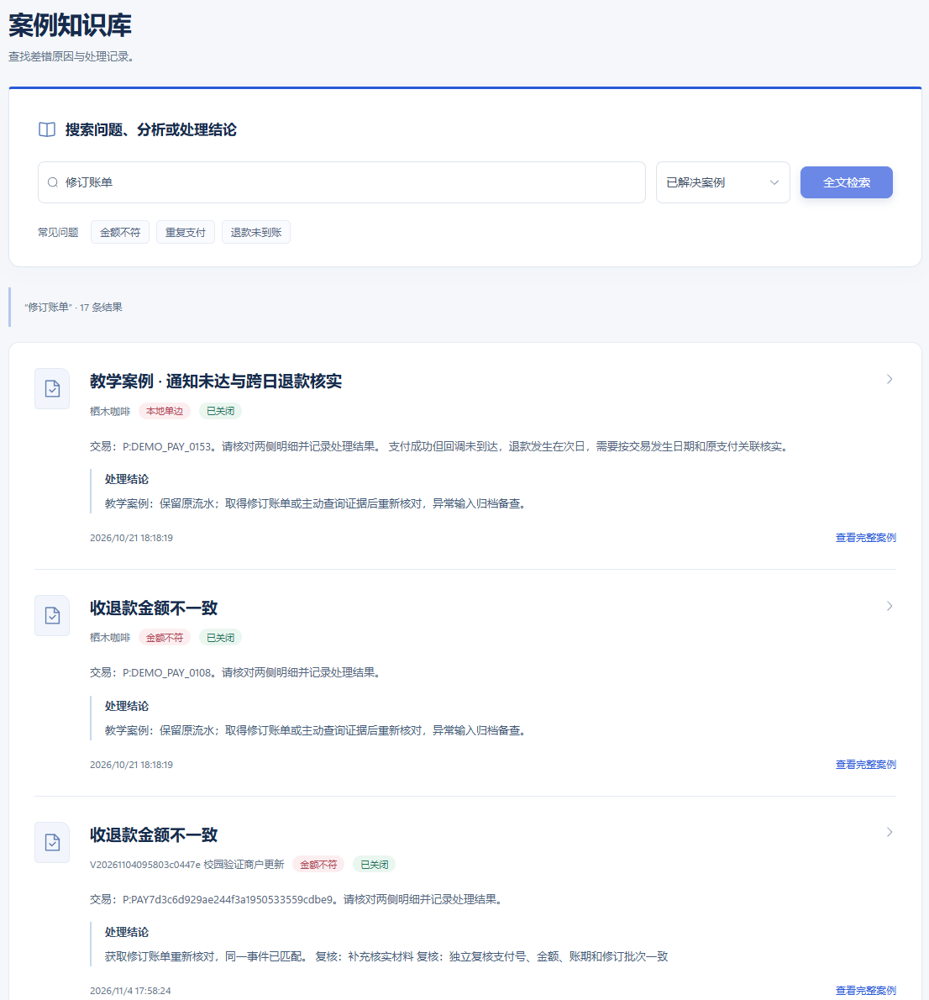

## 7.2 多粒度统计与逐级钻取

图7-2 给出统计与关联的共同路径。经营分析支持商户、门店、年、月、日五种维度。组织维度可从商户进入其门店，再查看流水；时间维度可从年进入月、日，再查看该日具体事件。钻取改变统计粒度，并保留当前权限、金额范围、期间与数据截止时点。例如，原查询为一周时，进入月份层级仍限于该周。

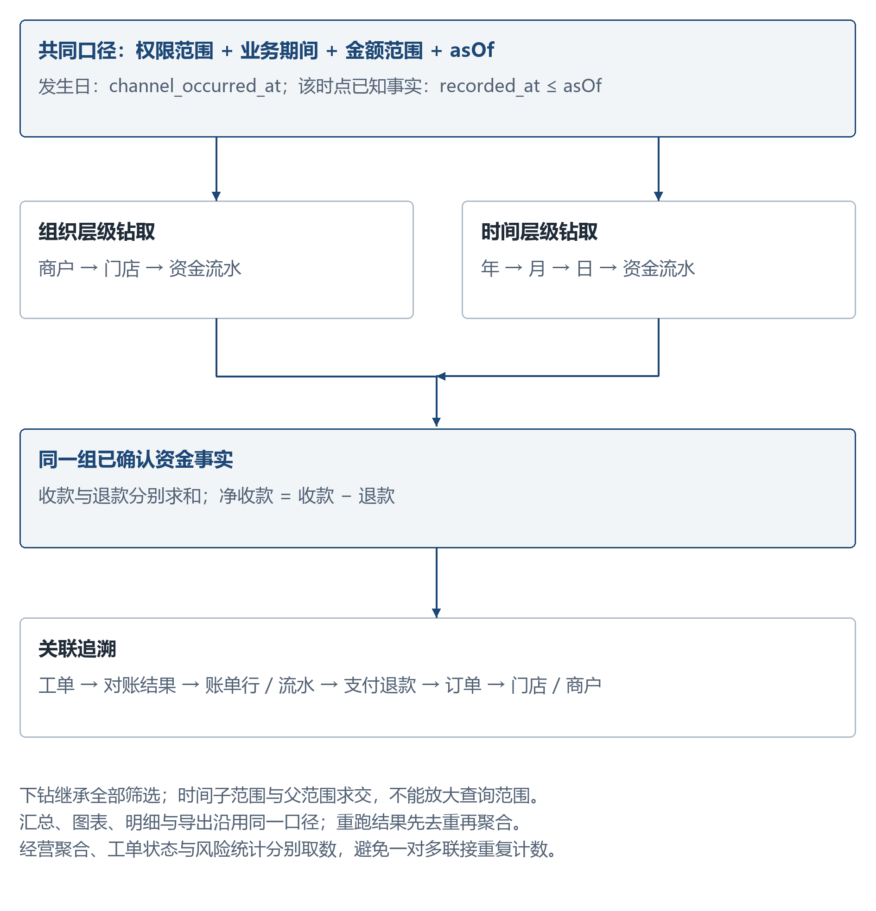

前端 drillFilters 复制父过滤器，年/月/日的子范围与父期间取交集；月底使用日历计算，处理跨年和闰年二月。后端只接受预定义维度，校验门店属于所选商户，再构造参数化查询。金额以整数分传输，大整数以字符串或 BigInt 处理，避免 JavaScript 浮点精度影响统计和比例。

商户 54 在同一期间和 asOf 下，五种分组都得到收款 15,000 分、退款 3,000 分、净额 12,000 分；门店明细共三条。将每页条数设为 1，第一页与第二页返回不同记录而总数仍为 3。页面汇总、明细、图表与导出使用同一过滤逻辑，能够逐项核算 150.00−30.00=120.00 元。

图7-3至图7-5展示同一统计范围的商户、门店和最终流水。三个资金事件分别为100元收款、50元收款和30元退款，净额始终为120元；面包屑保留钻取路径。

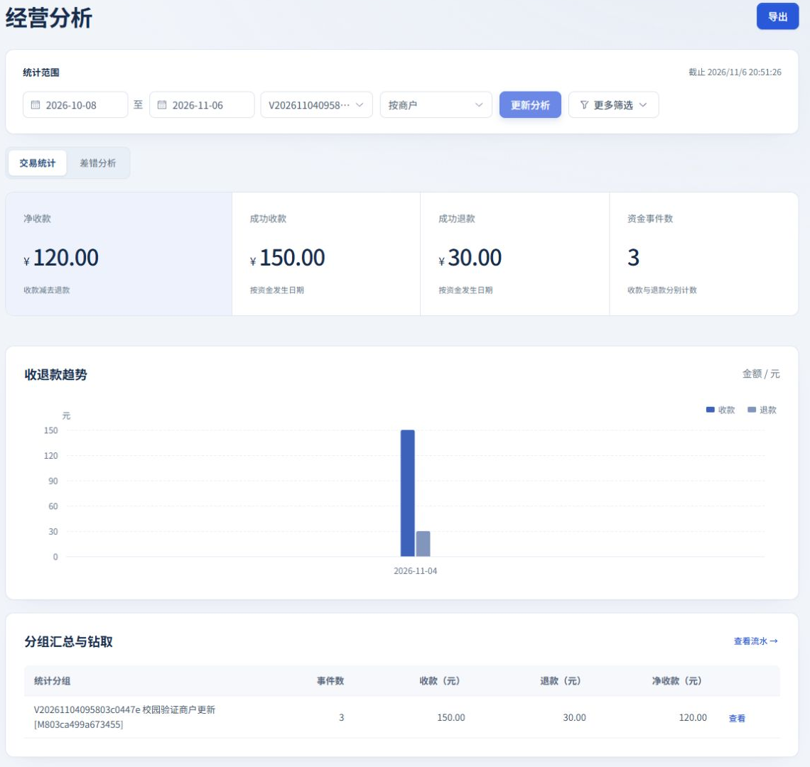

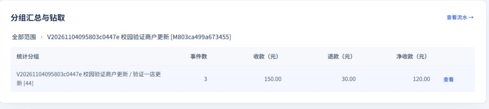

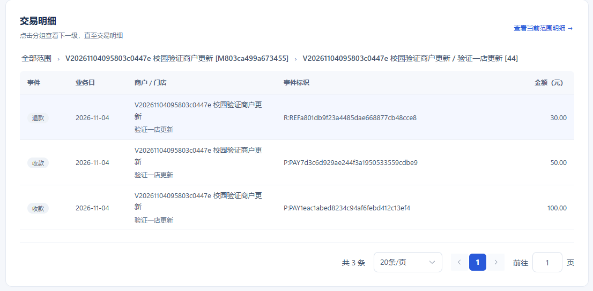

## 7.3 发生时间、获知时间与历史截面

收退款同时保存 channel_occurred_at 和 recorded_at。前者表示渠道事件发生时间，用于确定上海时区的业务日；后者表示系统确认并记录该事实的时间，用于判断某一截止时点是否已经获知。两者都采用 UTC 约定保存，查询时将业务日转为 UTC 半开区间，避免一天结束边界漏计或重复计入。

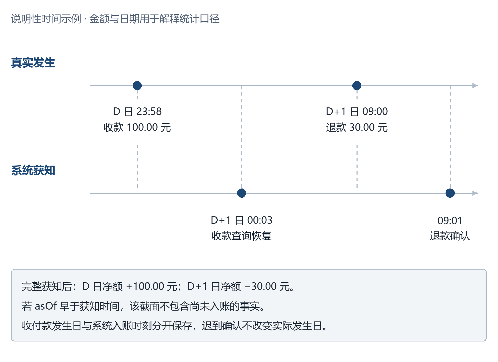

图7-6 使用明确标注的说明性示例：D 日 23:58 收款 100.00 元，系统在 D+1 日 00:03 查询确认；D+1 日又退款 30.00 元。完整获知后，D 日净额为 100.00 元，D+1 日为−30.00 元。收款不能因为系统在次日得知就改变实际发生日；如果查询 asOf 早于确认时刻，该历史截面又不能包含当时尚未入账的事实。

迟到确认可能使同一历史期间的当前报表与当时截面出现差异。对账批次保存 observed_at 和独立结果，可解释“当时为什么出现渠道单边记录、后续何时匹配”。工单历史状态从审计快照恢复，缺少完整历史时标记 HISTORY_UNAVAILABLE。

## 7.4 差错关联统计与运营风险

数据关联既体现在详情追溯，也体现在统计查询。资金事实经支付或退款回到订单，再经门店找到商户；差错则连接其原始及最新对账结果，取得渠道金额、本地金额和相关业务。由一条金额差异即可定位所属门店、原订单和资金流。

同一交易可能多次核对，也可能关联不同工单。如果把流水、所有历史结果和工单直接连接后求和，金额会随联接行数放大。系统先选择有效观察并去重，再分别聚合事件与工单。经营分析中的“差错分析”展示有效差异事件、待处理金额、未结案与超时、账龄、结案时长中位数和 P95 等指标，提供对应明细。

修订账单后，最新账单差异事件数为 0，但仍有未人工结案的工单。最新核对结果反映账目匹配情况，工单状态反映协作手续是否完成。比例指标在分母为零时显示“—”；无法可靠计算金额的差错单独标记不确定数量，不以零金额掩盖信息缺口。

## 7.5 自动获取与可靠任务

自动采集包括支付/退款查询和账单任务。账单任务从“账单与对账”的“自动对账”入口进入；其他具备查看权限的角色通过“渠道状态”查看相应信息。平台财务可按已结束账期创建账单获取任务，任务键由环境、应用和业务日期确定；重复提交复用同一任务。启用每日任务后按上海时间 10:00 获取前日账单。任务状态、尝试次数、租约、原件和各商户子批次持久化在 reconciliation_batch，进程退出后仍可判断未完成工作。

执行前重新核验当前授权执行者的权限；下载采用允许地址、HTTPS、公共地址检查、无重定向和容量/时间限制。失败最多尝试四次，成功子批次保留，重试不重做已完成核对。账单原件被改动时散列校验失败，任务不能继续使用该文件。

非DEMO任务识别出账单模板后，以 TEMPLATE_ONLY 结束，保留原件，不产生交易账单行、对账结果和差错。任务调度和下载校验已经实现，业务日账单核对需要渠道提供含实际业务数据的账单。自动任务与沙箱账单的测试结果见第9.4节。

## 7.6 Excel、XML 与分析报告

数据交换支持商户和账单的 XLSX/XML 导入，交易及对账结果的 XLSX/XML 导出；交易统计另可生成 PDF 和 Word。PDF/Word 报告包含环境、期间、访问范围、金额范围、截止时点、维度、汇总、分组图和完整结果表。商户或对账结果不能选择 PDF/Word，接口会明确拒绝不支持的组合。

四格式交易导出测试中，下载字节与声明 SHA256 均一致；XLSX 和 XML 各包含三条资金事件，重新导入并核对均为三条 MATCHED。Word 包含实际图像和分组表，PDF 校验中文、金额及页内图像。数据往返后，业务键与金额保持一致。导出路径绑定创建人和权限范围，成员权限变化后再次下载仍需重新授权。

# 8 安全设计、外模式与审计

## 8.1 身份认证与职责划分

系统采用平台身份与商户成员关系两层授权。平台身份为 MEMBER、PLATFORM_FINANCE、ADMIN、AUDITOR；商户成员角色为 OWNER、CASHIER、FINANCE、REVIEWER。消费者使用 MEMBER 平台身份，通过本人订单关系访问数据。角色和商户范围须同时满足，不能只检查用户已经登录。

表8-1 角色授权与操作限制

| 身份 | 主要授权范围 | 关键限制 |
|---|---|---|
| 消费者 MEMBER | 本人订单、付款、退款申请 | 不能审核本人申请或读取其他消费者订单 |
| OWNER | 所属商户资料、成员、交易与协作 | 审批和复核仍须满足人员分离 |
| CASHIER | 所属商户开单、收款及受派工单 | 无退款审批和独立复核权限 |
| FINANCE | 所属商户退款审批、账单、派单与分析 | 新建订单接口不因“财务”身份自动开放 |
| REVIEWER | 所属商户工单复核及关联查看 | 不能复核自己提交的工单 |
| PLATFORM_FINANCE | 跨商户财务、未知归属处理、自动任务 | 仍受状态、版本和额度约束 |
| ADMIN | 账号、角色、商户审核与审计 | 不默认办理收退款，财务统计另有限制 |
| AUDITOR | 跨商户只读及日志查询 | 不得同步或变更支付、执行业务审批 |

权限以具体接口的校验规则为准。当前预下单接口依据订单可读范围并禁止 ADMIN/AUDITOR，未单独排除商户 REVIEWER。

注册账户先进入待审核状态，密码用 BCrypt 散列保存。登录校验有效状态并更换会话标识，退出使会话失效。每次 API 请求重新加载当前用户状态和角色，因此账号停用后旧会话也会被拒绝。浏览器业务请求使用 CSRF 令牌，支付宝外部回调作为单独入口采用签名及业务参数校验。

图8-1为当前登录入口。用户可通过“注册账号”进入申请表单，提交后仍须经管理员审核方可登录。


## 8.2 外模式与行范围

v_order 汇总订单金额和商户归属，v_transaction_fact 统一收退款与业务日期，v_case 提供工单起因、最新观察和人员关系，这些视图被实际业务查询使用。v_case_matched_evidence 和 v_case_attribution_evidence 则限定可用于结案的匹配和归属证据，减少各模块重复编写容易漂移的条件。

数据库还部署 v_consumer_order、v_merchant_transaction、v_case_search 等会话限定视图。当前主要 Java 查询使用 Access 生成权限谓词，例如普通成员只查询有效 merchant_member 覆盖的商户，订单另允许 consumer_id 为当前用户。

MyBatis 插件在实际连接上设置 user_id、role、merchant_id、request_id，执行结束后清空，支持外模式和审计触发器并避免连接池串用上下文。实际数据库没有 SQL Server 行级安全策略，运行角色具有 dbo 范围 SELECT 权限。因此用户级隔离的主要执行点是 Spring 认证、Access 动作权限和查询范围；这一边界要求所有新接口继续接受跨商户回归检查。

## 8.3 数据库权限与不可变事实

应用运行角色只取得已列出的表操作和业务过程执行权限，资金确认通过存储过程完成，不开放直接插入 transaction_entry 的普通业务路径。审计数据库角色限定读取相关摘要视图。SQL Server 管理账户用于数据库管理，应用业务角色按授予权限执行操作。

资金流水、原始账单行、历史核对结果和审计日志由触发器限制更新、删除，防止通过常规 DML 覆盖历史。订单明细冻结、工单提交与结案保护、源键唯一性构成进一步约束。应用层负责给出清楚的操作提示，数据库层负责在绕过页面或请求并发时继续守住核心事实。

## 8.4 访问日志、业务审计与文件安全

请求进入时生成 requestId，响应携带 X-Request-Id；访问日志记录方法、路径、人员、商户、HTTP 结果和时间。身份行为另记 AUTH，关键数据变化由业务记录与触发器保存前后快照。管理员及审计人员可按人员、类型、结果、时间和关键词检索，并查看分类、人员及结果统计。出现错误时，可凭请求编号联接页面提示、应用日志与数据库操作。

图8-2展示管理员的访问与操作审计。查询条件和动作结果支持进一步追踪，请求编号保存在审计明细中。

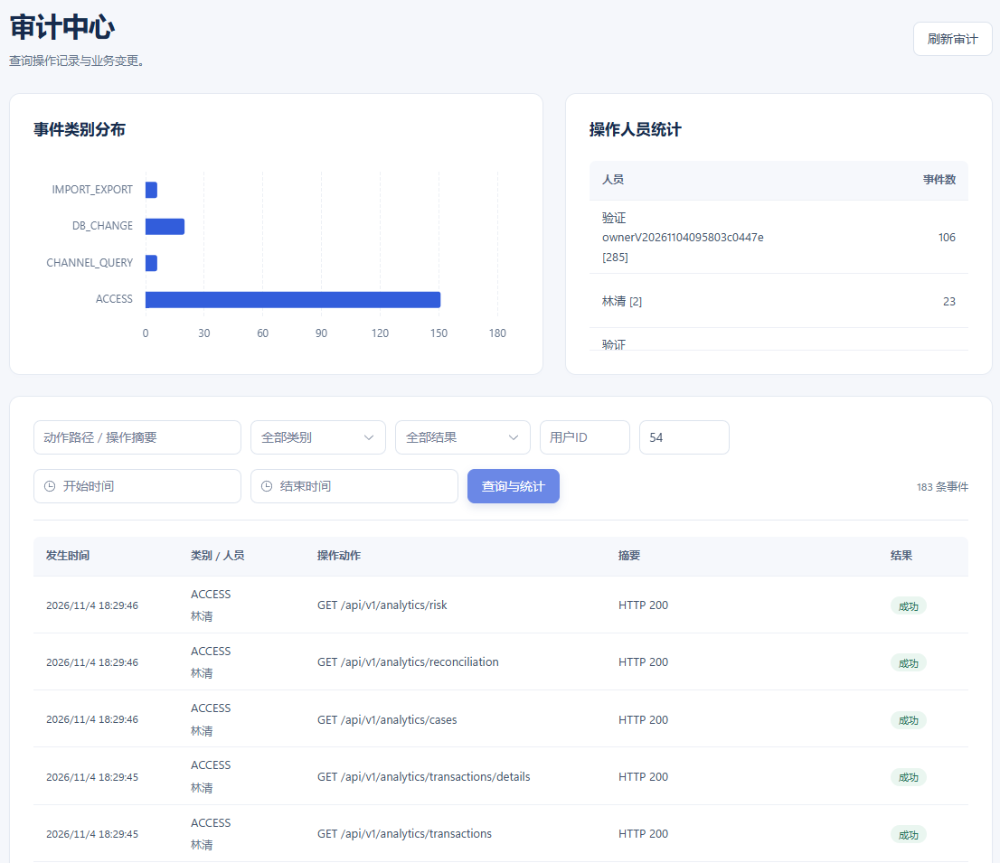

文件存放在环境独立目录，以随机标识引用；路径解析后必须位于允许根目录。附件限非空、允许扩展名和大小，并记录 SHA256。导出和档案下载重新检查角色及商户关系，不因文件此前生成成功就永久允许访问。数据库故障期间审计写入可能失败，应用会记录警告。

本地部署的 HTTP Cookie secure 默认关闭，数据库连接信任本地证书。公网部署所需的证书、密钥管理和运行权限调整见第3.3节与第11.3节。


# 9 测试与结果分析

## 9.1 测试环境与方法

集中测试以收款、退款、账单核对和差错结案为主线，检查业务结果的一致性与可追溯性[6]。测试同时检查接口响应和数据库中的金额、状态、关联记录及审计信息，并通过越权、重复请求、陈旧版本及事务故障等反例检查业务边界。

表9-1列出实际环境。后端数据库测试使用该发布版本的源码快照；HTTP和浏览器测试连接本机8080端口的运行服务。测试结束后健康状态仍为UP，发布标识和构建源指纹未变化。

表9-1 测试环境

| 项目 | 配置 |
|---|---|
| 测试日期与版本 | 2026年11月4日17:55至18:04；homepage-redesign-20261104-r1 |
| 操作系统与内存 | Windows 11，构建26200；物理内存约15.78 GiB，测试开始时空闲约1.98 GiB |
| Java环境 | 实际运行Java 24.0.2；项目编译目标Java 21 |
| 前端与浏览器工具 | Node.js 24.11.0；Node内置测试运行器；Playwright 1.64.1、Chromium |
| 数据库 | SQL Server 16.0.4305.5；服务器内存上限2048 MB |
| 规模实验配置 | 独立临时数据库，MAXDOP=2；2个商户、10个门店 |
| 页面尺寸 | 业务访问覆盖1440px和390px；首页布局另覆盖1280px，键盘检查覆盖320px |

验证分为五层：前端逻辑测试检查钻取范围和金额计算；后端JUnit测试检查服务逻辑、数据库约束与事务；HTTP流程检查真实接口和持久化结果；浏览器测试完成多角色操作；独立数据库实验观察数据规模扩大后的正确性与查询成本。数据库用例运行于临时库，实验结束后清理；业务测试使用唯一前缀的DEMO数据，结束后停用测试账户并保留账务与审计记录。

执行入口分别为 `node --test tests/*.test.mjs`、`test-database.ps1 -AllTests`、`verify-business-flow.ps1`、`verify-browser.ps1` 和 `verify-performance.ps1 -Sizes 10000,100000`。

## 9.2 测试统计与代表性用例

表9-2按层次统计集中测试结果。“项”表示测试框架用例，“组”表示连续业务场景，“次”表示页面访问。后端190项包含72项数据库测试；11项浏览器测试共完成83次页面访问。

表9-2 2026年11月4日集中测试结果

| 层次 | 规模 | 通过 | 失败/错误 | 跳过 |
|---|---:|---:|---:|---:|
| 前端逻辑 | 5项 | 5 | 0 | 0 |
| 后端JUnit | 190项 | 190 | 0 | 0 |
| 其中实库测试 | 72项，属于上述190项 | 72 | 0 | 0 |
| HTTP业务流程 | 26组 | 26 | 0 | 0 |
| 浏览器自动化 | 11项 | 11 | 0 | 0 |
| 规模实验 | 2档，每档13个测量 | 26个测量及数据断言 | 0 | 0 |

浏览器覆盖管理员、财务、审计、商户负责人、经办人、复核人、消费者和无关成员八种身份视角。这些视角由平台角色与商户成员关系组合形成。73次桌面访问与10次手机宽度访问均通过。七个HTTP测试账户、八个浏览器测试账户均已停用。

表9-3选取20个代表用例，正常流程与拒绝分支均以预期行为为判断依据。例如越权访问预期返回403，响应符合预期时判定用例通过。

表9-3 代表性用例、预期与实际结果

| 编号 | 输入或操作 | 预期结果 | 实际结果 | 结论 |
|---|---|---|---|---|
| T01 | 匿名读取订单，普通成员访问用户管理 | 拒绝未认证或无权限请求 | 返回401/403，未获得业务数据 | 通过 |
| T02 | 未审核账户登录；审核通过后登录；管理员停用 | 审核前不可用，停用后会话失效 | 前者403，审核后成功，停用后立即拒绝访问 | 通过 |
| T03 | 支付100元、50元；重复通知，模拟通知丢失后查询 | 每笔仅记一次收款，查询可恢复结果 | 两笔成功，只有两条收款事实 | 通过 |
| T04 | 提交无效RSA2签名通知 | 拒绝无效签名通知 | 返回纯文本failure，账务及支付状态不变 | 通过 |
| T05 | 退款30元，重复申请与同步 | 复用退款对象，不重复扣减 | 退款67成功，唯一退款事实，可退70元 | 通过 |
| T06 | 再申请70.01元并审批；申请人自审；消费者审核 | 禁止超退、自审和越权 | 前两者409，消费者审核403 | 通过 |
| T07 | 回调与查询并发，退款并发审批 | 收款唯一，退款预占不超过已付 | 独立连接并发断言通过 | 通过 |
| T08 | 账务写入失败或事务进程退出 | 状态回滚，后续可以恢复 | 支付与订单未部分提交，恢复操作成功 | 通过 |
| T09 | 预览三条账单并重复导入 | 校验通过，同文件复用批次 | 有效3行、错误0行，批次125三条MATCHED | 通过 |
| T10 | 两笔渠道收款各增加1元 | 识别金额差异并生成工单 | 批次127两条AMOUNT_MISMATCH、两张工单 | 通过 |
| T11 | 导入声明完整的空账单 | 识别本地存在而渠道缺失的事实 | 三条LOCAL_ONLY，未误判为全部一致 | 通过 |
| T12 | 平台导入归属不明记录，普通商户读取 | 隔离记录，禁止跨归属访问 | 标记为平台未归属；商户访问返回403/404 | 通过 |
| T13 | 导入修订账单，比较前后批次 | 差异消除且历史保留 | 批次130三条MATCHED，比较结果两条RESOLVED | 通过 |
| T14 | 分派、提交、退回、再提交、独立复核 | 状态按流程推进，保留处理证据 | 工单115最终CLOSED，原差异分类未改写 | 通过 |
| T15 | 旧版本分派、自审、跨商户证据、修改已提交内容 | 拒绝陈旧或不合法操作 | 409/403及数据库保护断言通过 | 通过 |
| T16 | 固定账期与asOf，切换商户、门店、年月日 | 金额一致，历史不泄漏未来变化 | 收款150元、退款30元、净额120元 | 通过 |
| T17 | 全文查询“金额”并推荐相似已结案工单 | 使用原生全文引擎，命中新记录 | 引擎为SQL_SERVER_FREETEXTTABLE，命中且推荐分大于0 | 通过 |
| T18 | 导出四种格式、下载证据ZIP、外商户访问 | 文件内容有效，原件可校验，越权被拒 | 格式、内容及哈希通过；档案隔离有效 | 通过 |
| T19 | 重复触发同账期自动任务，非授权人触发或读取 | 任务幂等，权限明确 | 复用成功任务103；越权403 | 通过 |
| T20 | 公开首页、登录、保护路由、跨标签会话和窄屏交互 | 跳转正确，内容可读，焦点操作有效 | 首页6项与角色业务5项通过，无横向溢出 | 通过 |

HTTP流程记录号为 `V20261104095803c0447e`。其中订单266、267及退款67构成150元收款、30元退款的可复核样本。工单115的原结果371仍为金额不符，最新结果381为匹配；结案采用新证据并经过独立复核，经办人为286，复核人为287。前端五项测试还覆盖闰年月份、父子时间范围交集和超大金额百分比，防止钻取时扩大口径或损失精度。

后端逐例记录为 `backend-test-results.json`，并发与回滚可追溯至 `FinancialConcurrencyDatabaseTest`，查询取消及连接可用性见 `DbDatabaseTest`，工单保护见 `CaseWorkflowDatabaseTest`。浏览器记录为 `browser-results.json`，业务断言见同运行号JSON。上述2026年11月4日测试记录位于 `artifacts/report-validation-20261104`。

## 9.3 规模实验与查询结果分析

规模实验先生成1万笔流水，再累计至10万笔，两商户各占一半。每档将2%的渠道记录设置为金额不符，分别执行对账、聚合、分页和全文查询，并采集STATISTICS IO/TIME及实际执行计划。1万档每商户发现100条金额差异，10万档每商户发现1000条；独立逐笔计算的收款总额分别为50,005,100分、500,501,000分，与数据库汇总一致。两档全文查询使用的工单数量分别为200、2000。

表9-4 规模实验耗时（毫秒）

| 操作 | 1万流水档 | 10万流水档 |
|---|---:|---:|
| 商户1对账 | 2397.977 | 15574.102 |
| 商户2对账 | 2385.127 | 20226.653 |
| 商户1门店聚合 | 233.658 | 843.120 |
| 商户2门店聚合 | 95.818 | 507.310 |
| 商户1分页，跳过100条取20条 | 142.116 | 145.344 |
| 商户2分页，跳过100条取20条 | 81.736 | 16.681 |
| 全文首次查询，最多30条 | 134.226 | 180.994 |
| 同条件重复全文查询 | 28.641 | 115.042 |

表9-4记录从客户端发起执行到读完结果的总耗时，包含实际执行计划和STATISTICS IO/TIME的采集开销。每次对账处理单个商户，10万流水档中每个商户各处理5万笔，耗时约15.6至20.2秒。批量写入和约束检查成本较高，处理时需要向用户呈现任务状态。

实际计划显示，门店聚合使用 `IX_order_store_time`、`IX_payment_order` 等索引，同时包含扫描、连接和聚合。10万档商户1分页虽然只返回20行，对transaction_entry的逻辑读仍达11,370页，说明关联权限过滤及排序具有成本，后续可研究更合适的访问路径或游标分页。全文查询还需关联批次、结果和权限信息，两个规模档位的查询均在超时前完成。

原始读数见 `performance-results.json`，实际计划见 `performance-20261104-180224`。实验采用顺序单次测量，保留数据库原有缓存；表中的“首次”指同条件查询的第一次执行。实验未重复多轮、施加并发压力或进行删除索引的同期对照。结果反映给定环境中的单次处理成本，吞吐率、P95与索引提速倍数尚未测量。

## 9.4 支付渠道证据与验证边界

2026年11月4日的HTTP及浏览器收退流程均使用DEMO。异步通知测试覆盖本地处理逻辑中的签名反例、幂等与并发；支付失败提示通过只读响应注入检查页面呈现。

2026年10月22日11:46:40的支付宝沙箱联调中，付款1分、退款1分均成功，系统各保存一条收款和退款事实，净额与可退金额为0，重复退款请求未新增资金事实，结果通过ACTIVE_QUERY主动查询确认[7]。这组历史交易单独记录于 `alipay-sandbox-verification-20261022.json`。该次下载的1017字节ZIP通过哈希校验，内容为账单模板，账单行与对账结果均为0。

自动账单任务103于11月4日00:09已成功；17:58重复触发时复用原任务，没有再次下载账单。该用例检查幂等、原件校验和权限隔离。任务领取、失败恢复和租约处理由数据库集成测试验证。

DEMO收退流程和已列出的沙箱收退款测试均达到预期。生产支付、公网异步回调闭环、真实支付宝业务日账单完整对账，以及多用户长期压力、真实手机和跨浏览器兼容仍未验证。

## 9.5 最终界面版本回归

2026年11月6日完成 category-artwork-20261106-r2 的构建与回归[8]，结果见表9-5。72项数据库专项测试未启用；规模实验和支付宝沙箱联调沿用第9.3、9.4节所列日期的记录。

表9-5 2026年11月6日最终界面版本回归结果

| 层次 | 发现用例 | 通过 | 失败/错误 | 跳过 |
|---|---:|---:|---:|---:|
| 前端逻辑 | 9项 | 9 | 0 | 0 |
| 后端JUnit | 190项 | 118 | 0 | 72 |
| 浏览器自动化 | 11项 | 11 | 0 | 0 |

前端测试覆盖原有金额和钻取逻辑，以及分类插画对明确主题、宽泛类别、缺失信息和未知商户的处理。

浏览器自动化覆盖公开页与登录路由、八种身份视角、订单收款、独立退款审批、差错分派与复核、账单核对、分析钻取及检索。另在1440、1280和390像素宽度下检查实际页面，核验订单图文条目、详情、商户卡片、退款与工作台布局，并验证筛选、弹窗开关和减少动态效果模式。商户抽屉关闭时的空对象报错已修复，复测标签切换、反复开关和页面跳转后未出现新报错。

回归结束后服务健康状态为UP。测试日志、版本清单与页面验收记录见附件 `evidence/20261106`。


# 10 设计调整与实践总结

## 10.1 从初期方案到最终实现

初期方案已确定Java、Vue和SQL Server的技术方向，也规划了15张表、跨日收退款、对账协作、全文检索和统计钻取。开发过程中，这些功能逐步细化为数据库约束、持久状态和对应测试，主要调整及原因见表10-1。

表10-1 主要设计细化及原因

| 初期关注点 | 最终落实 | 调整原因 |
| --- | --- | --- |
| 重复请求不重复入账 | UUID、稳定渠道业务号、资金源唯一键、短事务锁、租约与令牌 | 重复点击、并发恢复和迟到响应发生在不同层，单一按钮禁用不能覆盖 |
| 自动获取账单 | 数据库持久任务、限时下载、重试、子批次复用、TEMPLATE_ONLY | 下载后还需校验内容；识别出的模板文件保留原件并结束任务 |
| 多维统计与钻取 | 发生日与记录时点分离、asOf截面、父子范围求交、重跑去重 | 同一金额在不同粒度下守恒；后到事实按实际记录时点进入历史截面 |
| 留存处理证据 | 原件散列、审计前后值、独立复核引用、权限内档案导出 | 人工结论需要事实支撑，共享文件不能向单商户泄露其他数据 |
| 差错闭环 | 原始差异、最新结果与人工结案状态分别保存 | 工单关闭不能改写当时观察到的差异 |
| 业务界面 | 公开首页、角色工作台、分类插画、移动布局和统一操作反馈 | 通过信息层级与图文识别辅助浏览，保持金额、状态和原有业务路径 |

## 10.2 问题定位、处理与效果

支付预下单超时后，渠道可能已收到请求，本地尚未取得结果。如果立即创建新支付号，既无法查询原请求，也可能造成重复收款。系统持久保存UNKNOWN和原交易号，再通过主动查询恢复。租约防止多个恢复线程同时派发，随机令牌限制迟到响应的写入资格，终态条件防止成功被覆盖。针对性测试覆盖了这些竞争条件，DEMO业务测试也确认主动查询能够补全丢失通知后的支付状态。

中文全文检索在首次初始化或内存紧张时出现过长等待。排查涉及SQL Server全文组件、分词器初始化和应用请求超时。系统增加异步预热、READY/WARMING/UNAVAILABLE状态和失败后的重试，使检索就绪情况可观察。2026年11月4日的测试中，新写入案例能够被FREETEXTTABLE检索，独立规模实验记录了对应耗时；低内存环境下仍可能超时。

渠道账单联调下载的ZIP散列一致，解析后识别为模板。模板记录不符合业务账单的核对条件。系统在非DEMO自动下载流程中保留原件和解析结果，以TEMPLATE_ONLY结束任务，不生成账单行或业务差错。

统计需要处理两类问题：钻取到月份时可能扩大原先只选一周的范围；资金流水联接多条工单后，可能重复累计同一金额。处理方法是取父子日期交集、共享asOf，并分别聚合资金、差错和工单。测试中，150元收款、30元退款与120元净额在商户、门店和明细层保持一致。

多人协作中的覆盖问题发生在保存、改派、上传和复核之间。操作同时检查受派人、状态和ROWVERSION，旧版本冲突返回409，失败上传清理新文件。数据库复核过程还检查submitted_by，结合实际提交人与当前assignee判断职责分离，使改派后的复核仍受约束。

界面验收还发现商户抽屉关闭后仍访问已清空选择对象的问题。修复时对空选择增加保护，并以请求版本和当前商户校验异步返回结果，避免关闭或切换商户后旧数据重新写入页面。操作同时固定发起时的商户，防止确认过程中切换选择影响后续请求。重新打开、切换标签、关闭和离开页面后未出现同类报错。

## 10.3 数据库与工程实践收获

首先，数据模型必须区分对象和事实。订单描述交易意图，支付尝试描述渠道交互，资金流水描述确认结果，账单行描述外部输入，工单描述人员处理。将这些概念合并在单表中虽然少写几次联接，却容易用一个状态覆盖不同时间的事实。分离模型后，跨日退款、第二笔真实收款和历史批次都能够得到正确表达。

其次，范式与一致性需要结合业务讨论。把名称从订单中拆到商户和门店，可避免重复更新；事件键、原始文件散列和观察时点用于溯源，有保留的必要。有意冗余的金额和标识需要确定的写入入口与校验，第4.4节结合实际函数依赖说明了这些设计。

第三，应用事务与外部调用之间必须有清楚边界。本地事务适合完成额度预留和多表入账；等待支付渠道时持锁会拉长阻塞。网络交互放在事务外后，系统需要持久保存中间状态，通过原请求号、唯一键和查询补偿完成恢复。

第四，查询测试需要检查业务不变量。对账保留单边记录，风险统计防止连接倍增，全文检索遵守权限范围，钻取继承父过滤器，报表记录截止时点。这些条件为构造测试数据和判定预期结果提供了依据。

最后，前后端协作需要统一接口中的金额单位、ID类型、状态码和错误语义。Long以字符串传到浏览器、金额以整数分计算、409代表陈旧版本、503代表检索未就绪，都能减少接口两端的隐含假设。构建快照、测试日志和可复现样本则让出现问题时有共同讨论的依据。

# 11 小组分工与系统局限

## 11.1 小组职责与协作

小组由王梓豪、吕世英、朱晓天三人组成，按端到端业务模块划分成果责任，每人承担三分之一。各成员负责所属模块的数据结构、接口与页面、异常分支和对应测试说明，并共同完成跨模块联调、报告校核与最终验收。表11-1列出小组约定的职责及责任份额。

表11-1 成员职责与成果责任份额

| 成员 | 学号 | 独立负责内容 | 共同工作与份额 |
| --- | --- | --- | --- |
| 王梓豪 | 24373342 | 身份与商户门店成员、订单及明细；公共页面和工作台；角色入口与访问范围；经营分析页面及钻取交互 | 对应数据设计、代码、测试和章节整理；参与联调、交叉检查与终稿复核；1/3 |
| 吕世英 | 24373352 | 支付适配、通知与主动查询、退款审批与额度控制、资金流水；渠道异常恢复；统计口径及交易报表导出 | 对应数据设计、代码、测试和章节整理；参与联调、交叉检查与终稿复核；1/3 |
| 朱晓天 | 24373340 | 账单导入与自动任务、逐笔对账及批次比较；差错分派与独立复核、证据档案；全文检索、案例推荐和审计查询 | 对应数据设计、代码、测试和章节整理；参与联调、交叉检查与终稿复核；1/3 |

协作以业务交接点为检查单位：订单提交后支付模块接收确定金额；资金确认后对账模块读取已保存的资金事实；对账结果进入工单时保留原始分类；复核结案引用明确证据；分析与导出使用同一范围和金额口径。每个交接点都检查正常输入、重复输入和拒绝条件。

## 11.2 现有限制

系统在本地教学环境验证，支付渠道的验证范围见第9.4节。多商户真实支付宝入驻尚未完成。

用户级隔离依赖第8.2节所述的应用层检查。复核员仍具有预下单等接口能力，后续需要进一步细化授权。

文件安全采用扩展名白名单、随机路径、大小限制、范围校验和SHA256。SHA256用于核对留存文件的字节一致性，业务内容的真实性不在该校验范围内；系统尚未实现恶意文件扫描。证据档案存在每类500条、单文件20MB、总归档80MB的上限，缺失或超限由清单说明。

性能实验采用单机环境，测量条件见第9.3节。10万条流水中，每商户5万条的对账耗时约15.6—20.2秒，后续需要研究索引覆盖、集合运算代价、任务拆分和资源配置。持续高并发、多实例故障切换、备份恢复时限及生产可用性指标尚未验证。

## 11.3 后续改进方向

下一阶段可优先完成真实签名通知和真实业务账单的端到端测试，随后完善复核角色的细粒度接口能力、文件内容鉴别与恶意内容扫描，并在固定数据和资源条件下进行并发及故障注入实验。数据库方面可结合实际执行计划优化大批次核对，增加备份恢复演练；检索方面可针对中文分词与领域词建立人工评估集，评价推荐效果。

系统已完成教学环境中的收退款、对账和差错协作流程。资金变化、核对结果和人员结论分别保存来源、状态与证据，为历史查询、复核和后续改进提供依据。

# 参考文献

[1] 数据库课程设计指导手册2021. 课程教学资料，2021.

[2] Reconis项目组. Reconis 项目源程序与数据库脚本[CP/OL]. https://github.com/floatingmist828-eng/Reconis，2026-11-06最终工作区版本，发布快照见附录C.

[3] Microsoft. rowversion (Transact-SQL)[EB/OL]. https://learn.microsoft.com/en-us/sql/t-sql/data-types/rowversion-transact-sql，访问日期2026-11-04.

[4] Microsoft. SET TRANSACTION ISOLATION LEVEL (Transact-SQL)[EB/OL]. https://learn.microsoft.com/en-us/sql/t-sql/statements/set-transaction-isolation-level-transact-sql，访问日期2026-11-04.

[5] Alipay. Alipay SDK for Java[CP/OL]. https://github.com/alipay/alipay-sdk-java-all，访问日期2026-11-04.

[6] Reconis小组. 2026-11-04实现、数据库及测试证据. 报告附件evidence/20261104；项目artifacts/report-validation-20261104.

[7] Reconis小组. 支付宝沙箱联调记录，2026-10-22. artifacts/validation/alipay-sandbox-verification-20261022.json.

[8] Reconis小组. 最终界面版本构建与回归记录，2026-11-06. 报告附件evidence/20261106，含test-summary.json、build-r2.log、browser-r2.log及visual-check.json；原始项目路径与文件散列见同目录证据清单.


# 附录A 完整字段字典

本附录列出最终数据库的15张表和207个字段。两套运行数据库结构一致。所有表均以 id 为 BIGINT IDENTITY 主键；字符串长度按字符数列示，NVARCHAR(MAX) 为可变长Unicode文本，ROWVERSION 为8字节自动版本标记。金额单位均为分，DATETIME2(3) 按UTC约定保存。

“非空／可空”对应列的 NULL 属性；PK 表示主键，UQ 表示单列唯一约束，UK 表示组合唯一约束中的一列，FK 表示外键。组合唯一约束要求所列字段的组合值唯一。各表下列出完整的唯一约束与外键，全部32个外键的更新和删除动作均为 NO_ACTION。筛选唯一索引另见附录B。

## A.1 用户账号（app_user）

表A-1 用户账号字段字典

| 字段 | 类型 | 空值与键 | 含义 |
|---|---|---|---|
| id | BIGINT | 非空；PK | 账号主键 |
| username | NVARCHAR(64) | 非空；UQ | 唯一登录名 |
| password_hash | VARCHAR(100) | 非空 | 密码哈希，不保存明文密码 |
| display_name | NVARCHAR(80) | 非空 | 显示姓名 |
| platform_role | VARCHAR(24) | 非空 | 平台身份，默认MEMBER |
| status | VARCHAR(16) | 非空 | 账号审核及启停状态 |
| reviewed_by | BIGINT | 可空；FK | 审核该账号的用户 |
| reviewed_at | DATETIME2(3) | 可空 | 审核完成时间 |
| review_reason | NVARCHAR(500) | 可空 | 审核意见 |
| created_at | DATETIME2(3) | 非空 | 账号创建时间 |
| updated_at | DATETIME2(3) | 非空 | 账号最近更新时间 |
| version | ROWVERSION | 非空 | 并发修改版本标记 |

主键：id。唯一约束：(username)。

外键：reviewed_by → app_user(id)。

## A.2 商户（merchant）

表A-2 商户字段字典

| 字段 | 类型 | 空值与键 | 含义 |
|---|---|---|---|
| id | BIGINT | 非空；PK | 商户主键 |
| merchant_code | VARCHAR(32) | 非空；UQ | 唯一商户编号 |
| name | NVARCHAR(100) | 非空 | 正式商户名称 |
| category_code | NVARCHAR(30) | 非空 | 正式经营类别 |
| contact | NVARCHAR(150) | 可空 | 正式联系信息 |
| status | VARCHAR(16) | 非空 | 商户审核及启停状态 |
| proposed_name | NVARCHAR(100) | 可空 | 待审修订名称 |
| proposed_category | NVARCHAR(30) | 可空 | 待审修订经营类别 |
| proposed_contact | NVARCHAR(150) | 可空 | 待审修订联系信息 |
| reviewed_by | BIGINT | 可空；FK | 商户资料审核人 |
| reviewed_at | DATETIME2(3) | 可空 | 最近审核时间 |
| review_reason | NVARCHAR(500) | 可空 | 审核意见 |
| created_at | DATETIME2(3) | 非空 | 商户创建时间 |
| updated_at | DATETIME2(3) | 非空 | 资料最近更新时间 |
| version | ROWVERSION | 非空 | 并发修改版本标记 |

主键：id。唯一约束：(merchant_code)。

外键：reviewed_by → app_user(id)。

## A.3 商户成员（merchant_member）

表A-3 商户成员字段字典

| 字段 | 类型 | 空值与键 | 含义 |
|---|---|---|---|
| id | BIGINT | 非空；PK | 成员关系主键 |
| merchant_id | BIGINT | 非空；UK；FK | 所属商户 |
| user_id | BIGINT | 非空；UK；FK | 成员对应账号 |
| role_code | VARCHAR(16) | 非空 | 商户内角色 |
| status | VARCHAR(16) | 非空 | 成员关系是否有效 |
| created_at | DATETIME2(3) | 非空 | 加入商户时间 |

主键：id。唯一约束：(merchant_id, user_id)。

外键：merchant_id → merchant(id)；user_id → app_user(id)。

## A.4 门店（store）

表A-4 门店字段字典

| 字段 | 类型 | 空值与键 | 含义 |
|---|---|---|---|
| id | BIGINT | 非空；PK | 门店主键 |
| merchant_id | BIGINT | 非空；UK；FK | 所属商户 |
| store_code | VARCHAR(32) | 非空；UK | 商户内唯一门店编号 |
| name | NVARCHAR(100) | 非空 | 门店名称 |
| location_text | NVARCHAR(200) | 可空 | 门店位置说明 |
| status | VARCHAR(16) | 非空 | 门店启停状态 |
| created_at | DATETIME2(3) | 非空 | 门店创建时间 |
| updated_at | DATETIME2(3) | 非空 | 门店最近更新时间 |
| version | ROWVERSION | 非空 | 并发修改版本标记 |

主键：id。唯一约束：(merchant_id, store_code)。

外键：merchant_id → merchant(id)。

## A.5 业务订单（business_order）

表A-5 业务订单字段字典

| 字段 | 类型 | 空值与键 | 含义 |
|---|---|---|---|
| id | BIGINT | 非空；PK | 订单主键 |
| order_no | VARCHAR(60) | 非空；UQ | 唯一订单业务编号 |
| store_id | BIGINT | 非空；FK | 收款门店 |
| consumer_id | BIGINT | 可空；FK | 关联消费者，可不指定 |
| created_by | BIGINT | 非空；FK | 订单创建人 |
| client_request_id | VARCHAR(36) | 非空；UQ | 创建操作幂等标识 |
| subject | NVARCHAR(160) | 非空 | 收款事项标题 |
| remark | NVARCHAR(1000) | 可空 | 订单备注 |
| status | VARCHAR(24) | 非空 | 订单业务状态 |
| created_at | DATETIME2(3) | 非空 | 订单创建时间 |
| updated_at | DATETIME2(3) | 非空 | 订单最近更新时间 |
| version | ROWVERSION | 非空 | 并发修改版本标记 |

主键：id。唯一约束：(client_request_id)；(order_no)。

外键：consumer_id → app_user(id)；created_by → app_user(id)；store_id → store(id)。

## A.6 订单明细（order_item）

表A-6 订单明细字段字典

| 字段 | 类型 | 空值与键 | 含义 |
|---|---|---|---|
| id | BIGINT | 非空；PK | 明细行主键 |
| order_id | BIGINT | 非空；UK；FK | 所属订单 |
| line_no | INT | 非空；UK | 订单内唯一行号 |
| item_name | NVARCHAR(120) | 非空 | 成交时的项目名称 |
| category_code | NVARCHAR(30) | 非空 | 项目分类 |
| quantity | INT | 非空 | 项目数量，须为正整数 |
| unit_price_cent | BIGINT | 非空 | 成交单价，单位分，允许零 |

主键：id。唯一约束：(order_id, line_no)。

外键：order_id → business_order(id)。

## A.7 支付尝试（payment_attempt）

表A-7 支付尝试字段字典

| 字段 | 类型 | 空值与键 | 含义 |
|---|---|---|---|
| id | BIGINT | 非空；PK | 支付尝试主键 |
| order_id | BIGINT | 非空；FK | 对应订单 |
| client_request_id | VARCHAR(36) | 非空；UQ | 预下单操作幂等标识 |
| out_trade_no | VARCHAR(64) | 非空；UQ | 商户交易号，跨渠道请求追踪 |
| channel_code | VARCHAR(16) | 非空 | 渠道代码，默认ALIPAY |
| channel_env | VARCHAR(24) | 非空 | DEMO或ALIPAY_SANDBOX |
| app_id | VARCHAR(64) | 非空 | 渠道应用标识 |
| seller_id | VARCHAR(64) | 非空 | 渠道收款方标识 |
| channel_trade_no | VARCHAR(100) | 可空 | 渠道返回的交易号 |
| status | VARCHAR(16) | 非空 | 支付尝试状态 |
| is_primary | BIT | 非空 | 是否为订单主支付 |
| next_query_at | DATETIME2(3) | 可空 | 下次自动查询时刻 |
| query_count | INT | 非空 | 已执行的结果查询次数 |
| confirmed_at | DATETIME2(3) | 可空 | 渠道确认的支付发生时刻 |
| created_at | DATETIME2(3) | 非空 | 支付尝试创建时间 |
| updated_at | DATETIME2(3) | 非空 | 支付尝试最近更新时间 |
| qr_code | NVARCHAR(2048) | 可空 | 当前可用支付二维码内容 |
| last_result_code | VARCHAR(64) | 可空 | 最近渠道或业务结果代码 |
| last_result_message | NVARCHAR(300) | 可空 | 面向用户的最近结果说明 |
| next_action | VARCHAR(32) | 可空 | 当前建议动作，如查询或重试 |
| precreate_count | INT | 非空 | 预下单尝试次数 |
| dispatch_token | VARCHAR(36) | 可空 | 本轮发送的排他租约令牌 |
| dispatch_lease_until | DATETIME2(3) | 可空 | 发送租约失效时刻 |

主键：id。唯一约束：(out_trade_no)；(client_request_id)。

外键：order_id → business_order(id)。

## A.8 支付通知（payment_notification）

表A-8 支付通知字段字典

| 字段 | 类型 | 空值与键 | 含义 |
|---|---|---|---|
| id | BIGINT | 非空；PK | 通知记录主键 |
| payment_id | BIGINT | 可空；FK | 能够识别时关联支付尝试 |
| notify_id | VARCHAR(100) | 可空 | 渠道通知标识，允许缺失 |
| payload_file_uri | NVARCHAR(300) | 可空 | 通知原始内容的受控文件位置 |
| payload_hash | CHAR(64) | 非空 | 通知内容SHA-256摘要 |
| signature_valid | BIT | 非空 | 签名校验是否通过 |
| handling_result | NVARCHAR(300) | 非空 | 通知处理结果或拒绝原因 |
| received_at | DATETIME2(3) | 非空 | 系统接收通知的时刻 |
| request_id | VARCHAR(36) | 非空 | 当前接口请求追踪标识 |

主键：id。唯一约束：无额外唯一约束。

外键：payment_id → payment_attempt(id)。

## A.9 退款申请（refund_request）

表A-9 退款申请字段字典

| 字段 | 类型 | 空值与键 | 含义 |
|---|---|---|---|
| id | BIGINT | 非空；PK | 退款申请主键 |
| payment_id | BIGINT | 非空；FK | 原支付尝试 |
| client_request_id | VARCHAR(36) | 非空；UQ | 申请操作幂等标识 |
| out_request_no | VARCHAR(64) | 非空；UQ | 渠道退款请求号 |
| amount_cent | BIGINT | 非空 | 申请退款金额，单位分 |
| reason | NVARCHAR(1000) | 非空 | 申请退款的业务原因 |
| status | VARCHAR(24) | 非空 | 申请、发送及确认状态 |
| applicant_id | BIGINT | 非空；FK | 退款申请人 |
| reviewed_by | BIGINT | 可空；FK | 退款审核人 |
| reviewed_at | DATETIME2(3) | 可空 | 退款审核时间 |
| review_reason | NVARCHAR(1000) | 可空 | 审核意见 |
| query_count | INT | 非空 | 已执行的退款查询次数 |
| next_query_at | DATETIME2(3) | 可空 | 下次自动查询时刻 |
| succeeded_at | DATETIME2(3) | 可空 | 渠道确认的退款发生时刻 |
| dispatch_token | VARCHAR(36) | 可空 | 本轮退款发送租约令牌 |
| dispatch_lease_until | DATETIME2(3) | 可空 | 退款发送租约失效时刻 |
| created_at | DATETIME2(3) | 非空 | 退款申请创建时间 |
| updated_at | DATETIME2(3) | 非空 | 退款申请最近更新时间 |
| version | ROWVERSION | 非空 | 并发修改版本标记 |

主键：id。唯一约束：(out_request_no)；(client_request_id)。

外键：applicant_id → app_user(id)；payment_id → payment_attempt(id)；reviewed_by → app_user(id)。

## A.10 资金事实（transaction_entry）

表A-10 资金事实字段字典

| 字段 | 类型 | 空值与键 | 含义 |
|---|---|---|---|
| id | BIGINT | 非空；PK | 资金事实主键 |
| entry_no | VARCHAR(64) | 非空；UQ | 唯一流水业务编号 |
| event_key | VARCHAR(150) | 非空；UQ | 唯一事件键：P:交易号或R:退款号 |
| entry_type | VARCHAR(12) | 非空 | 收款或退款方向 |
| payment_id | BIGINT | 可空；FK | 收款来源支付；退款时为空 |
| refund_id | BIGINT | 可空；FK | 退款来源申请；收款时为空 |
| amount_cent | BIGINT | 非空 | 已确认金额，单位分，始终为正 |
| channel_occurred_at | DATETIME2(3) | 非空 | 渠道实际发生时刻 |
| recorded_at | DATETIME2(3) | 非空 | 本系统记录资金事实的时刻 |
| evidence_file_uri | NVARCHAR(300) | 可空 | 确认依据的受控文件位置 |

主键：id。唯一约束：(event_key)；(entry_no)。

外键：payment_id → payment_attempt(id)；refund_id → refund_request(id)。

## A.11 对账批次与获取任务（reconciliation_batch）

表A-11 对账批次与获取任务字段字典

| 字段 | 类型 | 空值与键 | 含义 |
|---|---|---|---|
| id | BIGINT | 非空；PK | 批次或任务主键 |
| batch_no | VARCHAR(64) | 非空；UQ | 唯一批次业务编号 |
| scope_type | VARCHAR(24) | 非空 | 商户范围或平台未归属范围 |
| merchant_id | BIGINT | 可空；FK | 所属商户；未归属范围为空 |
| period_start | DATETIME2(3) | 非空 | 账期起点，包含该时刻 |
| period_end | DATETIME2(3) | 非空 | 账期终点，不包含该时刻 |
| source_type | VARCHAR(24) | 非空 | 文件、查询、种子或自动任务来源 |
| statement_source_batch_id | BIGINT | 可空；FK | 重跑时引用的原始输入批次 |
| baseline_batch_id | BIGINT | 可空；FK | 重跑比较使用的基线批次 |
| source_file_uri | NVARCHAR(300) | 可空 | 账单原件的受控文件位置 |
| file_sha256 | CHAR(64) | 可空 | 原件SHA-256摘要 |
| ingest_options_sha256 | CHAR(64) | 可空 | 归属、账期等导入选项的摘要 |
| completeness | VARCHAR(24) | 非空 | 账单完整性声明 |
| status | VARCHAR(16) | 非空 | 导入或对账批次状态 |
| observed_at | DATETIME2(3) | 可空 | 本次对账观察时刻 |
| started_at | DATETIME2(3) | 可空 | 本次对账开始时刻 |
| finished_at | DATETIME2(3) | 可空 | 批次或获取任务结束时刻 |
| created_by | BIGINT | 可空；FK | 批次或任务创建人 |
| created_at | DATETIME2(3) | 非空 | 批次或任务创建时间 |
| acquisition_key | CHAR(64) | 可空 | 环境、应用与账日组合的任务摘要键 |
| acquisition_state | VARCHAR(24) | 可空 | 自动获取任务状态 |
| acquisition_env | VARCHAR(20) | 可空 | 自动任务使用的渠道环境 |
| acquisition_app | VARCHAR(64) | 可空 | 自动任务使用的应用标识 |
| acquisition_attempts | INT | 非空 | 本轮获取已尝试次数，最多4次 |
| acquisition_generation | INT | 非空 | 补跑代次；申请补跑时递增 |
| acquisition_token | VARCHAR(36) | 可空 | 当前执行者持有的租约令牌 |
| acquisition_lease_until | DATETIME2(3) | 可空 | 自动任务执行租约失效时刻 |
| acquisition_next_at | DATETIME2(3) | 可空 | 下次自动获取或重试时刻 |
| acquisition_message | NVARCHAR(500) | 可空 | 任务进度、结果或失败说明 |
| acquisition_format | VARCHAR(8) | 可空 | 已保存原件的格式，如xml、zip、csv |
| acquisition_result | NVARCHAR(MAX) | 可空 | 任务结果JSON，含子批次或错误信息 |
| acquisition_daily | BIT | 非空 | 是否作为每日获取的启用配置 |
| acquisition_owner | BIGINT | 可空；FK | 当前授权执行者；权限失效可暂停任务 |

主键：id。唯一约束：(batch_no)。

外键：acquisition_owner → app_user(id)；baseline_batch_id → reconciliation_batch(id)；created_by → app_user(id)；merchant_id → merchant(id)；statement_source_batch_id → reconciliation_batch(id)。

source_type=AUTO_JOB 时，status 保持任务容器的 IMPORTING，执行进度使用 acquisition_state。普通账单批次的生命周期使用 status。acquisition_owner 是授权执行账号，acquisition_token 是工作者租约。

## A.12 原始账单行（statement_line）

表A-12 原始账单行字段字典

| 字段 | 类型 | 空值与键 | 含义 |
|---|---|---|---|
| id | BIGINT | 非空；PK | 账单行主键 |
| import_batch_id | BIGINT | 非空；UK；FK | 原始导入批次 |
| line_no | INT | 非空；UK | 原件内行号，同批次唯一 |
| event_type | VARCHAR(12) | 非空 | 渠道记录的收款或退款类型 |
| out_trade_no | VARCHAR(64) | 可空 | 商户交易号，可缺失 |
| channel_trade_no | VARCHAR(100) | 可空 | 渠道交易号，可缺失 |
| out_request_no | VARCHAR(64) | 可空 | 退款请求号，可缺失 |
| amount_cent | BIGINT | 非空 | 渠道记录金额，单位分 |
| channel_occurred_at | DATETIME2(3) | 非空 | 渠道记录的发生时刻 |
| raw_line_file_uri | NVARCHAR(300) | 可空 | 该原始行内容的受控文件位置 |

主键：id。唯一约束：(import_batch_id, line_no)。

外键：import_batch_id → reconciliation_batch(id)。

## A.13 对账结果（reconciliation_result）

表A-13 对账结果字段字典

| 字段 | 类型 | 空值与键 | 含义 |
|---|---|---|---|
| id | BIGINT | 非空；PK | 观察结果主键 |
| batch_id | BIGINT | 非空；UK；FK | 所属对账观察批次 |
| result_key | VARCHAR(180) | 非空；UK | 同批次内唯一结果键 |
| source_event_key | VARCHAR(150) | 非空 | 规范事件键或问题行追踪键 |
| entry_id | BIGINT | 可空；FK | 命中的本地资金事实，可空 |
| statement_line_id | BIGINT | 可空；FK | 命中的渠道账单行，可空 |
| classification | VARCHAR(32) | 非空 | 八种对账分类之一 |
| reason_code | VARCHAR(60) | 非空 | 分类的具体原因代码 |
| detected_at | DATETIME2(3) | 非空 | 该结果被检测的时刻 |

主键：id。唯一约束：(batch_id, result_key)。

外键：batch_id → reconciliation_batch(id)；entry_id → transaction_entry(id)；statement_line_id → statement_line(id)。

## A.14 差错工单（exception_task）

表A-14 差错工单字段字典

| 字段 | 类型 | 空值与键 | 含义 |
|---|---|---|---|
| id | BIGINT | 非空；PK | 差错工单主键 |
| case_no | VARCHAR(64) | 非空；UQ | 唯一工单业务编号 |
| case_key | VARCHAR(240) | 非空；UQ | 范围、事件与分类构成的去重键 |
| origin_result_id | BIGINT | 非空；UQ；FK | 最初异常结果，不可改写 |
| latest_result_id | BIGINT | 非空；FK | 当前关联的最新观察结果 |
| assignee_id | BIGINT | 可空；FK | 当前经办人 |
| status | VARCHAR(24) | 非空 | 工单处理阶段 |
| title | NVARCHAR(200) | 非空 | 工单标题 |
| description | NVARCHAR(MAX) | 非空 | 异常起因描述 |
| analysis_text | NVARCHAR(MAX) | 可空 | 经办分析正文 |
| resolution_text | NVARCHAR(MAX) | 可空 | 处理或复核结论说明 |
| resolution_code | VARCHAR(40) | 可空 | 结案类型代码 |
| evidence_file_uri | NVARCHAR(300) | 可空 | 经办证据附件的受控位置 |
| submitted_by | BIGINT | 可空；FK | 提交分析并申请复核的人员 |
| reviewed_by | BIGINT | 可空；FK | 最近复核人员 |
| due_at | DATETIME2(3) | 可空 | 要求完成的截止时间 |
| closed_at | DATETIME2(3) | 可空 | 最近结案时间 |
| created_at | DATETIME2(3) | 非空 | 工单创建时间 |
| updated_at | DATETIME2(3) | 非空 | 工单最近更新时间 |
| version | ROWVERSION | 非空 | 并发修改版本标记 |

主键：id。唯一约束：(origin_result_id)；(case_key)；(case_no)。

外键：assignee_id → app_user(id)；latest_result_id → reconciliation_result(id)；origin_result_id → reconciliation_result(id)；reviewed_by → app_user(id)；submitted_by → app_user(id)。

## A.15 审计日志（audit_log）

表A-15 审计日志字段字典

| 字段 | 类型 | 空值与键 | 含义 |
|---|---|---|---|
| id | BIGINT | 非空；PK | 审计记录主键 |
| event_category | VARCHAR(24) | 非空 | 审计事件类别 |
| actor_user_id | BIGINT | 可空；FK | 操作用户；系统事件可空 |
| scope_merchant_id | BIGINT | 可空；FK | 事件涉及的商户范围 |
| object_type | VARCHAR(60) | 可空 | 多态业务对象类型 |
| object_id | BIGINT | 可空 | 对应类型的业务对象编号 |
| action | NVARCHAR(100) | 非空 | 操作名称或动作代码 |
| result | VARCHAR(24) | 非空 | 操作结果代码 |
| summary | NVARCHAR(1000) | 可空 | 可读事件摘要 |
| before_json | NVARCHAR(MAX) | 可空 | 变更前字段的JSON快照 |
| after_json | NVARCHAR(MAX) | 可空 | 变更后字段或结果的JSON快照 |
| occurred_at | DATETIME2(3) | 非空 | 审计事件发生时刻 |
| request_id | VARCHAR(36) | 可空 | 接口请求追踪标识，可空 |

主键：id。唯一约束：无额外唯一约束。

外键：actor_user_id → app_user(id)；scope_merchant_id → merchant(id)。

object_type 与 object_id 共同定位不同类型的业务对象，object_id 未设置指向固定业务表的外键。快照保存审计事件发生时的内容。

# 附录B 显式索引与CHECK约束

主键和唯一约束产生34个索引，另有19个显式业务索引，合计53个B树索引。本附录列出这19个显式索引；均为非聚集索引。键列未标注方向时为升序；INCLUDE列仅覆盖查询，不参与唯一性判断。全文索引独立于本表统计。

## B.1 显式业务索引

表B-1 六个筛选唯一索引

| 索引 | 所在表及键列 | WHERE条件 |
|---|---|---|
| UX_payment_primary | payment_attempt(order_id) | ([is_primary]=(1)) |
| UX_payment_channel | payment_attempt(channel_env, app_id, channel_trade_no) | ([channel_trade_no] IS NOT NULL) |
| UX_entry_payment | transaction_entry(payment_id) | ([payment_id] IS NOT NULL) |
| UX_entry_refund | transaction_entry(refund_id) | ([refund_id] IS NOT NULL) |
| UX_import_file | reconciliation_batch(scope_type, merchant_id, file_sha256, ingest_options_sha256) | ([file_sha256] IS NOT NULL AND [statement_source_batch_id] IS NULL) |
| UX_batch_acquisition_key | reconciliation_batch(acquisition_key) | ([acquisition_key] IS NOT NULL) |

表B-2 十三个非唯一业务索引

| 索引与所在表 | 键列 | INCLUDE列 | WHERE条件 |
|---|---|---|---|
| IX_order_store_time（business_order） | store_id, created_at | status | 无 |
| IX_payment_pending（payment_attempt） | status, next_query_at | 无 | 无 |
| IX_payment_order（payment_attempt） | order_id | status, is_primary | 无 |
| IX_refund_pending（refund_request） | status, next_query_at | payment_id, amount_cent | 无 |
| IX_entry_time（transaction_entry） | channel_occurred_at | entry_type, amount_cent, payment_id, refund_id | 无 |
| IX_batch_acquisition_work（reconciliation_batch） | acquisition_env, acquisition_app, acquisition_state, acquisition_next_at | acquisition_lease_until | ([source_type] = 'AUTO_JOB') |
| IX_statement_key（statement_line） | import_batch_id, out_trade_no, out_request_no | 无 | 无 |
| IX_result_batch（reconciliation_result） | batch_id, classification | 无 | 无 |
| IX_result_event_observation（reconciliation_result） | source_event_key, detected_at | batch_id, classification | 无 |
| IX_case_assignee（exception_task） | assignee_id, status, due_at | 无 | 无 |
| IX_audit_scope（audit_log） | scope_merchant_id, occurred_at | 无 | 无 |
| IX_audit_actor（audit_log） | actor_user_id, occurred_at | 无 | 无 |
| IX_audit_case_snapshot（audit_log） | object_id, occurred_at DESC, id DESC | after_json | ([object_type] = 'CASE' AND [event_category] = 'DB_CHANGE') |

定义示例：IX_refund_pending 的键为 (status, next_query_at)，包含 payment_id、amount_cent，允许不同退款记录具有相同的状态和查询时间。UX_payment_primary 则只覆盖 is_primary=1 的记录，约束每个订单至多有一条主支付，不限制订单具有多次普通支付尝试。

## B.2 状态与类型CHECK约束

数据库实际共有27个CHECK约束。以下按业务作用使用报告编号B-C01至B-C27，SQL Server中各约束另有名称。表达式将同列的多个等值OR合并为等价的IN写法，保留原有允许值及空值语义；行列是否允许NULL仍以附录A为准。

表B-3 状态与类型约束（18项）

| 编号 | 表与字段 | CHECK表达式 |
|---|---|---|
| B-C01 | app_user.platform_role | platform_role IN ('MEMBER', 'PLATFORM_FINANCE', 'ADMIN', 'AUDITOR') |
| B-C02 | app_user.status | status IN ('PENDING', 'ACTIVE', 'REJECTED', 'DISABLED') |
| B-C03 | merchant.status | status IN ('PENDING', 'ACTIVE', 'REJECTED', 'DISABLED') |
| B-C04 | merchant_member.role_code | role_code IN ('OWNER', 'CASHIER', 'FINANCE', 'REVIEWER') |
| B-C05 | merchant_member.status | status IN ('ACTIVE', 'DISABLED') |
| B-C06 | store.status | status IN ('ACTIVE', 'DISABLED') |
| B-C07 | business_order.status | status IN ('DRAFT', 'WAITING_PAYMENT', 'PAID', 'CANCELED', 'PAYMENT_EXCEPTION') |
| B-C08 | payment_attempt.channel_env | channel_env IN ('DEMO', 'ALIPAY_SANDBOX') |
| B-C09 | payment_attempt.status | status IN ('CREATED', 'PENDING', 'SUCCEEDED', 'CLOSED', 'FAILED', 'UNKNOWN') |
| B-C10 | refund_request.status | status IN ('PENDING_REVIEW', 'APPROVED', 'PROCESSING', 'SUCCEEDED', 'REJECTED', 'FAILED', 'UNKNOWN') |
| B-C11 | transaction_entry.entry_type | entry_type IN ('RECEIPT', 'REFUND') |
| B-C12 | statement_line.event_type | event_type IN ('RECEIPT', 'REFUND') |
| B-C13 | reconciliation_batch.scope_type | scope_type IN ('MERCHANT', 'PLATFORM_UNASSIGNED') |
| B-C14 | reconciliation_batch.completeness | completeness IN ('UNKNOWN', 'DECLARED_COMPLETE', 'PROVIDER_COMPLETE') |
| B-C15 | reconciliation_batch.status | status IN ('IMPORTING', 'READY', 'RUNNING', 'COMPLETED', 'FAILED') |
| B-C16 | reconciliation_batch.source_type | source_type IN ('XLSX', 'XML', 'ALIPAY_CSV', 'ALIPAY_ZIP', 'TRADE_QUERY', 'DEMO_SEED', 'AUTO_JOB') |
| B-C17 | reconciliation_result.classification | classification IN ('MATCHED', 'CHANNEL_ONLY', 'LOCAL_ONLY', 'AMOUNT_MISMATCH', 'BILL_DUPLICATE', 'KEY_UNRESOLVED', 'PENDING_CONFIRMATION', 'EXTRA_SUCCESS') |
| B-C18 | exception_task.status | status IN ('OPEN', 'ASSIGNED', 'PROCESSING', 'PENDING_REVIEW', 'CLOSED') |

## B.3 数量、金额与时间CHECK约束

表B-4 数值及账期约束（6项）

| 编号 | 所在表 | CHECK表达式及含义 |
|---|---|---|
| B-C19 | order_item | quantity > 0；项目数量为正 |
| B-C20 | order_item | unit_price_cent >= 0；单价允许零 |
| B-C21 | refund_request | amount_cent > 0；退款申请金额为正 |
| B-C22 | transaction_entry | amount_cent > 0；记账方向由类型另行表达 |
| B-C23 | statement_line | amount_cent > 0；渠道行金额为正 |
| B-C24 | reconciliation_batch | period_end > period_start；账期非空且顺序正确 |

金额列CHECK不承担跨行退款总额控制；累计额度由函数和审批事务共同校验。账期使用左闭右开的范围，结束时刻不计入该批次。

## B.4 跨字段CHECK约束

B-C25约束 reconciliation_batch 的范围与商户是否指定相一致。它允许未归属账单进入平台处理范围，避免把缺少商户归属的记录归入任意商户。

```sql
CHECK ((scope_type='MERCHANT' AND merchant_id IS NOT NULL)
    OR (scope_type='PLATFORM_UNASSIGNED' AND merchant_id IS NULL))
```

B-C26约束 transaction_entry 的流水来源互斥。收款必须关联支付，退款必须关联退款申请，不能两者同时存在或同时为空。

```sql
CHECK ((entry_type='RECEIPT' AND payment_id IS NOT NULL
        AND refund_id IS NULL)
    OR (entry_type='REFUND' AND payment_id IS NULL
        AND refund_id IS NOT NULL))
```

B-C27为 reconciliation_batch 的 CK_batch_acquisition。普通批次不设置获取任务键；自动获取任务需要完整的环境、应用、执行状态及有效次数，保持任务容器与普通导入批次的区别。该约束不强制普通批次的全部 acquisition_* 字段均为空。

```sql
CHECK ((source_type<>'AUTO_JOB' AND acquisition_key IS NULL)
    OR (source_type='AUTO_JOB'
        AND scope_type='PLATFORM_UNASSIGNED'
        AND merchant_id IS NULL
        AND status='IMPORTING'
        AND acquisition_key IS NOT NULL
        AND acquisition_env IS NOT NULL
        AND acquisition_app IS NOT NULL
        AND acquisition_state IS NOT NULL
        AND acquisition_state IN (
          'QUEUED','FETCHING','VALIDATING','RECONCILING',
          'RETRY_WAIT','SUCCEEDED','FAILED','UNCONFIGURED',
          'UNSUPPORTED','TEMPLATE_ONLY')
        AND acquisition_attempts BETWEEN 0 AND 4
        AND acquisition_generation>0))
```

acquisition_state=TEMPLATE_ONLY 表示已取得并保存沙箱模板，该任务未进入真实交易账单核对。工单结案证据、退款申请人与审核人分离等跨行规则由存储过程及触发器校验。


# 附录C 运行、复现与证据索引

## C.1 启动与验证入口

已配置本地数据库和环境文件后，在项目根目录运行下列命令。密钥、数据库密码和教学账号凭据由本机私有配置读取，不随报告公开。默认8080为DEMO，沙箱应使用独立端口及数据库。

```powershell
& './scripts/start.ps1' -Environment DEMO -Port 8080
```

数据库与业务验证入口包括 scripts/test-database.ps1 -AllTests、scripts/verify-business-flow.ps1、scripts/verify-browser.ps1，以及 scripts/verify-performance.ps1 -Sizes 10000,100000。完整参数、运行目录和日志索引见同日期的test-audit.md。性能脚本在隔离临时数据库中生成实验数据。

## C.2 本次运行版本标识

最终发布标识：category-artwork-20261106-r2。构建快照位于项目目录下的 artifacts/build/category-artwork-20261106-r2，运行包位于 artifacts/releases/category-artwork-20261106-r2/reconis-server.jar。11月4日集中测试使用的 homepage-redesign-20261104-r1 版本仍按原日期保留在测试证据中。

源码快照SHA256：

```text
DCBDDAD4FB91482D80DBE57DE84A08047217051EB8D6C650989899DEDA5198DB
```

运行JAR SHA256：

```text
2168A76A9B642ACB323021E50046003FDDC6BBEFD815992E2A7A8491BD75BEDA
```

## C.3 证据文件与报告源文件

表C-1列出测试记录、数据库快照和报告源文件。仓库中的报告目录为docs/reports，交付副本位于课程目录的Reconis课程报告文件夹。可编辑正文为implementation-report.md，结构图的SVG、PNG及生成脚本位于implementation-assets，最终Word和PDF位于final。下表中的evidence与implementation-assets路径相对于报告目录，artifacts路径相对于项目目录。

表C-1 证据索引

| 文件或目录 | 内容 |
| --- | --- |
| evidence/20261104/schema-summary.json | 两库字段、键、约束、索引和模块定义快照 |
| 同目录 direct-object-counts.json | 直接查询系统目录得到的对象数量 |
| 同目录 database-checks.json | 六类业务一致性只读检查 |
| 同目录 business-records-current.json | 11月4日订单、退款、批次及工单关联记录 |
| 同目录 test-audit.md、test-summary.json | 11月4日测试方法、结果与范围 |
| 同目录 performance-summary.csv | 两种规模的性能测量及采集口径 |
| artifacts/report-validation-20261104 | 11月4日后端、前端、HTTP及浏览器日志 |
| artifacts/validation/performance-20261104-180224 | 隔离规模实验及实际执行计划 |
| artifacts/validation/alipay-sandbox-verification-20261022.json | 明确日期的沙箱收退款历史联调记录 |
| implementation-assets/screenshots | 2026-11-06最终运行版截图及原始裁切记录 |
| artifacts/releases/category-artwork-20261106-r2/manifest.json | 最终版本、源文件与运行包散列及构建测试结果 |
| artifacts/category-artwork-build-r2.log、category-artwork-browser-r2.log | 11月6日构建、前端与浏览器回归日志 |
| artifacts/category-artwork-20261106/visual-check.json | 三种宽度的实际页面复核记录 |
| evidence/20261106/test-summary.json | 最终界面版本测试汇总、原始文件来源与SHA256 |
| 同目录 release-manifest.json、build-r2.log、browser-r2.log | 发布清单、构建日志与浏览器日志的逐字节副本 |
| 同目录 browser-results.json、visual-check.json | 浏览器逐例结果与实际页面验收记录的逐字节副本 |
