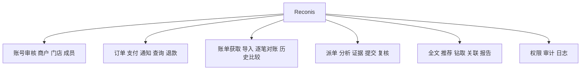
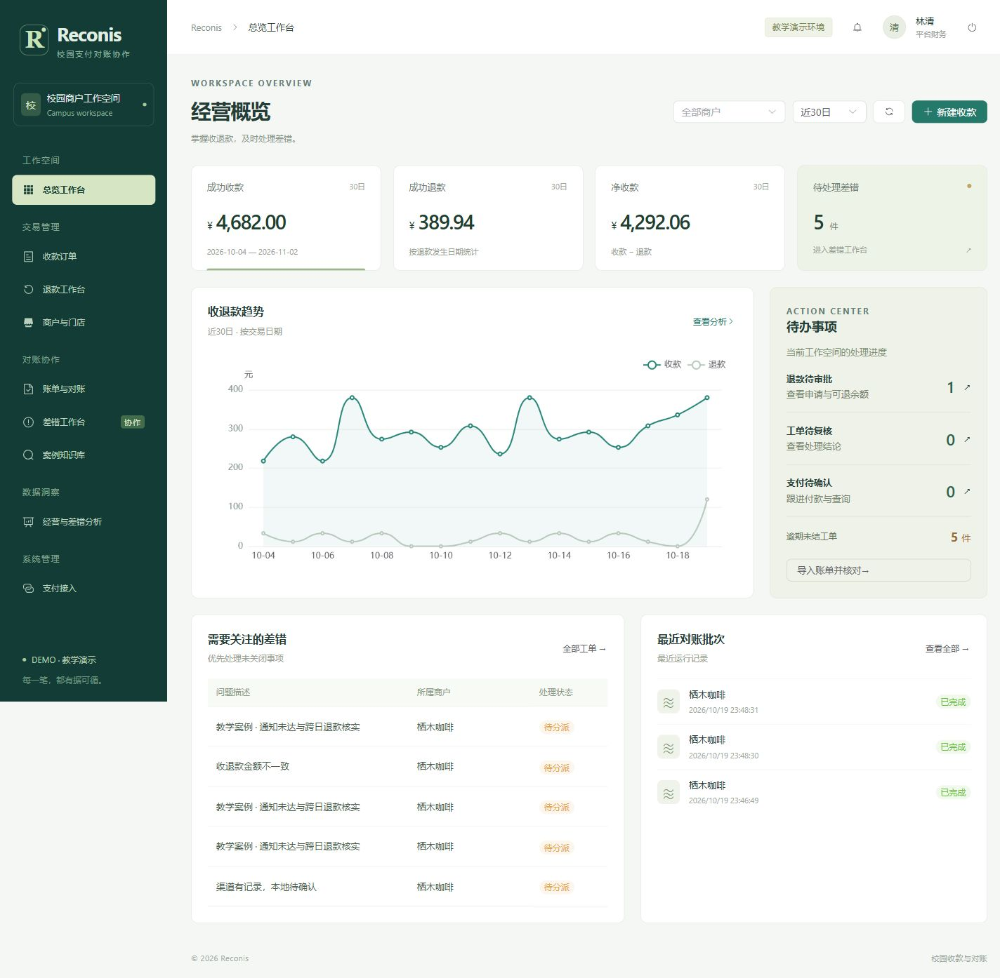
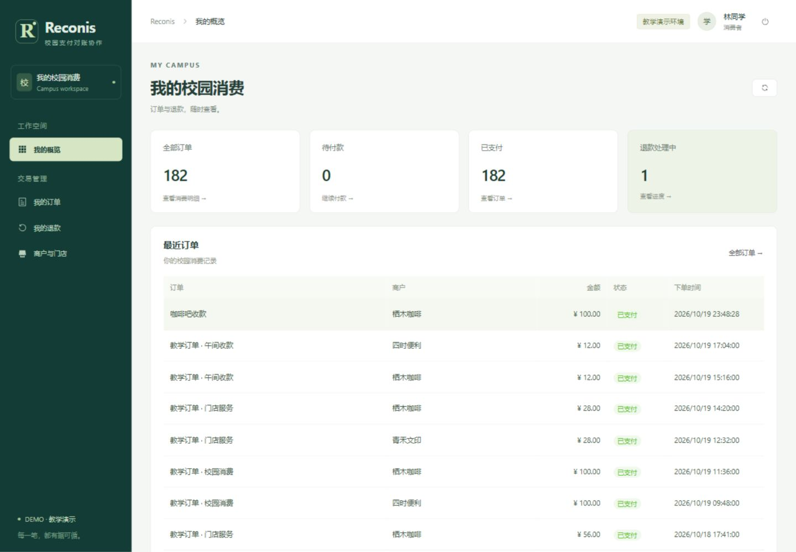

# Reconis 系统实现总结报告

## 1 实现环境

Reconis 采用前后端分离结构，生产构建将前端资源合入 Spring Boot 程序包，通过同一端口提供页面与 API。数据库采用 SQL Server 2022 Developer，启用快照隔离与中文全文检索。

| 层次 | 技术与版本 | 作用 |
| --- | --- | --- |
| 数据库 | SQL Server 2022 Developer | 关系数据、事务、过程、触发器与全文索引 |
| 服务端 | JDK 21、Spring Boot 4.1.1、MyBatis 4.0.0 | 会话、权限、业务服务和参数化 SQL |
| 客户端 | Vue 3.5.22、TypeScript 5.9.3、Vite 7.1.12 | 页面、表单、路由与构建 |
| 界面与图表 | Element Plus 2.11.5、ECharts 6.0.0 | 交互组件、趋势图和关联分析 |
| 数据与报告 | POI 5.4.1、PDFBox 3.0.5、JFreeChart 1.5.6 | Excel、Word、PDF 与服务端图表 |
| 支付接入 | 支付宝官方 SDK 4.40.272.ALL | 预下单、查询、退款和账单下载 |
| 构建工具 | Maven 3.9.11、pnpm 11.25.0 | 固定依赖、编译与版本打包 |

DEMO 环境使用独立的教学渠道数据；ALIPAY_SANDBOX 环境使用官方沙箱接口。数据库、文件目录和渠道标识随环境切换。

## 2 系统功能结构

主要页面包括登录注册、角色工作台、商户与门店、收款订单、订单详情、退款、账单与对账、差错工单、工单详情、案例知识库、经营分析、审计中心、账号审核和支付接入。列表提供关键字、多条件筛选、排序、分页与详情跳转。

消费者概览显示本人订单、待付款、已支付与退款进度。商户概览支持商户及 7／30／90 日筛选，汇总收款、退款、净收款与未结差错，提供退款审批、工单复核和支付确认入口。管理与审计页面随角色展示。

## 3 数据库物理实现

### 3.1 基础表与关键约束

系统包含 15 张基础表，按身份经营、订单资金、对账协作三个业务域组织。完整字段字典与函数依赖见《系统设计报告》。

| 业务域 | 基础表 | 关键联系 |
| --- | --- | --- |
| 身份与经营 | app_user、merchant、merchant_member、store | 用户与商户通过成员关系关联；商户拥有门店 |
| 订单与资金 | business_order、order_item、payment_attempt、payment_notification、refund_request、transaction_entry | 订单拥有明细与支付尝试；支付关联通知、退款及资金流水 |
| 对账与协作 | reconciliation_batch、statement_line、reconciliation_result、exception_task、audit_log | 批次保存原行与核对结果；差错关联处理工单与审计记录 |

金额以 BIGINT 整数分保存。order_item 保存成交名称、数量和单价，订单金额由视图汇总。transaction_entry 通过 CHECK 保证收款源与退款源互斥，通过 event_key 和源记录过滤唯一索引保证同一资金事件只入账一次。ROWVERSION 用于资料、订单与工单的并发编辑检查。

原始账单按批次与行号唯一，保留业务标识重复的输入行，以便对账识别重复账单。每次重跑保存独立结果；工单以稳定 case_key 复用，分别引用起因结果与最新证据。

### 3.2 索引与查询

订单索引覆盖门店、状态与创建时间；支付和退款索引覆盖状态与下次查询时间；资金流水按发生时间检索；对账结果按批次与分类检索；工单按处理人、状态与期限检索；日志按商户、操作者与时间检索。全文索引覆盖工单标题、分析和结论，FREETEXTTABLE 返回中文文本的匹配分数。

基础脚本依次定义模式、约束索引、服务器端程序、触发器全文与数据库权限。迁移 006—010 用于已有数据库升级，补充完整性、自动账单、风险分析索引与支付反馈。

## 4 外模式与权限实现

| 外模式 | 面向的业务 |
| --- | --- |
| v_consumer_order | 本人订单与消费记录 |
| v_merchant_transaction | 商户收退款及资金明细 |
| v_reconciliation_summary | 批次核对结果与分类汇总 |
| v_case_search | 案例检索与历史推荐 |
| v_audit_summary | 操作日志及审计统计 |

登录使用 Session，密码采用 BCrypt 散列。RequestAuditFilter 在请求开始时读取当前账号状态与平台角色；Access 按有效成员关系限定商户行范围。消费者访问本人订单，商户角色访问所属商户，平台财务处理跨商户事项，审计员只读查询，管理员审核账号与经营资料。

SessionContextPlugin 在实际执行 SQL 的连接上设置操作者、角色、商户与请求标识，执行后清理上下文。数据库部署账号负责结构变更，运行账号通过 reconis_runtime 角色访问业务对象。导出文件的创建和下载使用同一范围检查。

## 5 数据库服务器端程序

| 对象 | 入口与实现要点 |
| --- | --- |
| usp_confirm_payment | 支付确认；锁定订单，确认支付尝试，写入唯一收款流水 |
| usp_approve_refund | 退款审批；锁定原支付，核对审批人、申请状态与剩余额度 |
| usp_confirm_refund | 退款确认；更新渠道结果，写入唯一退款流水 |
| usp_run_reconciliation | 逐笔对账；在 SNAPSHOT 事务中分类并固化核对结果 |
| usp_review_exception | 工单复核；检查处理人与复核人、结论和匹配证据 |
| fn_refundable_amount | 计算原收款扣除成功退款及预留退款后的可退金额 |
| fn_case_overdue_days | 按工单期限计算逾期天数 |
| trg_refund_audit、trg_case_audit | 用 inserted／deleted 集合记录审批与工单变化 |
| 商户、账号审核触发器 | 保存资料审核与角色变更快照 |
| 事实保护与明细冻结触发器 | 维护流水、原账单、历史结果及已付款订单明细的稳定性 |

支付、退款、对账与工单复核由存储过程管理事务。普通资料维护与订单草稿使用 Spring 事务。外部支付调用与本地金额事务分开，以稳定请求号及后续查询衔接；APPROVED、PROCESSING 与 UNKNOWN 退款共同预留额度。函数、过程与触发器的关键代码列于附录 A。

## 6 主要模块实现

### 6.1 订单、支付与退款

OrderService 管理订单草稿、明细、提交和取消。发起支付后冻结成交明细；PaymentGateway 封装教学渠道与支付宝接口；PaymentService 按请求号完成预下单、支付查询和定时恢复。可信通知校验应用、收款方与金额，支付查询结果进入数据库确认过程。

退款经过申请、独立审批、渠道执行和确认。审批过程锁定原支付并重新计算可退额度，使并发审批共享同一金额约束。通知和查询重复执行时复用渠道请求与本地事件键。

### 6.2 账单获取、导入与逐笔对账

自动账单任务按账期创建，支持历史补取与每日调度，按渠道、环境、应用及账期生成唯一任务键。任务记录执行次数、下次尝试时间、租约与处理结果。下载原件归档后进入统一导入流程。

ImportService 将 XLSX、XML、渠道 CSV／ZIP 转换为统一行模型，预览有效、重复与错误记录，校验金额、时间、环境和商户。原件 SHA256 与导入选项共同参与复用判断；错误清单可下载。

对账先检查缺失标识、重复键与渠道标识冲突，再以 FULL OUTER JOIN 对齐两侧事实，识别一致、金额不符、渠道单边、本地单边等类别。页面支持结果筛选、两侧证据查看和批次比较；重新识别账单归属后可继续核对。

### 6.3 工单、全文检索与案例推荐

工单依次经过分派、处理、提交复核和关闭。处理人填写分析、结论并上传证据；复核人核对来源与处理结果，选择通过或退回。版本字段协调多人编辑，审计日志记录每次状态变化。

全文检索使用 FREETEXTTABLE 查询中文长文本。案例推荐在可见的已结案工单中，结合差错类型、业务环节与文本相似度排序，返回推荐理由。工单档案汇集起因、历次对账、处理轨迹、附件及原件散列，可下载整包归档。

### 6.4 统计、钻取与导出

交易统计以资金流水为基表，按商户、门店、类别及年／月／日聚合。用户可从汇总钻取至流水，再进入订单、退款和相关工单。差错统计关联事件、批次与工单，展示差错率、待核实金额、账龄、逾期、按时关闭率及关闭耗时。

统计筛选保存统一起止日期和数据截止时间，图表、明细与导出使用同一范围。ReportData 为 PDF 与 Word 提供一致的数据模型，JFreeChart 生成服务端图表，POI 与 PDFBox 输出正式报告。Excel 与 XML 支持数据交换和账单回导。

## 7 运行实例

本项目在 Windows、JDK 21 与 SQL Server 2022 环境完成构建和 DEMO 联调。数据库升级前创建备份，随后执行迁移 006—010，并刷新视图、过程、函数与触发器。

### 7.1 角色工作台

平台财务登录后查看收退款趋势、待处理差错及实时待办。消费者登录后直接进入本人消费概览，订单金额、状态和退款进度由当前用户范围查询。

图 7.1 经营工作台：交易趋势与待办事项。

图 7.2 消费者概览：本人订单及退款进度。

### 7.2 支付与退款实例

以 100 元订单为例，支付确认后产生 10000 分收款流水；重复确认复用同一事件。审批并成功退款 30 元后，退款流水为 3000 分，可退金额为 7000 分。支付结果通过主动查询恢复，退款审批由不同于申请人的财务人员完成。

### 7.3 对账与协作实例

导入含金额差异的账单后，系统保存原始行与核对结果，生成对应差错工单。处理人补充原因和证据，复核员查看修正后的匹配结果后完成复核。历史批次可并排比较，原始核对记录与处理轨迹保存在同一工单档案中。

图 7.3 对账工作台：分类结果与两侧证据。

图 7.4 手机订单页：消费记录与订单状态。

### 7.4 运行结果

业务联调覆盖账号与商户审核、订单支付、通知恢复、独立退款审批、金额统计、四格式导出、账单导入复用、单边与金额差异、批次比较、工单复核、全文检索、历史推荐、档案归档、风险钻取和审计查询。运行结果与对应版本保存在 artifacts/validation，图 7.1—7.4 为本地系统运行画面。

## 8 源程序组织与部署

后端按 identity、merchant、order、payment、reconciliation、casework、analytics 与 common 分包。SQL 使用 MyBatis 参数绑定，动态排序使用服务端白名单。前端以路由组织页面，Pinia 管理会话，共用 API、状态标签、图表和表单组件。

| 目录 | 内容 |
| --- | --- |
| backend | Java 服务、SQL 访问、渠道接入与报告生成 |
| frontend | Vue 页面、组件、样式与静态资源 |
| database | 建库、权限、服务器端程序与增量迁移 |
| scripts | 环境准备、构建、启动、备份和源码打包 |
| samples | Excel、XML 及渠道账单示例 |
| docs | 设计、接口、部署、课程映射与正式报告 |

首次部署准备 JDK 21、Node 24 与 SQL Server，建立数据库并初始化教学数据；已有环境先备份再迁移。build.ps1 固化源码并生成含前端资源的单程序包；start.ps1 按环境选择数据库与运行目录；backup.ps1 生成数据库备份；源码打包脚本汇集代码、SQL、样例和文档。

## 9 实现体会

数据库设计的核心是明确事实的粒度。业务订单、渠道观察、已确认资金流水与历次核对结果分别建模，使重复通知、迟到结果与跨日退款能够使用统一规则处理。候选键、约束、函数与事务共同承担金额和状态的一致性。

协作功能建立在稳定的来源关系上。工单保存差错起因、处理证据与独立复核结果，统计再沿外键回到具体事实。前端按角色组织任务入口，使数据库中的状态和权限转化为清楚的操作流程。
