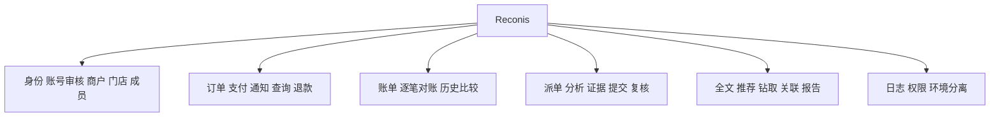
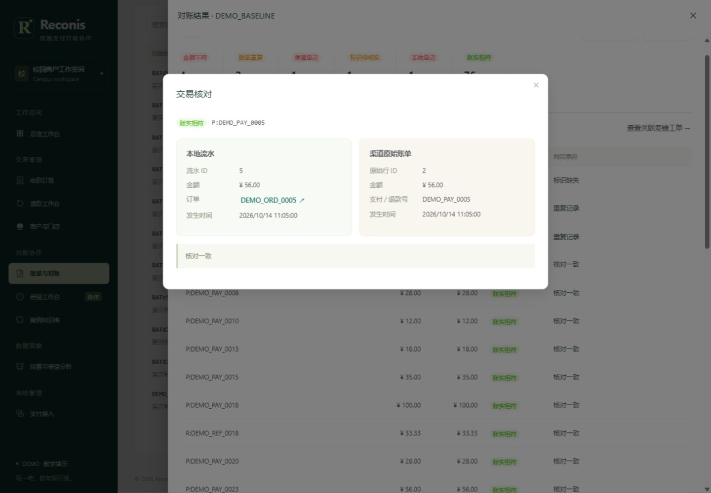
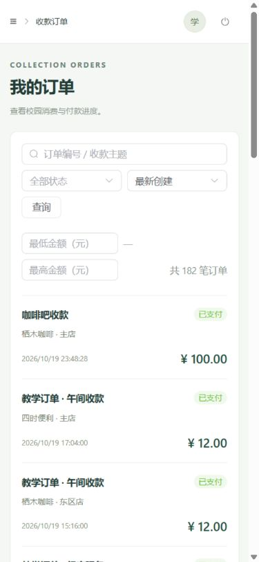

# Reconis 系统实现总结报告

本报告依据当前源码与 2026-10-22 实施记录整理。历史运行结果见第 7 节；2026-10-25—26 的本次检查、构建结果与未验收事项见交付说明。沙箱支付、查询与退款已有成功记录，真实签名通知和实际交易账单仍待验收。

## 1 实现环境

JDK21、Spring Boot4.1.1、MyBatis Starter4.0.0、Microsoft JDBC12.10.2、SQL Server2022 Developer和全文组件；Vue3.5.22、TypeScript5.9.3、Vite7.1.12、Element Plus2.11.5、ECharts6.0.0。Maven3.9.11和pnpm11.25.0固定依赖。支付宝SDK4.40.272.ALL；POI5.4.1、PDFBox3.0.5、JFreeChart1.5.6。

## 2 功能结构

前端包含登录、工作台、商户、订单及详情、退款、对账、工单及详情、案例检索、分析、审计、账号审核和接入状态14个业务页面。列表提供筛选与分页，订单和工单联动到来源详情。

## 3 表、约束与索引

001_schema.sql建立15表，002建立过滤唯一和查询索引。订单按门店/创建时间、支付退款按状态/下次查询、流水按实际发生时间、结果按批次/分类、工单按处理人/状态/期限、日志按商户和人员/时间建立索引。

transaction_entry的收款与退款FK恰好一个非空；各源过滤唯一。payment_attempt仅对is_primary=1过滤唯一，不拒绝保存额外成功。statement_line保留重复原行，result保存每次观察的两侧FK。order_item不保存金额小计，business_order不保存可漂移合计。

## 4 外模式与安全实现

v_consumer_order、v_merchant_transaction、v_reconciliation_summary、v_case_search、v_audit_summary分别服务本人订单、商户资金、对账、案例和审计。Access在接口内对详情、推荐、统计和写操作做行范围检查；RequestAuditFilter逐请求重新读取账号状态和平台角色，商户成员关系实时查询。

SessionContextPlugin拦截MyBatis Executor实际连接，设置user_id、role、merchant_id和request_id，执行后清理。禁用MyBatis二级缓存，一级缓存按语句，防止缓存跨范围复用。文件侧车保存创建者和范围，下载复核当前角色和商户资格。XML禁用外部实体，Excel按文本输出标识，密码/密钥不写日志。

## 5 数据库服务器端程序

| 对象 | 实际入口与职责 |
| --- | --- |
| usp_confirm_payment | 查询或可信通知恢复，锁订单后确认支付并写唯一收款流水 |
| usp_approve_refund | 退款审批，锁原支付、校验独立审批与余额，批准状态占额度 |
| usp_confirm_refund | 退款渠道确认，幂等状态更新和唯一退款流水 |
| usp_run_reconciliation | 对账/重跑接口，SNAPSHOT读取、分类、固化结果、复用工单 |
| usp_review_exception | 独立复核接口，校验人员、结论和匹配证据，关闭或退回 |
| fn_refundable_amount | 详情、退款列表及审批过程中的剩余可退计算 |
| fn_case_overdue_days | 工单详情和处理效率统计中的超期天数 |
| trg_refund_audit / trg_case_audit | inserted/deleted集合审计，和业务事务共同提交 |
| trg_merchant_review_audit / trg_user_review_audit | 资料审核与权限变更快照，排除密码 |
| 事实保护与订单明细冻结触发器 | 阻止修改流水、原始账单、历史结果和已发起支付的明细 |

过程自管事务，Java不套外层事务；普通资料和草稿用Spring事务。外部退款调用不放入金额锁事务，UNKNOWN保留预留，使用原请求号查询恢复。

## 6 主要模块

PaymentGateway封装DEMO和官方沙箱，DEMO渠道记录单独持久化；PaymentService完成请求幂等、查询和定时恢复。签名回调校验应用、收款方和金额，并通过官方查询确认；浏览器跳转不会改变支付结果。

ImportService统一XLSX/XML模型，校验环境、商户、金额和带时区时间，预览有效/重复/错误行。原件SHA256用于重导复用，错误清单与原件归档。对账优先识别重复/缺键，再FULL OUTER JOIN，原件不完整时本地单边标为待确认。

工单按稳定case_key复用，保留起因和最新证据；分派处理、上传附件、提交和独立复核。FREETEXTTABLE检索中文长文本，推荐仅含可见已结案案例，按差错类型、业务环节与归一文本分数排序并返回理由。

AnalyticsService在流水层先聚合，再关联商户门店，避免通知和工单导致金额重复。商户/门店、年/月/日均可钻取到事实明细。PDF与Word使用同一ReportData，JFreeChart从服务端数据生成图，POI/PDFBox生成文件，下载入口检查权限。

## 7 运行实例与证据

2026-10-22 实施记录记载 SQL Server 2022 Developer 及全文组件已部署，两套数据库各有 15 张表，迁移 010 已执行。当前源码定义 5 个业务过程、2 个函数及 9 个触发器。历史记录中早期的“8 个触发器”为旧口径，当前数量以 SQL 脚本为准。docs/assets 中保存工作台、对账双栏和手机订单截图。

历史 DEMO 联调记录包括：100 元收款重复通知后只有 1 条流水；30 元退款后剩余 70 元，两笔 60 元审批并发时一笔通过、一笔返回 409。跨日例分别得到 10000 分与 −3000 分。84 条标准账单在原运行和重跑中分别保存 84 条结果，比较为 UNCHANGED，重导返回原批次。另有跨商户拒绝、独立复核、全文检索、案例推荐及四格式导出记录。这些数字引用历史记录，本次源码副本未附原始验证日志。

2026-10-22 的统一版本记录进一步记载：后端 190 项测试通过，前端 5 项测试与生产构建通过，浏览器 5 组流程及接口 26 组验证通过。真实沙箱 0.01 元订单付款、查询及退款成功，收款与退款各 1 分，净额和可退余额为 0；重复退款未增加流水。

沙箱账单下载得到 1017 字节原始 ZIP，但内容为模板，系统标记 TEMPLATE_ONLY，未生成业务交易或差错。真实签名通知数仍为 0；无签名探测返回 failure 只证明拒绝路径，不代表支付宝实际通知已经验收。后续需配置公网 HTTPS 443 地址，并通过新支付观察真实通知；实际交易账单需在渠道提供后复验。

图 7.1 工作台：展示商户交易与差错概览，图片沿用仓库保存的历史运行画面。

图 7.2 对账工作台：展示批次与两侧证据，具体演示数据以现场运行结果为准。

图 7.3 手机订单页：展示订单、支付及退款状态。

### 7.1 本次源码副本验证（2026-10-25—26）

本次使用项目内 JDK 21.0.8、Maven 3.9.11 和官方 Maven Central，前端按 pnpm 锁文件安装。TypeScript 检查、生产构建及现有 5 项统计筛选/金额断言通过。后端 190 项测试中实际执行 118 项，失败 0、错误 0；72 项真实数据库测试因未配置 SQL Server 测试环境而跳过，不能算作数据库联调通过。

Windows 主机只读检查未发现 MSSQL 服务，1433、8080、8081 均无监听。当前目录缺少历史数据库备份、业务原件及私有配置，因此本次没有重新执行数据库和浏览器完整业务验收。打包结果、测试总数与日志见 artifacts/validation/closeout.json；恢复条件见 docs/handover.md。

收尾修正了 bootstrap 对 Java 的判断：已有 JRE 或旧版 Java 不再被当作 JDK 21。Windows 检测函数已通过缺失 JDK、JRE 8、Java 17 和 JDK 21 场景检查；未执行新的 Windows 软件安装。两份报告使用 Word 导出 PDF，答辩使用 PowerPoint 原生导出并检查跨日负值，配图与章节结构另作内容校验。

## 8 源程序与交付

后端按identity、merchant、order、payment、reconciliation、casework、analytics、common分包。所有SQL参数通过MyBatis绑定，动态排序来自服务端白名单；不存在接收用户SQL的接口。前端使用路由懒加载、Pinia会话、共用API和状态标签。

scripts 提供工具准备、单包构建、管理员 SQL 安装、建库、启动、CHECKSUM 备份和源码打包。DEMO 与沙箱分数据库和目录；私有配置、原件、日志和工具均忽略。历史记录中的备份、发布包与私有配置不在当前源码目录中，课程提交时需从原运行电脑取回并校验，或在目标电脑按版本 SQL 重建。

## 9 实现体会

本项目将“业务订单”“渠道观察”“已确认资金事实”和“历史核对结果”分开，避免通过覆盖金额消除差错。事务只能原子保护本地数据，网络结果需以稳定请求号和查询恢复衔接。规范化模型与不可变来源让跨日统计、历史比较和审计能够共用同一事实。
