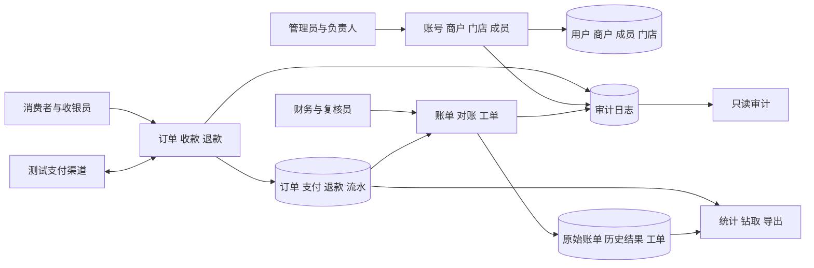
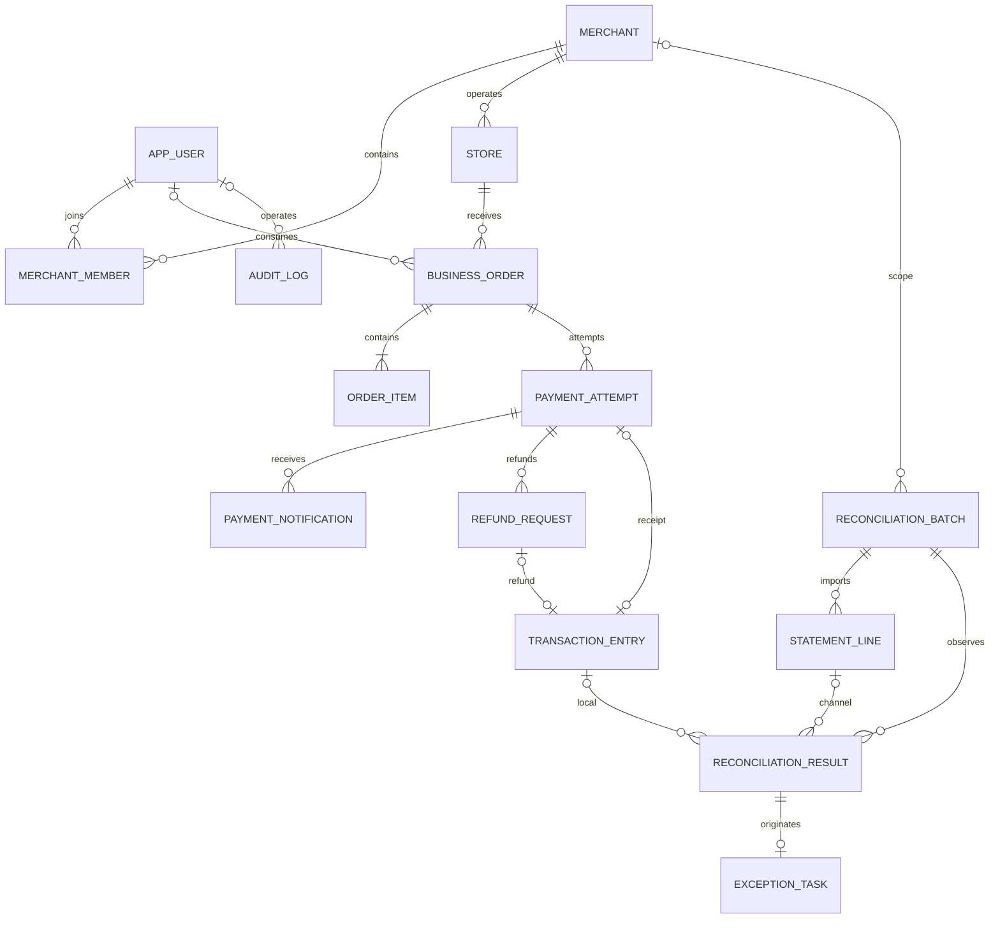

# Reconis 系统设计报告

## 1 需求分析

校园咖啡店、文印店和便利店产生收款、退款及渠道账单。通知丢失、跨日退款和重复账单会使业务状态与渠道记录不一致。Reconis管理订单、已确认资金事实及每次对账结果，并用差错工单记录处理与复核。

消费者查看本人订单和申请退款；收银员开单；商户财务审批退款和执行对账；处理人填写分析与证据；复核员关闭或退回；管理员审核资料和分配平台角色；审计员只读追踪。平台角色与商户内角色分别建模。

系统支持资料管理、支付退款、逐笔对账、工单协作和统计报告；高级功能覆盖 Excel/XML 导入导出、自动账单获取、资料审核、全文检索、历史比较、案例推荐、统计钻取及审计查询。

系统采用单支付渠道、人民币计价和多商户数据隔离。订单明细保存成交快照，已确认收退款按资金事件追加，差错处理保留原始记录与复核结果。

### 1.1 角色与使用范围

| 角色 | 主要操作 | 数据范围 |
| --- | --- | --- |
| 消费者 | 查看本人订单、支付、申请退款 | 本人消费记录 |
| 商户负责人 | 维护商户候选资料、门店和成员 | 有效成员关系对应商户 |
| 收银员 | 建单、发起收款、处理分派工单 | 所属商户与被分派任务 |
| 商户财务 | 审核他人退款、导入账单、执行对账、分派工单 | 所属商户 |
| 复核员 | 核对证据，关闭或退回工单 | 授权商户；不能复核本人提交 |
| 平台财务 | 跨商户核验与未知归属账单处理 | 平台财务授权范围 |
| 管理员 | 账号、商户审核和平台角色管理 | 管理资料；不默认办理收退款 |
| 审计员 | 查看日志、业务证据及汇总 | 只读审计范围 |

### 1.2 核心业务规则

| 场景 | 要求的结果 | 数据库落点 |
| --- | --- | --- |
| 同一通知重复到达 | 接收日志可多条，收款流水只有一条 | 通知表与流水表分离；源键唯一 |
| 通知丢失 | 使用原请求号主动查询恢复 | payment_attempt 的查询状态与下次查询时间 |
| 部分退款并发审批 | 成功及预留合计不超过原收款 | 锁定原支付，调用额度函数重新检查 |
| 外部退款超时 | 保留 UNKNOWN 与额度，不新建退款请求号 | refund_request 状态与查询恢复 |
| 次日退款 | 原收款日保持原金额，次日独立记退款 | transaction_entry 的渠道发生时间 |
| 账单重导与对账重跑 | 输入复用；重跑保存新结果 | 文件散列、输入来源与批次自关联 |
| 工单关闭 | 记录处理结论，不覆盖历史差错 | origin_result_id、latest_result_id 与复核证据 |

## 2 数据流与功能结构

支付流由订单明细产生应付金额，可信渠道结果确认支付并生成唯一流水。退款流先审批预留额度，再调用渠道，最后确认独立退款事实。对账流规范原始账单、检测重复和缺键，再对清洁集合进行FULL OUTER JOIN，保存匹配与差错。工单流从差错结果关联来源，由处理人与复核员共同完成。

### 2.1 数据流说明

| 数据流 | 来源 → 去向 | 主要数据元素 | 处理及存储 |
| --- | --- | --- | --- |
| 订单提交 | 消费者/收银员 → 订单模块 | 门店、消费者、明细、请求号 | 检查权限与数量，保存订单和明细 |
| 支付请求 | 订单模块 → 支付渠道 | 商户订单号、金额、通知地址 | 登记支付尝试后请求渠道 |
| 支付结果 | 渠道通知/查询 → 支付模块 | 渠道交易号、金额、发生时间、状态 | 验签及身份核验，确认支付并记流水 |
| 退款审批 | 消费者/财务 → 退款模块 | 原支付、单次退款号、金额、意见 | 独立审批，原子预留额度 |
| 退款确认 | 渠道查询 → 退款模块 | 单次请求号、成功金额、时间 | 幂等确认退款流水 |
| 账单输入 | 财务/自动任务 → 对账模块 | 原文件、商户、期间、完整性、散列 | 预览、错误反馈、原件归档与原始行 |
| 对账结果 | 本地事实+账单 → 差错协作 | 事件键、两侧记录、分类、观察时间 | 保存独立结果并复用同事件工单 |
| 处理与复核 | 处理人/复核员 → 工单模块 | 原因、措施、证据、结论、版本 | 保存审计，检查复核人与匹配证据 |
| 经营报表 | 资金事实/差错 → 统计模块 | 业务日、商户、门店、金额、处理时长 | 先聚合再关联，统一图表与导出口径 |

## 3 数据元素

| 元素 | 类型与单位 | 约束与来源 |
| --- | --- | --- |
| 主键和业务外键 | BIGINT | IDENTITY主键，真实外键，不级联删除事实 |
| 订单号/支付号/退款号 | VARCHAR | 业务唯一，客户端重试使用同一UUID |
| 金额 | BIGINT，分 | 正整数；订单单价可为0，订单总额需大于0 |
| 数量 | INT | 正整数，订单金额由数量乘成交单价汇总 |
| 渠道发生时间 | DATETIME2(3)，UTC | 可信收退款实际时间，决定统计业务日 |
| 系统获知时间 | DATETIME2(3)，UTC | 记录系统写入事实的时间，与发生时间区分 |
| 名称、说明、结论 | NVARCHAR | 中文文本，全文索引主要覆盖工单 |
| 可编辑版本 | ROWVERSION | 表单提交版本匹配，避免覆盖其他人的修改 |
| 文件SHA256 | CHAR(64) | 原件去重、完整性核对，文件保存在环境目录 |
| 对账完整性 | 固定代码 | 未知、操作人声明、渠道确认分开表达 |

API金额和ID为十进制字符串，时间为带Z的ISO8601；页面使用人民币元，整数运算转换为分。业务日期按Asia/Shanghai。

## 4 概念模式

共15个主要关系，merchant_member明确表达多对多联系；order_item为依赖订单的明细。普通一对多联系用外键，不额外创建无业务含义的联系表。通知、流水、账单和结果表示不同事实。批次还具有输入来源与基线自关联，工单另保存最新复核结果外键。

## 5 逻辑模式与3NF

| 关系 | 候选键 | 主要依赖与规范化处理 |
| --- | --- | --- |
| app_user | id，username | 候选键决定身份、状态、角色；不保存商户列表 |
| merchant | id，merchant_code | 候选键决定当前资料与唯一待审提案；商户名不复制到交易 |
| merchant_member | id，merchant_id+user_id | 复合候选键决定角色和状态，无部分依赖 |
| store | id，merchant_id+store_code | 候选键决定门店资料，通过商户FK取得商户名 |
| business_order | id，order_no，client_request_id | 候选键决定门店、消费者、说明和状态；不存明细合计 |
| order_item | id，order_id+line_no | 候选键决定成交项目、数量、单价；不存可推导小计 |
| payment_attempt | id，out_trade_no，client_request_id | 候选键决定本次请求的渠道身份和状态；一订单可多次尝试 |
| payment_notification | id | 一行是一次接收事实，通知号不强制唯一以保留重放 |
| refund_request | id，out_request_no，client_request_id | 候选键决定原支付、单次金额和审批；不复制订单与商户 |
| transaction_entry | id，entry_no，event_key；分类型源键 | 候选键决定单次真实资金事件；收款/退款源互斥，分别过滤唯一 |
| reconciliation_batch | id，batch_no | 决定范围、期间、来源和时点；不存可漂移统计合计 |
| statement_line | id，import_batch_id+line_no | 决定原始行；重复业务键是输入事实，不能强行作为候选键 |
| reconciliation_result | id，batch_id+result_key | 决定本次观察分类与两侧FK；不复制源金额和商户名 |
| exception_task | id，case_no，case_key，origin_result_id | 决定处理主体；起因不变，最新结果可指向新运行 |
| audit_log | id | 决定一次历史快照；JSON只记录当时状态，不替代关系模型 |

各关系字段保持原子，非键属性依赖完整候选键，移除商户名称、明细小计等可由其他关系或计算取得的传递依赖。成交项目名称/单价、请求时渠道身份、审计当时值属于各自历史事实，不是当前资料副本。

### 5.1 规范化分析示例

商户成员关系的业务候选键为 (merchant_id, user_id)，完整候选键决定 role_code 和 status，任一单独分量都不能决定用户在某商户的角色。商户名和用户名分别保存在商户表与用户表中，避免通过 merchant_id 或 user_id 形成非键属性间的传递依赖。

订单明细使用 (order_id, line_no) 表达一次成交中的行。项目名称与成交单价是当次交易快照，数量与单价不重复派生保存小计；订单总额由视图对明细汇总。已发起支付的明细通过触发器冻结，避免应收金额在支付过程中漂移。

支付尝试的 client_request_id 与 out_trade_no 分别对应客户端幂等键及渠道请求标识。通知接收是一种可重复的观察事实，notify_id 不作为唯一候选键；已确认资金事件另在 transaction_entry 通过 event_key 与分类型源键保护唯一性。

对账结果的候选键为 (batch_id, result_key)。同一交易在不同时间可有不同核对结果，故不以 source_event_key 单独作为候选键。原始账单的重复行本身是输入事实，不能用业务键唯一约束在导入时抹去；原始行由 (import_batch_id, line_no) 标识。

各关系按业务函数依赖进行 3NF 分解；过滤唯一索引只在其条件范围内成立。字段、类型和引用关系列于附录 A；自动账单任务在 reconciliation_batch 中扩展，保持 15 张基础表。

## 6 完整性与事务设计

主外键、业务标识唯一、状态CHECK、正数金额、流水源互斥由数据库约束。主支付采用过滤唯一索引，每订单最多一条；第二笔真实成功收款仍可登记。事实表更新与删除由触发器阻止。

支付确认锁订单，检查冻结明细金额，确认尝试、主支付和唯一流水。退款审批先锁原支付，再锁申请，重新计算成功与预留退款，拒绝超额；调用渠道时不持锁。退款成功确认再次锁原支付和退款，幂等写流水。对账过程自己管理SNAPSHOT事务。工单复核检查处理人与复核人，重新匹配结案需同事件、同范围的MATCHED证据。

跨日收退款各记发生日。对账重跑复用原件但产生独立结果；同事件同类差错复用工单，历史来源不可变。系统生成的渠道核查批次created_by可空，审计以系统身份记录，避免伪装成网页用户。

### 6.1 状态与恢复

| 对象 | 主要状态 | 恢复依据 |
| --- | --- | --- |
| 订单 | DRAFT、WAITING_PAYMENT、PAID、CANCELED、PAYMENT_EXCEPTION | 冻结明细及可信支付事实 |
| 支付尝试 | CREATED、PENDING、UNKNOWN、SUCCEEDED、CLOSED、FAILED | 同一 out_trade_no 的渠道查询；租约防并发派发 |
| 退款 | PENDING_REVIEW、APPROVED、PROCESSING、UNKNOWN、SUCCEEDED、REJECTED、FAILED | APPROVED/PROCESSING/UNKNOWN 预留额度；结果未知先查询 |
| 对账批次 | IMPORTING、READY、RUNNING、COMPLETED、FAILED | 输入来源不变，重跑新建批次 |
| 差错工单 | OPEN、ASSIGNED、PROCESSING、PENDING_REVIEW、CLOSED | 版本检查、任务分派、证据及独立复核 |

支付成功与二维码返回可能并发发生。派发租约和令牌限制同时请求，后返回的预下单结果不能将已经成功的支付降级。对于一订单两次真实收款，保留两笔事实并标记额外收款异常，不以唯一主支付索引隐藏第二笔交易。

### 6.2 时间与统计口径

| 业务日 | 事件 | 收款/分 | 退款/分 | 净收款/分 |
| --- | --- | --- | --- | --- |
| D 日 | 支付 100 元 | 10000 | 0 | 10000 |
| D+1 日 | 退回原支付 30 元 | 0 | 3000 | -3000 |
| 两日合计 | 同一原交易及退款 | 10000 | 3000 | 7000 |

跨日退款按退款发生日统计。系统同时保留获知时间，支持按数据截止时点重现统计；迟到通知恢复后，可重新核对发生日。净收款按成功收款减成功退款计算。

## 7 外模式与权限设计

Session登录、BCrypt散列、CSRF、后端按当前账号和有效商户成员关系授权。管理员不默认办理收退款，审计只读。消费者仅看本人订单，商户角色限所属商户，平台财务跨授权范围。文件生成与下载都检查当前权限。

数据库部署账号负责DDL；运行账号只加入reconis_runtime；审计角色读取外模式。MyBatis在实际执行连接上设置操作者与已验证商户上下文，finally清理，显式SQL范围仍保留。

消费者工作台展示本人订单、待付款和退款进度；商户工作台展示收退款、7／30／90 日趋势、实时待办与最近批次。待办按商户范围汇总，点击后进入对应筛选列表。管理员以账号与商户审核为入口，审计员以只读查询和日志分析为入口。

## 8 物理实现与设计验证

物理脚本按基础表、约束索引、视图函数过程、触发器全文分层。迁移 006–010 补充完整性、自动账单、关联分析索引和支付反馈。新库使用初始化脚本，已有库通过备份与增量迁移升级。

常用查询按门店与创建时间、支付/退款状态与下次查询时间、流水发生时间、对账批次与分类、工单处理人与状态、日志人员与时间设置索引。唯一索引保护主支付、渠道标识、流水来源与导入文件；账单业务键允许重复以便识别输入异常。中文长文本由 SQL Server FREETEXTTABLE 查询，检索前检查全文就绪状态。

主要实现条件包括：重复确认生成唯一流水；并发退款审批共享原支付额度；跨日汇总可钻取至流水；对账重跑保存独立结果；详情与导出沿用同一商户权限。运行实例见《系统实现总结报告》第 7 章。

## 9 资料依据

1. 《数据库系统原理》课程设计指导手册，仓库副本 docs/course-guide.md。
2. 《Reconis 项目整体设计》，课程选题与总体方案。
3. 本项目 database/001_schema.sql、002_constraints_indexes.sql、003_views_functions_procedures.sql、004_triggers_fulltext.sql 及 migrations/006–010。
4. 本项目 docs/design.md、docs/requirements-matrix.md 与 docs/implementation-status.md。
