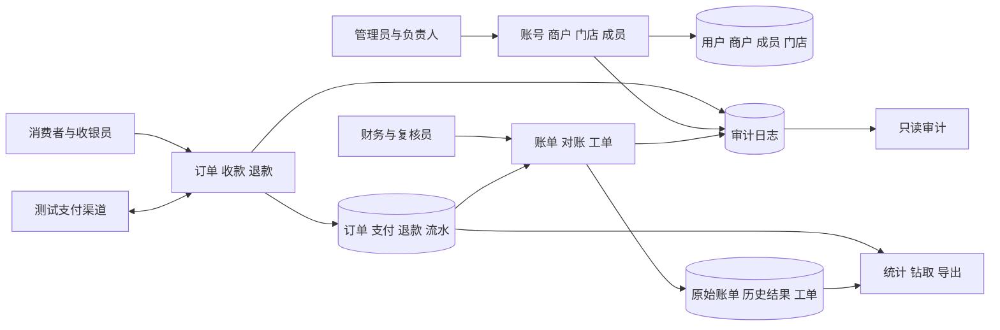
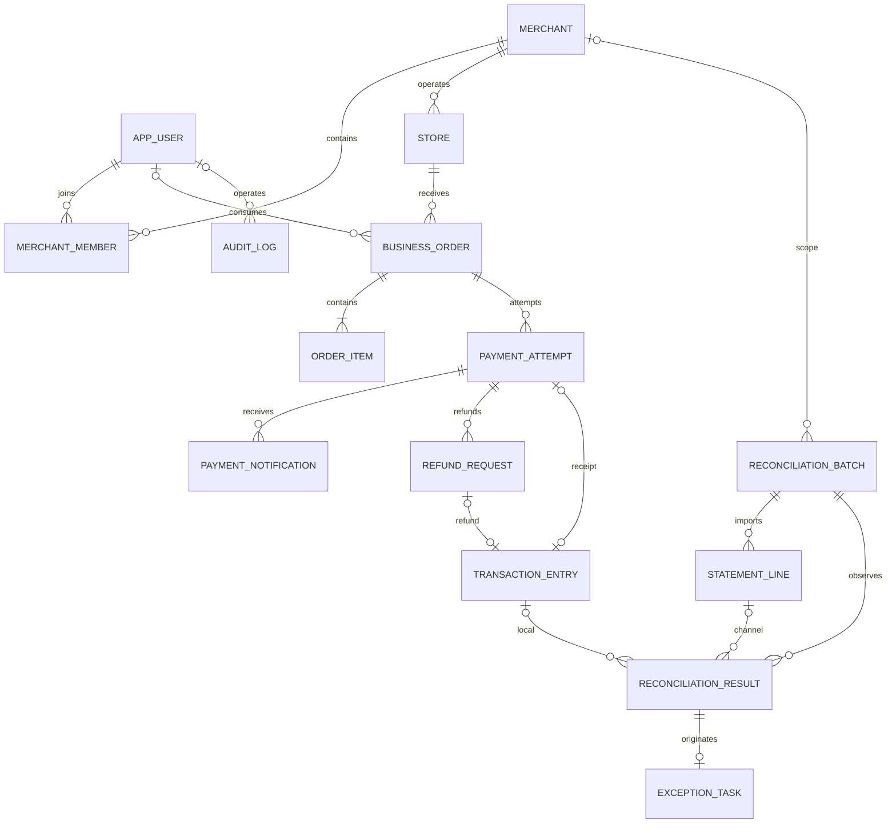

# Reconis 系统设计报告

题目：校园多商户跨日支付对账与差错协同处理系统的设计与实现

## 1 需求分析

校园咖啡店、文印店和便利店产生收款、退款及渠道账单。通知丢失、跨日退款和重复账单会使业务状态与渠道记录不一致。Reconis管理订单、已确认资金事实及每次对账结果，并用差错工单记录处理与复核。

消费者查看本人订单和申请退款；收银员开单；商户财务审批退款和执行对账；处理人填写分析与证据；复核员关闭或退回；管理员审核资料和分配平台角色；审计员只读追踪。平台角色与商户内角色分别建模。

全部基础与高级功能对应requirements-matrix.md。课程原文中的Excel/XML、全文/比较/推荐、PDF/Word含替代选项，本项目选择全部建设。

## 2 数据流与功能结构

支付流由订单明细产生应付金额，可信渠道结果确认支付并生成唯一流水。退款流先审批预留额度，再调用渠道，最后确认独立退款事实。对账流规范原始账单、检测重复和缺键，再对清洁集合进行FULL OUTER JOIN，保存匹配与差错。工单流从差错结果关联来源，由处理人与复核员共同完成。

## 3 数据元素

| 元素 | 类型与单位 | 约束与来源 |
| --- | --- | --- |
| 主键和业务外键 | BIGINT | IDENTITY主键，真实外键，不级联删除事实 |
| 订单号/支付号/退款号 | VARCHAR | 业务唯一，客户端重试使用同一UUID |
| 金额 | BIGINT，分 | 正整数；订单单价可为0，订单总额需大于0 |
| 数量 | INT | 正整数，订单金额由数量乘成交单价汇总 |
| 渠道发生时间 | DATETIME2(3)，UTC | 可信收退款实际时间，决定统计业务日 |
| 系统获知时间 | DATETIME2(3)，UTC | 记录系统写入事实的时间，与发生时间区分 |
| 名称、说明、结论 | NVARCHAR | 中文文本，全文索引主要覆盖工单 |
| 可编辑版本 | ROWVERSION | 表单提交版本匹配，避免覆盖其他人的修改 |
| 文件SHA256 | CHAR(64) | 原件去重、完整性核对，文件保存在环境目录 |
| 对账完整性 | 固定代码 | 未知、操作人声明、渠道确认分开表达 |

API金额和ID为十进制字符串，时间为带Z的ISO8601；页面使用人民币元，整数运算转换为分。业务日期按Asia/Shanghai。

## 4 概念模式

共15个主要关系，merchant_member明确表达多对多联系；order_item为依赖订单的明细。普通一对多联系用外键，不额外创建无业务含义的联系表。通知、流水、账单和结果表示不同事实。批次还具有输入来源与基线自关联，工单另保存最新复核结果外键。

## 5 逻辑模式与3NF

| 关系 | 候选键 | 主要依赖与规范化处理 |
| --- | --- | --- |
| app_user | id，username | 候选键决定身份、状态、角色；不保存商户列表 |
| merchant | id，merchant_code | 候选键决定当前资料与唯一待审提案；商户名不复制到交易 |
| merchant_member | id，merchant_id+user_id | 复合候选键决定角色和状态，无部分依赖 |
| store | id，merchant_id+store_code | 候选键决定门店资料，通过商户FK取得商户名 |
| business_order | id，order_no，client_request_id | 候选键决定门店、消费者、说明和状态；不存明细合计 |
| order_item | id，order_id+line_no | 候选键决定成交项目、数量、单价；不存可推导小计 |
| payment_attempt | id，out_trade_no，client_request_id | 候选键决定本次请求的渠道身份和状态；一订单可多次尝试 |
| payment_notification | id | 一行是一次接收事实，通知号不强制唯一以保留重放 |
| refund_request | id，out_request_no，client_request_id | 候选键决定原支付、单次金额和审批；不复制订单与商户 |
| transaction_entry | id，entry_no，event_key；分类型源键 | 候选键决定单次真实资金事件；收款/退款源互斥，分别过滤唯一 |
| reconciliation_batch | id，batch_no | 决定范围、期间、来源和时点；不存可漂移统计合计 |
| statement_line | id，import_batch_id+line_no | 决定原始行；重复业务键是输入事实，不能强行作为候选键 |
| reconciliation_result | id，batch_id+result_key | 决定本次观察分类与两侧FK；不复制源金额和商户名 |
| exception_task | id，case_no，case_key，origin_result_id | 决定处理主体；起因不变，最新结果可指向新运行 |
| audit_log | id | 决定一次历史快照；JSON只记录当时状态，不替代关系模型 |

各关系字段保持原子，非键属性依赖完整候选键，移除商户名称、明细小计等可由其他关系或计算取得的传递依赖。成交项目名称/单价、请求时渠道身份、审计当时值属于各自历史事实，不是当前资料副本。

## 6 完整性与事务设计

主外键、业务标识唯一、状态CHECK、正数金额、流水源互斥由数据库约束。主支付采用过滤唯一索引，每订单最多一条；第二笔真实成功收款仍可登记。事实表更新与删除由触发器阻止。

支付确认锁订单，检查冻结明细金额，确认尝试、主支付和唯一流水。退款审批先锁原支付，再锁申请，重新计算成功与预留退款，拒绝超额；调用渠道时不持锁。退款成功确认再次锁原支付和退款，幂等写流水。对账过程自己管理SNAPSHOT事务。工单复核检查处理人与复核人，重新匹配结案需同事件、同范围的MATCHED证据。

跨日收退款各记发生日。对账重跑复用原件但产生独立结果；同事件同类差错复用工单，历史来源不可变。系统生成的渠道核查批次created_by可空，审计以系统身份记录，避免伪装成网页用户。

## 7 安全与分工

Session登录、BCrypt散列、CSRF、后端按当前账号和有效商户成员关系授权。管理员不默认办理收退款，审计只读。消费者仅看本人订单，商户角色限所属商户，平台财务跨授权范围。文件生成与下载都检查当前权限。

数据库部署账号负责DDL；运行账号只加入reconis_runtime；审计角色读取外模式。MyBatis在实际执行连接上设置操作者与已验证商户上下文，finally清理，显式SQL范围仍保留。

三人分工可按A身份/商户/订单、B支付/退款/流水、C对账/工单/统计拆分；成员姓名和实际贡献由团队按真实工作填写。
